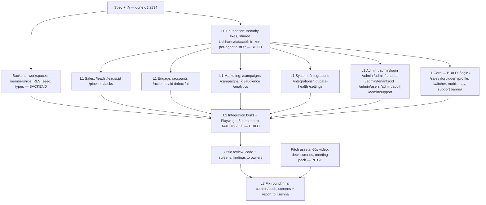

# Growth CRM build — dependency graph (DAG)

Updated 2026-10-13. Each node starts only when its parents are done. No cycles: shared code flows down, change requests flow to the owner, never sideways edits.

| Node | Owner | Owns (paths) | Depends on |
|---|---|---|---|
| L0 Foundation | BUILD | `src/components/**`, `src/lib/**`, `src/middleware.ts`, `src/styles/**`, layouts, `next.config.mjs`, `package.json` | Spec |
| L1 Core | BUILD | `/login`, `/`, `/sales`, `/forbidden`, `/profile` | L0 |
| L1 Sales | SALES | `src/app/(app)/{leads,pipeline,tasks}/**` | L0 |
| L1 Engage | ENGAGE | `src/app/(app)/{accounts,inbox,ai}/**` | L0 |
| L1 Marketing | MARKETING | `src/app/(app)/{campaigns,audience,analytics}/**` | L0 |
| L1 System | SYSTEM | `src/app/(app)/{integrations,data-health,settings}/**` | L0 |
| L1 Admin | ADMIN | `src/app/admin/**` | L0 |
| Backend | BACKEND | `supabase/migrations`, `seed`, `types.ts`, landing `api/leads` | Spec |
| L2 Integration | BUILD | single `next build`, Playwright, previews | all L1 + Backend types |
| Review | CRITIC | read-only | each L1 node as it finishes, then L2 |
| L3 Release | Orchestrator | final push, report | Review + Pitch |

Rules: page agents never edit shared (L0) files — they message BUILD; each agent commits only its own paths (`git commit -- <paths>`); only BUILD runs `next build`; parallel dev servers use `NEXT_DIST_DIR=.next-<agent>`.
