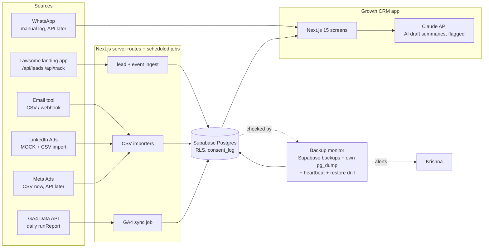

# Growth CRM: screens, metrics, data model, architecture

Product scope: LAWSOME only. Users: **Venket** (marketing, daily user), **Krishna** (admin, integrations/backups), optional viewers (Shaun, Kiruba, Ashique). Schema: `apps/growth-crm/supabase/schema.sql`. Scaffold: `apps/growth-crm` (synthetic data). Rationale: `01-build-vs-buy.md`.

## 1. Screen inventory (MVP = 12 screens)

| # | Screen | Route | User |
|---|---|---|---|
| 1 | Funnel overview | `/` | Venket |
| 2 | Leads list | `/leads` | Venket |
| 3 | Lead detail | `/leads/[id]` | Venket |
| 4 | Pipeline board | `/pipeline` | Venket |
| 5 | Campaigns | `/campaigns` | Venket |
| 6 | Audience / ICP | `/audience` | Venket |
| 7 | Channels & attribution | `/channels` | Venket |
| 8 | GA4 traffic | `/traffic` | Venket |
| 9 | Tasks & follow-ups | `/tasks` | Venket |
| 10 | Integrations hub | `/integrations` | Krishna, Venket |
| 11 | Data & backup monitor | `/data-health` | Krishna |
| 12 | Settings, roles, consent & privacy | `/settings` | Krishna (admin) |

**Later (not MVP):** campaign detail drill-down; email sequence builder; WhatsApp inbox; AI weekly insights digest; lead dedupe/merge tool; cohort/retention; revenue/MRR once paying customers exist; saved views and CSV export presets; notifications (Slack/email) for SLA breaches; multi-product switcher (explicitly out of scope until LAWSOME works).

### Common conventions
- Date-range picker (default last 30 days) applies to all analytical screens. Time zone IST.
- Every number shows its denominator on hover/footnote. Rates with denominators under 20 show "low n".
- Synthetic/mock data carries a visible badge. AI text carries an "AI draft" badge.
- A "person" in the funnel = distinct `coalesce(lead_id, anon_id)`; anonymous counts exist only for consented visitors (the landing app sends nothing without consent), so **funnel top-of-funnel is under-counted vs GA4**. State this on screen.

## 2. Screen specs

### 1. Funnel overview
- Purpose: where do prospects drop between visit and win.
- Components: 8-step funnel bars with step conversion and cumulative conversion; trend sparkline of leads/day; headline KPI tiles; "biggest drop" callout.
- Steps and sources (`lead_events.event_name`, names from `lawsome-landing/src/lib/track.ts`): Visit = `page_view`; CTA click = `cta_click`; Form start = `form_start`; Submit = `form_submit`; Demo booked = `demo_booked`; Demo done = CRM event `demo_done`; Won = `leads.stage='won'`. `tour_play` is shown as a side branch (product tour started) not a gating step.
- Metrics: see M1-M6.

### 2. Leads list
- Purpose: find and triage leads. Table with search; filters: stage, campaign, channel, owner, consent, date; columns: name, firm, role, city, source/campaign, stage, owner, age, SLA flag, consent. Export CSV (admin). Source: `leads`, `campaigns`.
- Metrics: count in view, median age, % breaching SLA (M14).

### 3. Lead detail
- Purpose: everything about one lead. Components: header (stage selector, owner), source/UTM card (first vs last touch), consent status per purpose with timestamp, event timeline (`lead_events`), notes/tasks, AI summary panel (draft + "based on these N events" link, regenerate button, off by default), score with the rule breakdown.
- Sources: `leads`, `lead_events`, `consent_log`, `tasks`.

### 4. Pipeline board
- Purpose: move leads through stages. Kanban columns New, Contacted, Demo booked, Demo done, Proposal, Won, Lost with card counts and age; stage-to-stage conversion strip. MVP: click-to-move (no drag library). Metrics M10, M11.

### 5. Campaigns
- Purpose: compare campaigns across email, LinkedIn and Meta. Table + per-channel summary + CPL/cost-per-demo bar chart. Columns: campaign, channel, status, spend, reach, clicks, CTR, leads, CPL, demos booked, cost per demo, lead->demo %. Source: `campaigns`, `campaign_daily_metrics`, `leads`. Imported-data banner showing source (`api|csv|mock`) per channel. Metrics M7-M13.

### 6. Audience / ICP
- Purpose: are we reaching the target buyer (managing partners, owners, senior advocates)? Breakdowns of leads and demos by role, firm size, state/city, practice area, personal vs work email; "ICP match %" tile. Source: `leads`. Metrics M15-M17.
- Honesty note: firm size and practice area are enriched by the owner after contact, not on the landing form; show "unknown" share explicitly.

### 7. Channels & attribution
- Purpose: which channel gets credit. Model toggle first-touch / last-touch, table by channel and by `utm_source / utm_medium / utm_campaign`, untagged ("direct / unknown") share, UTM hygiene check (leads with no UTM). Source: `leads.first_touch_*`, `last_touch_*`. Metrics M18-M19. Only two simple models in MVP; no multi-touch or "AI attribution".

### 8. GA4 traffic
- Purpose: site behaviour. Sessions trend, engagement rate, avg engagement time, top landing pages, device split, top states/cities, channel group table. Source: `ga4_daily` (filled by a daily `runReport` job). Metrics M20-M23. Reconciliation panel: GA4 key events vs CRM `form_submit` count (expect mismatch from consent gating and ad blockers; shown, not hidden).

### 9. Tasks & follow-ups
- Purpose: nobody falls through. List grouped Overdue / Today / Upcoming, assignee filter, mark done; SLA tile for first response. Source: `tasks`, `leads.first_response_at`. Metrics M12-M14. Auto-task on new lead: "First response within 4 business hours" (SLA configurable).

### 10. Integrations hub
- Purpose: honest connection status. Cards for GA4, LinkedIn, Meta, email provider, WhatsApp, lead webhook, Supabase: status badge (connected / mock / CSV only / error / not configured), last sync, rows in, last error, how to connect, "Import CSV" action for LinkedIn/Meta/email. Recent `sync_runs` table. Source: `integrations`, `sync_runs`.

### 11. Data & backup monitor
- Purpose: Krishna sees whether data is safe. Tiles: last successful backup (age vs threshold), status, retention days, PITR on/off, last logical dump + size, last restore drill; table row counts (current vs at last dump, flags big drops); alert rules list; restore-drill log; storage/Edge-Function caveat ("not covered by Supabase backups"). Source: `backup_checks`, `backup_alert_rules`, live `count(*)`. MVP reads a typed mock behind an adapter interface (`BackupMonitorAdapter`); real adapter does (a) reads our own dump job's heartbeat, (b) optionally Supabase Management API if its backup endpoints are confirmed. Metrics M24-M27.

### 12. Settings, roles, consent & privacy
- Purpose: access and DPDP hygiene. Tabs: Users and roles (admin / marketer / viewer); Consent log (searchable, by purpose and action, notice version); Requests (withdrawal and erasure queue with due date and status; completion writes `erasure_completed` and soft-deletes then hard-deletes the lead); Retention policy; Privacy notice version. Source: `users`, `consent_log`, `leads`. Metrics M28-M29.

## 3. Metric definitions

Period = selected date range, IST. "Live leads" = `leads` where `deleted_at is null` and `is_synthetic` matches the environment.

| ID | Metric | Formula | Denominator / notes | Source |
|---|---|---|---|---|
| M1 | Visitors | distinct people with `page_view` in period | consented only | `lead_events` |
| M2 | CTA click rate | people with `cta_click` / M1 | visitors | `lead_events` |
| M3 | Form start rate | people `form_start` / people `cta_click` | step-to-step | `lead_events` |
| M4 | Form completion | people `form_submit` / people `form_start` | | `lead_events` |
| M5 | Visit-to-lead | live leads created / M1 | cumulative | `leads`, `lead_events` |
| M6 | Lead-to-won | leads created in period that reached `won` / leads created in period | cohort by created date | `leads` |
| M7 | CTR | clicks / impressions | email: clicks / delivered | `campaign_daily_metrics` |
| M8 | Reach | sum(reach) | email: unique recipients | same |
| M9 | CPL | spend / leads attributed to campaign | n/a if spend 0 (email) | `campaign_daily_metrics`, `leads` |
| M10 | Demos booked | leads with stage in demo_booked, demo_done, proposal, won (or a `demo_booked` event) | | `leads` |
| M11 | Cost per demo | spend / M10 | | same |
| M12 | Lead-to-demo | M10 / leads | | `leads` |
| M13 | Platform-vs-CRM lead gap | platform_leads - CRM leads | flags duplicates or lost leads | metrics, leads |
| M14 | First-response time | `first_response_at - created_at`; report median and % within SLA (default 4 business hours) | exclude leads without a response yet but count them as breached once past SLA | `leads` |
| M15 | ICP match % | leads whose role in (Managing partner / owner, Senior advocate / practice head) AND work email / all leads | role from landing form | `leads` |
| M16 | Personal-email share | personal_email / leads | | `leads` |
| M17 | Geography / practice mix | count by state, city, practice_area | unknown shown separately | `leads` |
| M18 | Leads by channel (first / last touch) | count by `first_touch_channel` or `last_touch_channel` | | `leads` |
| M19 | Untagged share | leads with null utm_campaign / leads | UTM hygiene | `leads` |
| M20 | Sessions | sum(sessions) | GA4 definition | `ga4_daily` |
| M21 | Engagement rate | sum(engaged_sessions) / sum(sessions) | | `ga4_daily` |
| M22 | Avg engagement time | weighted by sessions | | `ga4_daily` |
| M23 | GA4 vs CRM submit gap | GA4 key_events (form_submit) - CRM form_submit | reconciliation | both |
| M24 | Backup age | now - latest successful `backup_taken_at` | alert if over threshold (default 26 h) | `backup_checks` |
| M25 | Row-count drift | (current rows - rows at last dump) / rows at last dump | flag if below -5% | `backup_checks.row_counts`, live |
| M26 | Restore-drill recency | days since last `restore_drill` success | target every 90 days | `backup_checks` |
| M27 | Sync freshness | now - integrations.last_sync_at per integration | | `integrations` |
| M28 | Consent coverage | live leads with granted `demo_followup` / live leads | should be 100% for form leads | `consent_log` |
| M29 | Open privacy requests | count withdrawal/erasure requests not completed; oldest age | internal target 30 days (set by counsel) | `consent_log` |

Rule-based lead score (transparent, editable): +40 owner/managing partner, +25 senior advocate, +10 associate; +15 work email; +10 `tour_play`; +20 `demo_booked`; shown with breakdown, never as an "AI prediction".

## 4. Data model (summary)

`users`, `campaigns`, `campaign_daily_metrics`, `leads`, `lead_events`, `ga4_daily`, `integrations`, `sync_runs`, `backup_checks` (+ `backup_alert_rules`), `tasks`, `consent_log`; views `v_funnel_daily`, `v_campaign_perf`. Full SQL with RLS stubs in `apps/growth-crm/supabase/schema.sql`. Mapping of landing payload: `/api/leads` body -> `leads` (+ `consent_log` row, purpose `demo_followup`, via service role); `/api/track` payload -> `lead_events` (anon_id from a consented first-party id; the current landing app does not yet set one, so linking pre-form visits to a lead is a follow-up).

## 5. Architecture

## 6. Integration map: real vs mocked at MVP

| Integration | MVP state | Path to real | Blocker |
|---|---|---|---|
| Landing app leads/events | Real contract (existing API), CRM data synthetic | Point landing `/api/leads` to Supabase tables | Supabase project + keys (Krishna) |
| GA4 | Mock (typed sample) | Data API `runReport` daily job via service account | GA4 property access |
| LinkedIn | **Mock + CSV import; labelled as such** | Real Lead Sync/Advertising API behind feature flag | Verified Company Page, API partner approval (not guaranteed) |
| Meta Ads | Mock + CSV | Marketing API | Ad-account access, app review |
| Email provider | Mock + CSV | Provider API/webhook for sends, opens, clicks | Which tool? (open question) |
| WhatsApp | Not integrated; manual log on lead | Cloud API via BSP | Business verification, template approval, Venket confirms need |
| Lead webhook | Real contract (existing `LEAD_WEBHOOK_URL`) | n/a | none |
| Backups | Typed mock + adapter interface | Own dump job heartbeat; Management API if confirmed | Who owns backups, storage target |
| AI summaries | Static sample text, flagged | Claude API server-side, off by default | PII/data-terms check, API key |

## 7. Compliance notes (short)
- BCI Rule 36: market the software to firms as a product; no client-solicitation features, lead-marketplace claims or celebrity endorsements. Legal review pending.
- DPDP: log purpose-specific consent with notice version, support withdrawal and erasure, keep a minimal-data posture (no case parties or client names in CRM). Verify dates and duties with counsel.
- Roles: only admin can export or delete; AI features never receive more than the lead's name, role, firm and event timeline.
