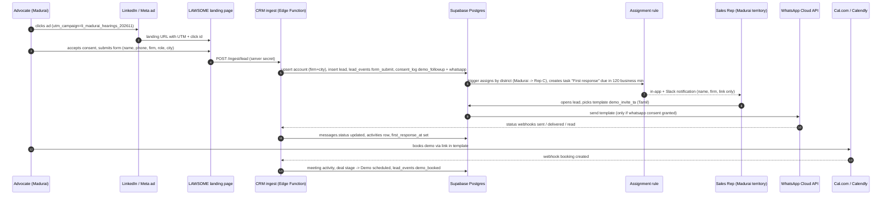
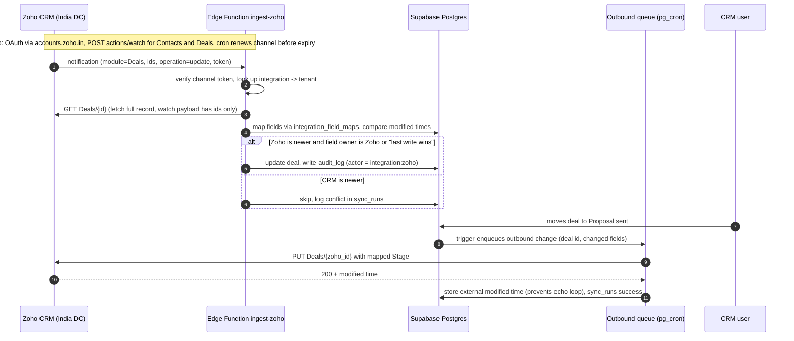
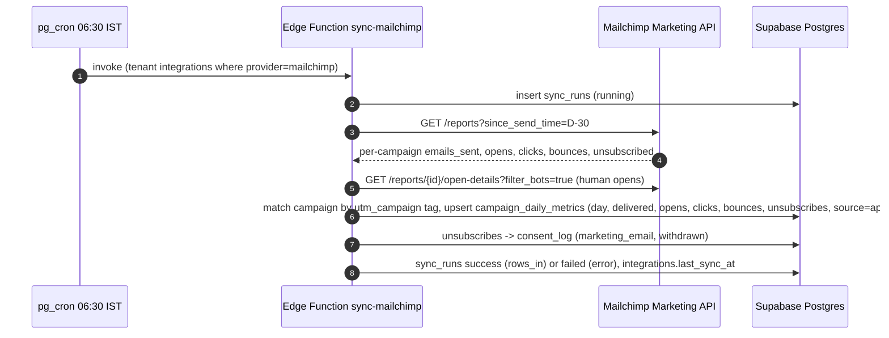
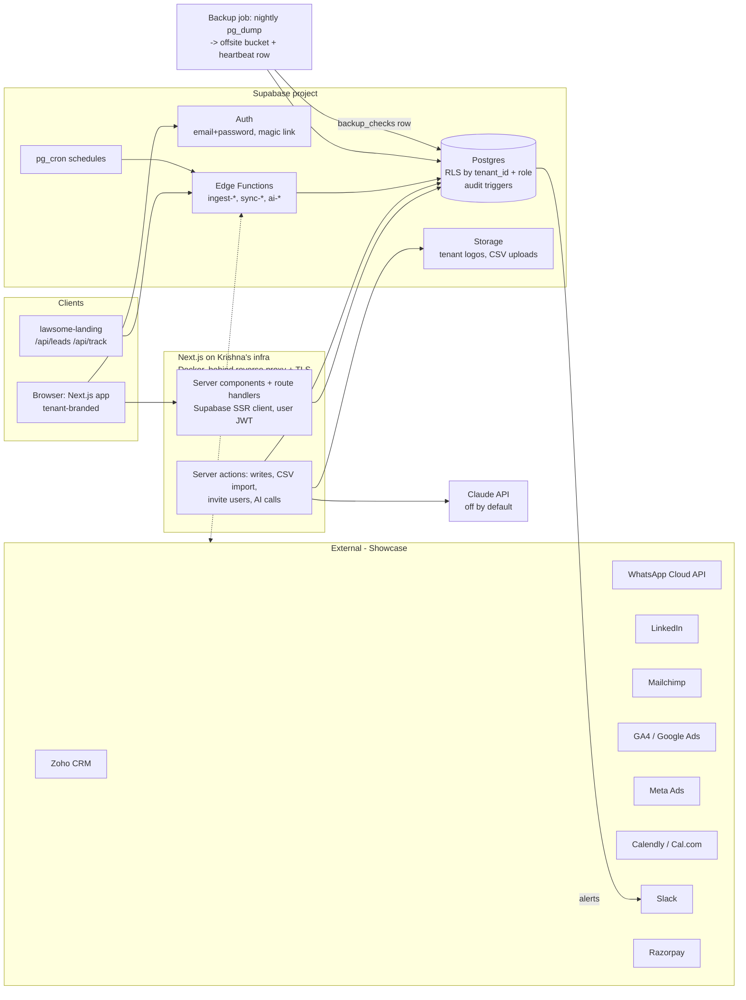

# Growth CRM: product spec (white-label, multi-tenant)

Date: 2026-10-13. Owner: Krishna (build). Reviewers: Shaun (RevOps), Ashique (sales), Venkat (marketing), Kiruba (data).
Status: spec for the redesign. Supersedes the screen list in `02-screens-and-metrics.md` (metric IDs M1-M29 are kept and extended here). Rationale for building at all: `01-build-vs-buy.md`.
Schema: `apps/growth-crm/supabase/schema.sql` (not applied anywhere). Route list and roles match what the UI build uses.

**What this is.** A sales and marketing CRM that the LAWSOME owner's team uses to sell LAWSOME (legal practice management SaaS) to law firms and advocates in Tamil Nadu. Every campaign (email, LinkedIn, Meta, Google, WhatsApp) and the website analytics land in one place and are tied to leads, law firms, the pipeline and revenue. We (Synthan AI-Edventures) run it in Krishna's infrastructure and white-label it for the client.

**Tenancy model (2026-10-13 update).** **Tenant** = a white-label client organisation (owns branding). **Workspace** = an isolated area inside a tenant with its own leads, pipeline, campaigns and settings (e.g. *LAWSOME · Tamil Nadu*, *LAWSOME · Kerala pilot*; demo tenant *Kaveri LegalTech (demo)* with *Kaveri · Coimbatore*). **Membership** = user x workspace x role; one person can be Sales Rep in one workspace and Viewer in another. **Super admin** = Synthan platform operator, outside every tenant, using a separate `/admin` console.

**What this is not.** It is not a practice management tool (that is LAWSOME), not a lawyer-to-public marketplace (Bar Council rules, see section 1.3), and it does not give legal advice. No integration is live today: every connector in section 7 is a **Showcase** (designed, mapped and demoed on synthetic data, not connected).

Source key, as in `01-build-vs-buy.md`: **[V]** vendor-authored or vendor-marketing source, **[O]** official docs or primary source, **[T]** third-party/press/secondary. Nothing below was tested hands-on unless stated.

---

## 1. Research: what the buyer wants to see, and what earns trust

There are two buyers in this deal and they want different things:

1. **The LAWSOME owner (our client).** Evaluates *our CRM*. Runs a SaaS business; wants to know where demos and revenue come from and whether salespeople follow up.
2. **Law-firm owners / managing partners in Tamil Nadu (LAWSOME's buyers).** Evaluate *LAWSOME*. The CRM must help LAWSOME's salespeople sell to them, so it must capture what these buyers care about (court focus, number of sites, lawyers count, practice areas, objections).

### 1.1 What a law-firm owner / managing partner wants (LAWSOME's buyer)

| Finding | Evidence | What it means for the CRM |
|---|---|---|
| Managing partners in Asia are broadly pro-technology and want routine work handled by software, keeping strategy and negotiation human. | Interviews with managing partners, [law.asia [T]](https://law.asia/law-firm-technology-readiness/) | Pitch LAWSOME as visibility and control ("one clear view"), not as replacing lawyers. Lead records should capture which workflow hurts (hearing tracking, multi-site visibility, cause-list checking). |
| Buying is not deploying: senior partners worry about reputational exposure from AI errors even after buying licences. | Managing-partner roundtable reported by [Legal Technology [T]](https://legaltechnology.com/indias-legal-tech-market-homegrown-ambition-and-global-inroads/) | Ask Nidhi (LAWSOME's AI) objections will come up in demos. CRM needs an "objections" field with a fixed list (AI accuracy, data security, price, training time, eCourts reliability) so we can count them (M60). |
| Indian survey (Manupatra Academy, 227 respondents, May 2025; 36.6% students, 23.8% advocates) names implementation cost, ethics and lack of skilled people as the main AI barriers. | [Bar & Bench summary [T]](https://www.barandbench.com/news/ai-adoption-and-impact-legal-industry-indian-perspective), [report PDF [O]](https://manupatracademy.com/assets/pdf/Survey-Report-on-Adoption-of-AI-in-the-Indian-Legal-Landscape.pdf) | Small sample, student-heavy: use as directional only. Sales playbook should lead with onboarding help and cost per user, not AI. |
| Indian firms and their clients are cautious about cloud solutions for data privacy; hallucination is a recurring concern. | Interview in [ALB India, Jan-Feb 2025 [T]](https://legalbusinessonline.com/sites/default/files/e-magazines/ALB-INDIA-JANUARY-FEBRUARY-2025/10) | Every demo needs a security answer: where data is hosted, who can see it, backups. The CRM's own data-health page doubles as proof we take this seriously. |
| The Supreme Court's Centre for Research and Planning white paper on AI and the judiciary (Nov 2025) stresses human verification of every AI output and confidentiality; draft court AI rules (June 2026) reportedly add disclosure duties (**unverified secondary source; do not present to the client**). | [MediaNama [T]](https://www.medianama.com/2025/12/223-supreme-court-ai-white-paper-indian-judiciary/), [Vision IAS summary [T]](https://visionias.in/current-affairs/news-today/2025-11-25/polity-and-governance/supreme-courts-centre-for-research-and-planning-releases-white-paper-on-artificial-intelligence-and-the-judiciary), [IAS Gyan on 2026 draft [T]](https://www.iasgyan.in/daily-current-affairs/supreme-court-draft-ai-rules-2026-explained) | Primary document not read; internal context only until verified. Our AI design (section 9) follows the same principle: drafts only, human approves, sources shown. |
| E-filing is spreading in Tamil Nadu courts: Madras HC e-Filing Rules 2020 cover courts in TN and Puducherry; e-filing is mandatory for some district-court case types (e.g. Section 138 NI Act cheque-bounce). A wider mandate from late 2025 was reportedly put on hold after Bar protests. | [Madras HC e-filing notifications [O]](https://hcmadras.tn.gov.in/efiling_notification.php), [Bar & Bench on S.138 [T]](https://barandbench.com/news/litigation/madras-high-court-makes-e-filing-mandatory-cheque-bounce-cases-district-courts), [Record of Law, student blog [T]](https://recordoflaw.in/issue-of-mandatory-e-filing-in-madras-high-court/) | A real, local trigger for "go digital" conversations. Capture `court_focus` (Madras HC, Madurai Bench, district courts) and practice areas so reps can open with the relevant e-filing change. Do not overstate: the hold status must be checked before any campaign uses it. |
| Dashboards that matter to partners: daily (new enquiries, unassigned, overdue follow-ups), weekly (conversion, pipeline), monthly (profitability, practice-area performance); a metric with no owner and no action should not be on version 1. Lead source must be carried through intake or attribution breaks. | [Enterprise DNA [V]](https://enterprisedna.co/resources/blog/law-firm-kpi-dashboard), [Litify [V]](https://www.litify.com/blog/law-firm-kpis), [Above the Law benchmarking [T]](https://abovethelaw.com/2024/09/law-firm-benchmarking-key-marketing-and-financial-metrics-in-2024/) | US/vendor sources about firms' own client intake, but the same discipline applies to the LAWSOME sales team: every widget in section 4 names its owner and its action. Source/UTM is stored on the lead at creation and never overwritten (first touch). |
| WhatsApp is the default business channel for Indian SMEs: a Meta-commissioned Ipsos survey (2022) reported 91% of SMEs using digital tools see messaging apps as very important to reach customers. Newer "78-80%" figures are unverified. | [Inc42 on WhatsApp SME survey [T]](https://inc42.com/?p=165002), [Hyperleap [V]](https://hyperleap.ai/blog/whatsapp-statistics-india-2026) | WhatsApp must be a first-class activity type and inbox channel, with template messages in Tamil and English. Treat the percentages as context, not as a slide claim. |

Not found: a credible, current count of practising advocates in Tamil Nadu and Puducherry, or a survey of Tamil Nadu firms' software use. Search returned only partial, dated figures ([Wikipedia on BCTN&P [T]](https://en.wikipedia.org/wiki/Bar_Council_of_Tamil_Nadu_and_Puducherry), [Bar & Bench 2019 AIBE notice [T]](https://www.barandbench.com/news/bctn-asks-1547-advocates-proof-passing-aibe-to-avoid-suspension)). **We will not put a market-size number in front of the client** until Kiruba sources one (open question Q-D3).

### 1.2 What the LAWSOME owner wants to see in a growth CRM

Derived from the findings above and from our own funnel (`01-strategy/lawsome-positioning.md`). These are hypotheses to confirm in the client meeting (open question Q-C1).

1. **Where do demos come from, and what does each cost?** Cost per demo by campaign and channel (M11), not just clicks.
2. **Are my salespeople following up?** First-response time against an SLA (M14), overdue follow-ups (M31), activity per rep (M40).
3. **What will close this quarter?** Pipeline value by stage in INR, weighted forecast, target vs achieved (M34, M35, M38).
4. **Which firms are we winning?** Wins by city/district, firm size and court focus (M54), so the next campaign targets lookalikes.
5. **Is my data safe and mine?** Hosting location, backups with a visible last-success time (M24), export on demand, audit log.
6. **Does it look like my product?** White-label branding (logo, colours, sender names), not "a Synthan tool".

### 1.3 What makes Indian legal-tech buyers trust or distrust a pitch

| Builds trust | Destroys trust |
|---|---|
| A live demo on realistic data from their own context (Tamil Nadu courts, real practice areas). An Australian survey found 74% of firms testing vendor functionality rely on demos ([Lawyers Weekly [T]](https://www.lawyersweekly.com.au/biglaw/42656-3-in-4-law-firms-say-demos-key-to-tech-decision-making)). | Generic "AI-powered" claims, stock dashboards with round numbers, US-centric examples (billable hours, PI firms). |
| Clear answers on data location, access control, backups and DPDP readiness ([ALB India [T]](https://legalbusinessonline.com/sites/default/files/e-magazines/ALB-INDIA-JANUARY-FEBRUARY-2025/10)). | Vague security answers; sending client data to an AI service without saying so. |
| Honest labels: "Showcase", "Sample data", "AI draft". | Pretending an integration is live; screenshots that turn out to be mock-ups. |
| Peer proof from comparable firms (same city, size, practice) - widely recommended by vendor marketers ([Insivia [V]](https://www.insivia.com/expertise/legaltech/guide/), [Abmatic [V]](https://blog.abmatic.ai/account-based-marketing-for-legaltech)). | Testimonials or endorsements from advocates. **Bar Council of India Rule 36** restricts advocates' advertising and solicitation; the BCI has warned platforms ([MediaNama [T]](https://www.medianama.com/2025/03/223-the-bar-council-of-india-warns-against-legal-advertising-online/)). We market software to firms; we never advertise a lawyer to the public, and we get counsel to review any reference programme. |
| Small, time-boxed pilot on one painful workflow ([SaaS Hero [V]](https://saashero.net/strategy/how-to-market-legaltech-lawfirms/)). | Long, unpriced "transformation" proposals. |

**Implication for the CRM build:** every screen shows real-looking density (dozens of rows, uneven numbers), every mock surface carries a visible badge, and the demo (section 12) leads with the salesperson's day and the owner's money view, not with AI.

---

## 2. Target personas

People below are roles. Our internal stand-ins are in brackets; the client's own staff take these roles after white-label handover.

### 2.1 Firm owner / managing partner (LAWSOME owner as buyer of the CRM; also the persona LAWSOME sells to)
- **Goals:** grow paying firms per month; know which spend works; hold the sales team accountable without micromanaging.
- **Top questions:** How much pipeline do we have and what will close by 31 Dec? Which campaign produced our last 5 wins? Who is not following up? Is our data backed up?
- **KPIs:** revenue won (M42), weighted pipeline (M35), target attainment (M38), cost per demo (M11), CAC (M44), first-response SLA % (M14).
- **Pages:** `/` Command Center, `/pipeline`, `/campaigns`, `/analytics`, `/data-health`, `/settings` (branding, users).

### 2.2 Senior advocate / practice head (end buyer inside a law firm; does not log in)
- Represented in the CRM as a **contact** on an **account** (law firm), with `role_title`, `is_decision_maker`, `practice_areas`, `court_focus`.
- **What reps need to know about them:** which court they appear in (Madras HC principal seat, Madurai Bench, a district court), how many juniors/clerks track hearings today (WhatsApp groups, diaries, Excel), and whether they influence or sign.
- **Pages:** `/accounts/[id]` (firm profile, contacts, deals), `/leads/[id]`.

### 2.3 Client's salesperson (Sales Rep) [Ashique]
- **Goals:** hit monthly demos and closed-won targets; never miss a follow-up; spend time on the right firms.
- **Top questions (asked at 9:30 every morning):** Who do I call or WhatsApp today? Which leads are hot? What demos do I have this week? Where am I against target?
- **KPIs:** demos booked (M10/M33), lead-to-demo % (M12), win rate (M37), first-response time (M14), activities per day (M40), target attainment (M38).
- **Pages:** `/sales` (home), `/leads`, `/leads/[id]`, `/pipeline` (own deals), `/inbox`, `/tasks`, `/accounts`.

### 2.4 Marketing lead [Venkat]
- **Goals:** fill the pipeline with ICP-fit firms at a sustainable cost; prove which channel works.
- **Top questions:** Which campaign has the best cost per demo? Is LinkedIn reaching managing partners or students? Which district responds? Did traffic convert after the email?
- **KPIs:** leads (M5), CPL (M9), cost per demo (M11), ICP match % (M15), CTR (M7), campaign reach profile (M45), marketing-sourced revenue (M43).
- **Pages:** `/campaigns`, `/campaigns/[id]`, `/audience`, `/analytics`, `/leads` (read), `/integrations` (read).

### 2.5 RevOps / Sales Manager [Shaun]
- **Goals:** clean process: every lead assigned within 1 business hour, stages mean the same thing for everyone, forecast is believable.
- **Top questions:** Which leads are unassigned? Which deals are stuck more than 14 days in a stage? Which rep breaches SLA? Is stage conversion falling?
- **KPIs:** unassigned leads (M61), SLA % (M14), stage conversion (M36), deal ageing (M41), pipeline coverage (M59), forecast accuracy (later).
- **Pages:** `/` (team view), `/pipeline`, `/leads`, `/tasks` (team), `/settings` (pipeline stages, SLA, users), `/ai` (lead-score settings).

### 2.6 Data [Kiruba]
- **Goals:** clean, deduplicated, lawfully sourced prospect lists; every row has a source.
- **Top questions:** How many duplicates? Which leads lack district or practice area? Did the last CSV import fail? When did the last backup succeed?
- **KPIs:** duplicate rate (M58), data completeness (M57), sync error rate (M56), backup age (M24), consent coverage (M28).
- **Pages:** `/data-health`, `/leads` (import, merge), `/accounts` (enrich), `/audience`, `/integrations`.

### 2.7 Viewer
- Investors, the client's leadership, auditors. Read-only aggregate dashboards plus masked lists (initials, firm, district, status; never phone, email or timeline). Rule stated once in section 10.1.

### 2.8 Platform operator (Super admin) [Krishna]
- **Goals:** onboard new white-label tenants and workspaces quickly; keep every tenant healthy (syncs, backups, AI cost caps); help a client without ever seeing their data casually.
- **Top questions:** Which tenants or workspaces have failing syncs or stale backups? Who is the owner of workspace X? Why is a client's CSV import failing (needs a support session with a reason)?
- **KPIs:** backup age (M24), sync error rate (M56) per tenant, open support sessions, AI calls vs cap.
- **Pages:** `/admin`, `/admin/tenants`, `/admin/tenants/[id]`, `/admin/users`, `/admin/audit`, `/admin/support`.
---

## 3. Key features

Priority: **MVP** = in the build now (on synthetic data, real Supabase schema); **P2** = after the client signs and first real data flows; **Later** = only with a reason.

### 3a. Sales
| Feature | Priority | Notes |
|---|---|---|
| "My day" dashboard for reps (`/sales`) | MVP | Section 4. |
| Lead list with saved filters (stage, owner, district, court focus, score band, source) | MVP | Default view for reps = "My open leads". |
| Lead detail with timeline, log call / WhatsApp / email / meeting / note, next step date | MVP | Logging a touch sets `first_response_at` if empty. |
| Round-robin auto-assignment by district territory | MVP | Rule table: Chennai + Kanchipuram + Chengalpattu -> rep A; Coimbatore + Tiruppur + Erode -> rep B; Madurai + Trichy + Tirunelveli + Salem -> rep C; else round-robin. Editable by Sales Manager. |
| Pipeline kanban with deal value in INR, stage ageing, click-to-move and drag | MVP | Moving to Won requires value, seats and plan; Lost requires a reason from a fixed list. |
| Law-firm accounts with contacts and multiple deals | MVP | Firms with multiple sites (e.g. Chennai + Madurai Bench office) are one account with `sites`. |
| Tasks + demo calendar (week view) | MVP | Calendar is a demo view of `tasks` and `activities` of kind meeting; no external calendar sync yet. |
| WhatsApp template send from lead | MVP as **Showcase** | Button opens template picker, preview in Tamil/English, "Send" writes a `messages` row with `status='simulated'`. Real send needs WhatsApp Cloud API (section 7). |
| Targets per rep per month (demos, won value) | MVP | Set by Sales Manager. |
| Duplicate detection on create (same phone or same email or same firm + city) | MVP | Warns; merge is a Data role action. |
| Email/calendar sync (Gmail/Outlook, Calendly/Cal.com) | P2 | Showcase now. |
| Quotes/proposals PDF, e-sign | Later | Use LAWSOME's existing process. |

### 3b. Marketing
| Feature | Priority | Notes |
|---|---|---|
| Campaign list across email, LinkedIn, Meta, Google, WhatsApp with spend, leads, CPL, demos, cost per demo, revenue | MVP | Data from `campaign_daily_metrics`; source badge `api / csv / manual / mock`. |
| Campaign detail: daily trend, funnel, reach profile radar, leads list, creatives/notes | MVP | |
| CSV import for platform exports (LinkedIn Campaign Manager, Meta Ads Manager, Mailchimp, Google Ads) | MVP | Column mapping preview; rejects rows with unknown campaign. |
| Audience / ICP segments (rule builder: district in, firm size, court focus, practice area, role) with counts and conversion | MVP | Segments can be exported as CSV for a platform upload (Owner/Data only, audit-logged). |
| Web analytics (GA4 daily) + first/last-touch attribution | MVP (mock data) | |
| UTM builder with naming convention `{channel}_{district|statewide}_{theme}_{yyyymm}` | MVP | e.g. `li_madurai_hearings_202611`. |
| Email sending / sequences inside the CRM | Later | Stay with Mailchimp (or whichever tool); import results. |
| Multi-touch attribution | Later | Only first/last touch; anything else is noise at our volumes. |

### 3c. Leadership
| Feature | Priority |
|---|---|
| Command Center: revenue won, weighted pipeline, target attainment, cost per demo, SLA %, funnel, top campaigns, wins by district | MVP |
| Rep scorecard table (team) | MVP |
| Weekly digest (AI-drafted narrative of what changed, with numbers linked) | P2, off by default |
| Forecast (commit / best case by rep) | P2 |
| Cohort retention / MRR (needs Razorpay or billing data) | Later |

### 3d. AI (details in section 9)
| Feature | Priority |
|---|---|
| Explainable lead score (rule-based with visible factors, 0-100) | MVP |
| Lead / conversation summary (draft) | MVP as showcase, off by default |
| Next-best-action suggestion | MVP as showcase |
| WhatsApp / email reply drafts (human approves) | MVP as showcase |
| Campaign insight digest | P2 |
| "Ask the CRM" natural-language questions over metrics | P2 |

### 3e. White-label and admin
| Feature | Priority |
|---|---|
| Tenant branding: product name, logo (light/dark), primary + accent colour, favicon, email sender name, support email, custom domain field | MVP (custom domain DNS is manual) |
| Users and roles, invite by email, deactivate | MVP |
| Pipeline stages, lost reasons, SLA hours, territory rules | MVP |
| Consent and privacy: consent log, withdrawal/erasure queue | MVP |
| Audit log (who changed what) | MVP |
| Data export (CSV per object) | MVP, Owner/Data only |
| SSO (Google Workspace / Microsoft) | Later |
| Per-tenant billing of the CRM itself | Later |

---

## 4. Salesperson dashboard spec (`/sales`, "My day")

**Who:** Sales Rep (own data only). Sales Manager can open any rep's view via a rep switcher (`/sales?rep=<id>`). **When:** first screen after login for reps, designed for 9:30 IST.
**Layout:** 12-column grid, 8px base spacing, 24px gutters. Desktop: 4 rows. Below 768px: single column in the order listed.
**Data rule:** "today" and "this week" are IST (`Asia/Kolkata`); weeks start Monday. All INR values in Indian grouping (`₹1,15,200`, `₹12.4 L`, `₹1.2 Cr`), tabular numerals.

| # | Widget | Metric(s) | Definition | Chart | Grid | Action from widget |
|---|---|---|---|---|---|---|
| W1 | Today's touch list | M30 | Tasks of kind `call` / `whatsapp` / `email` due today and assigned to me, sorted overdue first then due time; shows firm, contact, district, last touch, score chip | List with stat count in header ("14 due, 3 overdue") | cols 1-8, row 1-2 | Log call, Send WhatsApp template, Snooze to tomorrow 10:00, Mark done |
| W2 | Overdue follow-ups | M31 | Open tasks with `due_at < now()` assigned to me; tile shows count and oldest age in days | Stat tile, red when > 0 | cols 9-10, row 1 | Click filters W1 to overdue |
| W3 | First-response SLA (my last 30 days) | M14 | % of my leads with first touch within SLA (default 2 business hours, 10:00-19:00 IST Mon-Sat); median minutes beside it | Stat tile + 30-day line sparkline | cols 11-12, row 1 | Opens `/leads?sla=breached&owner=me` |
| W4 | Hot leads | M32 | My open leads with score >= 70, top 8 by score; each row shows the 2 strongest score factors ("Managing partner +30, Demo page 3 visits +15") | Ranked list with horizontal score bars | cols 9-12, row 2 | Open lead, Call, WhatsApp |
| W5 | Demos this week | M33 | Activities of kind `meeting` with `meeting_type='demo'` scheduled Mon-Sun this week, by day | Vertical column chart (Mon-Sat, 6 columns) + list below | cols 1-4, row 3 | Open demo, Reschedule, Mark done (moves deal to Demo done) |
| W6 | My pipeline by stage | M34 | Sum of `deals.value_inr` for my open deals by stage, with count | Horizontal bar (one bar per stage, stage order) | cols 5-8, row 3 | Click bar -> `/pipeline?owner=me&stage=..` |
| W7 | Target vs achieved (this month) | M38 | Won value vs `sales_targets.won_value_inr`; demos done vs `target_demos`; pace marker = expected by today (working days elapsed / working days in month) | Two bullet/progress bars with pace tick | cols 9-12, row 3 | — |
| W8 | My conversion rates (last 90 days, cohort by lead created) | M12, M36, M37 | Lead -> contacted, contacted -> demo, demo -> proposal, proposal -> won; each shows n | Horizontal funnel bars with % and n; "low n" when n < 20 | cols 1-6, row 4 | — |
| W9 | Weekly activity | M40 | Count of my logged activities per day for last 8 weeks, stacked by type (call, WhatsApp, email, meeting) | Vertical stacked column (max 4 series) | cols 7-12, row 4 | — |
| W10 | Unread inbox | M49 | Conversations assigned to me with unread inbound messages; WhatsApp 24-hour window countdown for each | Count chip in header + list (in a right drawer) | header | Open `/inbox?mine=1` |
| W11 | Leads by source (my last 30 days) | M18 | My new leads by first-touch channel; top 4 + "Other" | Donut, max 5 slices | collapsed "More" section | — |
| W12 | Stuck deals | M41 | My open deals with days in current stage > stage's `max_days` (default 14) | List with age chip | collapsed "More" section | Open deal, Log next step |
| W13 | AI next-best-action (showcase, off by default) | — | 3 suggested actions with reason and source links ("Meenakshi viewed pricing twice since the demo on 7 Oct: send proposal") | Card list with "AI draft" badge | right rail when enabled | Accept (creates task), Dismiss (with reason) |

States: **loading** = skeleton blocks at final size (no spinners), **empty** (new rep, no leads) = "No leads assigned yet. Your manager assigns leads from `/leads`; unassigned leads in your territory appear in *Claim queue*" + button "Open claim queue", **error** = widget-level inline message with retry; one failing widget never blanks the page.
Sales-rep-specific rule: the dashboard never shows other reps' names or numbers except the team median beside W3 and W7 (no leaderboard by default; Sales Manager can enable "team ranking" in Settings).

---

## 5. Page-by-page spec

Conventions for every page:
- **Shell:** left sidebar (navy, 240px, collapses to 64px icons; bottom tab bar on mobile with 5 items per role), top bar with global search (leads, firms, contacts by name/phone/city; `/` shortcut), date-range picker on analytical pages (default last 30 days, IST), tenant logo, user menu (profile, switch demo role in demo mode, **Log out**).
- **Workspace switcher:** top of the sidebar, shows tenant logo + workspace name + the user's role in it (e.g. "LAWSOME · Tamil Nadu — Sales Rep"). The list shows only workspaces the user has an active membership in, grouped by tenant. Choosing one sets the `ws` cookie (HttpOnly, SameSite=Lax, value = workspace id). The server validates the cookie against `memberships` on every request; if it is missing or invalid, the server falls back to the user's last-used workspace (`profiles.last_workspace_id`), and if there is none, shows a "Choose a workspace" screen. The app then re-themes to that workspace's tenant branding (CSS variables), reloads data and routes to the role's home for that workspace (a Sales Rep in one workspace may be a Viewer in another). Unsaved form state prompts before switching. Users with a single membership see the workspace name without a dropdown. Deep links carry `?ws=<id>`; if the user is not a member, they get a 403 that names the workspace, not a data leak.
- **Badges:** `Sample data` on synthetic tenants, `Showcase` on every non-connected integration surface, `AI draft` on generated text, `low n` on rates with denominator < 20.
- **States:** loading = skeletons at final size; empty = one sentence on why it is empty + the single next action; error = inline banner with the failing source and Retry, plus error id for support. A 403 (role cannot see) shows "Your role (Sales Rep) cannot open Campaigns. Ask your Owner/Admin." rather than a blank page.
- **Every write** is audit-logged (section 8). Destructive actions need a confirm dialog that names the object ("Delete lead *Adv. K. Senthil, Rockfort Legal*?").
- Permissions summarised per page with codes: **F** full, **E** edit own/assigned, **R** read, **M** read with masked phone/email, **—** no access. Full matrix in section 10.

### `/login`
- **Purpose:** sign in to the tenant's branded CRM.
- **Components:** tenant logo + product name (from `tenants.brand_*`), email + password form, "Email me a sign-in link" (magic link), "Forgot password", footer with tenant support email and privacy notice link. **Demo mode** (only when `NEXT_PUBLIC_DEMO_MODE=1` and tenant `is_demo=true`): a role picker with 6 cards (Owner/Admin, Sales Manager, Sales Rep, Marketing, Data, Viewer), each signs in as a seeded demo user; banner "Demo tenant: sample data, nothing is sent".
- **Actions:** Sign in; Send magic link (shows "Check your inbox" state, link valid 1 hour); Reset password; Pick demo role.
- **States:** wrong credentials ("Email or password is incorrect" - never reveal which); account deactivated ("Your access was removed by your admin"); no profile for this user ("You are signed in but not invited to a workspace") with Log out; rate-limited after 5 failures in 15 min (Supabase Auth limits plus our message).
- **After login:** redirect by role (see `/`). Preserve `?next=` for deep links.

### Logout (user menu action)
- Calls `supabase.auth.signOut()` (clears session cookies via the SSR helper), then routes to `/login?signed_out=1`. "Log out of all devices" in profile menu uses global sign-out scope. In demo mode, logout returns to the role picker.

### `/` Home (role-aware)
- **Routing:** Owner/Admin, Sales Manager, Viewer -> **Command Center** rendered here. Sales Rep -> redirect `/sales`. Marketing -> redirect `/campaigns`. Data -> redirect `/data-health`.
- **Command Center components:** KPI row (6 tiles: Revenue won this quarter M42, Weighted pipeline M35, Target attainment M38, Cost per demo M11, First-response SLA % M14, New leads M5) each with delta vs previous period; Revenue won by month (line, 12 months, target as dashed line); Funnel visit -> lead -> demo -> won (horizontal bars with step %); Pipeline by stage (horizontal bar, INR); Top 5 campaigns by cost per demo (table with sparkline); Leads and wins by district (bar, Tamil Nadu districts, top 10 + "Other TN" + "Outside TN"); Rep scorecard (table: rep, leads, SLA %, demos, won value, attainment); Source share of won deals (donut, max 5); Alerts strip (unassigned leads M61 > 0, SLA breaches today, sync failures, backup older than 26 h).
- **Actions:** change period; click any tile to drill into the filtered list; Export snapshot as PDF (P2); Owner only: "Set targets" shortcut to `/settings?tab=targets`.
- **Empty:** fresh tenant shows a 4-step setup checklist (branding, invite team, pipeline stages, import first leads).
- **Permissions:** Owner F, Sales Mgr R, Viewer M (aggregates), others redirected.

### `/sales` "My day"
- Spec in section 4. **Permissions:** Sales Rep E (own), Sales Mgr R (any rep via switcher), Owner R, others —.

### `/leads`
- **Purpose:** find, triage, assign and work leads.
- **Components:** saved views as tabs (My open leads; Unassigned; New today; SLA breached; Hot (score >= 70); All); filter bar (owner, status, source channel, campaign, district, city, court focus, practice area, firm size, score band, consent, created date); table columns: name + role title, firm, district/city, source (channel icon + campaign), status, score chip (0-100 with band colour), owner avatar, last touch ("2 d ago, WhatsApp"), next step date, SLA flag, consent icons; bulk bar on selection; right drawer preview on row click (timeline excerpt + quick actions).
- **Actions:** Create lead (modal: name, phone, email, firm (autocomplete accounts or create), city, role, source; duplicate check runs on blur); **Assign / reassign** (single or bulk; Sales Mgr, Owner); **Claim** (rep, only unassigned in own territory); Change status (bulk); Log call / Send WhatsApp template from drawer; **Import CSV** (Data, Marketing, Owner: upload -> column mapping -> dedupe preview "38 new, 6 duplicates (merge/skip), 2 invalid phone" -> confirm; writes `sync_runs` with `integration='csv'`); Export CSV (Owner, Data; audit-logged, masked option); Merge duplicates (Data, Owner); Delete (Owner only; soft delete then erasure job if a privacy request exists).
- **States:** empty for rep = "No leads assigned. Claim from Unassigned (12 in your territory)." Import errors show a downloadable rejects CSV.
- **Permissions:** Owner F, Sales Mgr F (no delete), Sales Rep E (own + unassigned in territory; cannot see other reps' leads), Marketing R + import + edit source fields, Data R + import/merge/enrich, Viewer M (masked, no drawer actions).

### `/leads/[id]`
- **Purpose:** everything about one person and their firm, and the place to act.
- **Components:** header (name, role title, firm link, district, status selector, owner selector, score chip -> factors popover, consent chips per purpose: Demo follow-up / Marketing email / WhatsApp); left column: contact card (phone, email, preferred language Tamil/English, best time to call), source card (first touch vs last touch: channel, campaign, landing page, UTM set, gclid/fbclid present yes/no), firm snapshot (sites, lawyers count, court focus, current tools: "Excel + WhatsApp groups"), open deal card; centre: activity timeline (filter: all / calls / WhatsApp / email / meetings / web events / system) merging `activities`, `lead_events`, `messages`; composer tabs (Log call with outcome list: Connected, No answer, Busy, Wrong number, Call back later; WhatsApp template; Email; Note; Meeting); right: tasks for this lead, AI panel (summary + next-best-action, `AI draft` badge, "based on 14 events" link, Regenerate, Thumbs up/down; hidden when AI is off).
- **Actions:** Log call (outcome, duration, notes, next step date -> creates task); Send WhatsApp template (showcase: choose template e.g. `demo_invite_ta`, fill variables, preview, Send -> `messages.status='simulated'`; blocked if no WhatsApp consent); Send email (opens mailto in MVP; logs activity); Schedule demo (date/time IST, duration 30/45 min, attendee contacts, mode Google Meet / in person at firm / phone; creates meeting activity + task + moves deal to Demo scheduled); Convert to deal (creates account if missing, deal with stage Discovery, value prefilled from seats x list price); Change status; Reassign; Add task; Mark disqualified (reason: student, not a firm, outside TN, duplicate, no budget, competitor); Record consent change (withdrawal -> stops WhatsApp/email actions); Merge with duplicate (Data, Owner).
- **States:** lead deleted -> "This lead was erased on 12 Nov 2026 under a privacy request" (no PII shown); no activities -> composer focused with "Log the first touch to start the SLA clock".
- **Permissions:** as `/leads`; reps only for own leads (403 otherwise).

### `/pipeline`
- **Purpose:** move deals through stages and see the money.
- **Components:** kanban columns from `pipeline_stages` (default: Discovery 10%, Demo scheduled 25%, Demo done 40%, Proposal sent 60%, Negotiation 80%, Won 100%, Lost 0%); column header shows count, sum INR and weighted INR; card shows firm, primary contact, value `₹1,15,200`, seats, owner avatar, days in stage (amber after 10, red after `max_days`), next step date; filters: owner, district, close month, value band; toggle Board / Table; stage conversion strip under the header (M36).
- **Actions:** Drag or "Move to" menu (keyboard accessible); on Won: modal requires plan (Practice / Chambers / Enterprise - placeholder names until LAWSOME pricing is shared), seats, annual value, start date; on Lost: reason (price, chose competitor, no decision, timing, not a fit, went with in-house Excel) + competitor name optional; Edit value / close date inline; Create deal; Reassign (Sales Mgr, Owner).
- **States:** empty pipeline = "No deals yet. Convert a qualified lead from Leads."
- **Permissions:** Owner F, Sales Mgr F, Sales Rep E (own deals; sees only own cards), Marketing R, Data R, Viewer R (no contact names: firm names only).

### `/accounts`
- **Purpose:** law firms as the unit of sale.
- **Components:** table: firm name, city/district, court focus (chips: Madras HC, Madurai Bench, District, Tribunals), practice areas, size band (Solo, 2-5, 6-20, 21-50, 50+), lawyers count, sites count, open deals value, owner, last activity, customer status (Prospect / Trial / Customer / Churned); map-free district filter (we use a district list, not a map, to keep it fast and accessible).
- **Actions:** Create account; Edit (Data, Owner, owning rep); Merge accounts (Data, Owner); Assign account owner (Sales Mgr, Owner); Import CSV; Export (Owner, Data).
- **Permissions:** Owner F, Sales Mgr F, Sales Rep R all accounts + E own, Marketing R, Data F (except delete), Viewer R (no contacts).

### `/accounts/[id]`
- **Components:** firm header (name, address line, district, court focus, practice areas, sites list e.g. "Egmore, Chennai (HQ) · Madurai (near Madurai Bench)", lawyers count, clerks count, current tools); contacts table (role title, decision maker flag, phone/email masked by role, consent); deals list; combined timeline of all contacts; LAWSOME fit notes (e.g. "Tracks ~120 hearings/month across 3 courts in Excel"); customer section after Won (plan, seats, go-live date, payments from Razorpay - showcase).
- **Actions:** Add contact; Create deal; Log activity; Edit firm profile; Mark as customer; Add site.
- **Permissions:** as `/accounts`.

### `/campaigns`
- **Purpose:** compare every campaign on cost and outcome.
- **Components:** channel summary cards (Email, LinkedIn, Meta, Google Ads, WhatsApp: spend, leads, CPL, demos, cost per demo, data source badge); table: campaign, channel, status, dates, spend, impressions, clicks, CTR, leads, CPL, demos, cost per demo, won deals, revenue, ROAS; Cost per demo by campaign (horizontal bar, sorted); Spend vs leads by week (column for spend + line for leads, dual axis labelled); "Platform vs CRM" gap column (M13) with tooltip.
- **Actions:** Create campaign (name, channel, objective, audience segment, dates, budget INR, UTM generated by the convention, owner); Import results CSV (per platform template); Archive; Duplicate; Copy UTM link; Connect source (links to `/integrations/[id]`).
- **Permissions:** Owner F, Marketing F, Sales Mgr R, Data R, Viewer R, Sales Rep — (sees campaign name on the lead only).

### `/campaigns/[id]`
- **Components:** header (channel, status, dates, budget used bar); KPI tiles (spend, reach, CTR, leads, CPL, demos, cost per demo, revenue); daily trend (line: clicks, leads; selectable); **reach profile radar** (5 axes M45a-e, this campaign vs channel average vs best campaign, 0-100); funnel for this campaign (impressions -> clicks -> leads -> demos -> won); leads table (from this campaign, first or last touch toggle); audience breakdown (role, district, firm size: bars); notes/creatives (text + links; no file uploads in MVP); AI insight card (P2, off by default).
- **Actions:** Edit; Import daily metrics; Add note; Export leads (Owner/Data); Pause (records status only; does not touch the ad platform in MVP).
- **Permissions:** as `/campaigns`.

### `/audience`
- **Purpose:** define and measure the ICP and segments.
- **Components:** ICP definition card (default: role in Managing partner/Owner, Senior advocate/Practice head; firm size >= 2 lawyers; district in Tamil Nadu); ICP match % tile (M15); segment list with rule summary, size, leads 30 d, lead-to-demo %, win rate; breakdowns: leads/demos by role (bar), by district (bar), by court focus (bar), by practice area (bar, top 8 + Other), work vs personal email (donut, 2 slices); "unknown" shown as its own bar.
- **Actions:** Create segment (rule builder: field, operator, values; AND groups); Edit ICP; Use segment in campaign; Export segment CSV (Owner, Data; audit-logged; excludes contacts without marketing consent).
- **Permissions:** Owner F, Marketing F, Data F, Sales Mgr R, Viewer R (counts only), Sales Rep —.

### `/analytics`
- **Purpose:** website behaviour and attribution.
- **Components:** sessions and engaged sessions (line, daily); engagement rate and avg engagement time tiles; channel group table (GA4 `sessionDefaultChannelGroup`); top landing pages (bar); device split (donut, 3 slices); top cities (bar; Chennai, Coimbatore, Madurai, ...); attribution panel with first-touch / last-touch toggle (leads, demos, won by channel: bar) and untagged share (M19); reconciliation strip: GA4 key events vs CRM form submits (M23) with the explanation "consent gating and ad blockers make GA4 and CRM differ; a gap above 25% is flagged".
- **Actions:** change model; change period; Connect GA4 (-> `/integrations/ga4`); Download CSV.
- **States:** GA4 not connected -> page renders on the mock series with a `Showcase` banner.
- **Permissions:** Owner F, Marketing F, Sales Mgr R, Data R, Viewer R, Sales Rep —.

### `/inbox` (Showcase)
- **Purpose:** one place for WhatsApp, email and LinkedIn conversations with leads.
- **Components:** three-pane layout: conversation list (channel icon, contact, firm, last message preview, unread dot, assignee, WhatsApp window timer "18 h left"); thread (messages with status ticks sent/delivered/read/failed, template messages labelled with template name, internal notes in a different background); context panel (lead card, open deal, consent, quick actions). Filters: Mine, Unassigned, Channel, Unread.
- **Actions:** Reply (free text only inside the 24-hour WhatsApp window; outside it only approved templates are offered, mirroring Meta's rule); Send template; Insert AI reply draft (human edits and sends); Assign conversation; Add internal note; Link to lead / create lead from unknown number; Close conversation.
- **States:** whole page carries `Showcase: no messages are sent. Data is sample.` Messages written here have `status='simulated'`.
- **Permissions:** Owner F, Sales Mgr F, Sales Rep E (own conversations), Marketing R, Data —, Viewer —.

### `/tasks`
- **Purpose:** nothing falls through; demo calendar.
- **Components:** tabs List / Calendar. List grouped Overdue / Today / This week / Later, each row: type icon, title, lead/firm, due time, assignee, priority; Calendar: week view 08:00-20:00 IST, Mon-Sat, demos and calls as blocks, colour by type, Tamil Nadu public holidays shaded from a tenant holiday list (Pongal, Tamil New Year, etc. - entered by Owner, not fetched).
- **Actions:** Create task; Complete; Snooze (1 h, tomorrow 10:00, next Monday); Reassign (Sales Mgr, Owner); Drag on calendar to reschedule; Bulk complete.
- **Permissions:** Owner F, Sales Mgr F (team), Sales Rep E (own), Marketing E (own), Data E (own), Viewer —.

### `/ai` (AI copilot hub)
- **Purpose:** one place that explains, configures and audits every AI feature.
- **Components:** feature cards (Lead scoring, Summaries, Next-best-action, Reply drafts, Campaign digest, Ask the CRM) each with status (On / Off / Showcase), what data it sends, last run, acceptance rate (M52); lead-scoring settings (factor weights table, editable, preview "score distribution if saved" as column chart by band); score calibration (win rate by score band, M51, column chart, needs n >= 30 per band); "Ask the CRM" box (P2; showcase answers on sample data with the SQL/metric used shown under each answer); AI activity log (who generated what, accepted/edited/dismissed).
- **Actions:** Toggle feature (Owner only; first enable shows a data-terms checklist that must be ticked); Edit score weights (Owner, Sales Mgr); Recalculate scores; Ask a question; Export AI log.
- **Permissions:** Owner F, Sales Mgr E (scoring weights, view logs), others R (feature descriptions only), Viewer —.

### `/integrations`
- **Purpose:** honest status of every data source.
- **Components:** category filter chips (All, CRM, Messaging, Social & Ads, Email, Analytics, Calendar, Payments, Automation, Notifications); cards grid (3 per row desktop, 1 mobile): logo (monochrome), name, one-line "what flows" ("Leads and ad spend in; qualified-lead events out"), direction icon (in / out / both), status chip (**Showcase**, Connected, Needs attention, Error, Not configured), last sync, rows in last 24 h; summary strip: "0 live, 12 showcase"; recent sync runs table (all integrations, last 20).
- **Actions:** Open card; Filter; Import CSV (for CSV-capable sources); Owner: Connect (in MVP opens the detail page with the steps and a disabled "Authorise" button labelled "Not enabled in this deployment").
- **Permissions:** Owner F, Data R + run CSV import, Marketing R, Sales Mgr R, Sales Rep —, Viewer —.

### `/integrations/[id]`
- **Components:** header (logo, status chip, direction, auth method, MVP state); **What flows** table (object, direction, trigger, frequency, our table); **Connect steps** (numbered, with prerequisites and real blockers, e.g. "Meta Business verification", "LinkedIn Advertising API approval"); **Field mapping** table from `integration_field_maps` (their field, our table.column, transform, direction, conflict rule) with "Sample value" column on mock data; **Sync log** (`sync_runs`: started, duration, status, rows in/out/rejected, error); **Flow diagram** (rendered sequence/flow for this connector, same as section 7); Settings (frequency, filters such as "only campaigns starting with `li_`").
- **Actions:** Connect / Disconnect (Owner; disabled in Showcase); Run sync now (disabled in Showcase; enabled for CSV); Edit mapping (Owner, Data); Download sample CSV template; View raw error.
- **Permissions:** Owner F, Data E (mappings, CSV), Marketing R, Sales Mgr R, others —.

### `/data-health`
- **Purpose:** Krishna and Kiruba see whether data is fresh, clean and backed up.
- **Components:** tiles: last successful backup (age vs 26 h threshold, M24), last logical dump size, last restore drill (days, M26, target <= 90), PITR on/off, sync freshness by integration (M27), duplicate rate (M58), completeness (M57); row counts per table now vs at last dump (M25, flag drops > 5%); backup checks log; alert rules list (`backup_alert_rules`); data-quality queue (leads missing district, invalid phone, possible duplicates); caveat card: "Supabase daily backups do not include Storage objects or Edge Functions; our nightly dump job covers the database only."
- **Actions:** Run restore drill log entry (record result); Edit alert rule (Owner); Acknowledge alert; Open duplicate pair -> merge; Download backup report (CSV).
- **Permissions:** Owner F, Data F (except alert-rule edit), Sales Mgr R, others —.

### `/settings`
Tabs, each its own URL (`/settings?tab=users`):
- **Users & roles (this workspace):** table (name, email, role in this workspace, other workspaces count, status Active/Invited/Deactivated, last sign-in); **Invite user** (email, role, territory for reps -> creates an `invitations` row for **this workspace** with 7-day expiry; an existing user gets a membership immediately plus a notification, a new user gets a Supabase invite email); Change role; Deactivate (keeps history, revokes sessions); Resend invite. Owner F; Sales Mgr can invite/manage Sales Rep and Viewer only.
- **Branding (white-label):** product name, logo upload (SVG/PNG, light and dark), primary colour, accent colour (with live preview and WCAG contrast check: blocks save if text contrast < 4.5:1), favicon, email sender name, support email, custom domain (CNAME instructions; manual verification). Owner only.
- **Pipeline:** stages (rename, reorder, probability %, max days), lost reasons, SLA hours and business hours, territories (district -> rep). Owner, Sales Mgr.
- **Targets:** monthly targets per rep (demos, won value INR). Owner, Sales Mgr.
- **Consent & privacy:** consent log (search by subject; purpose, action, notice version, captured via); requests queue (withdrawal, erasure: received, due, status; Complete erasure runs the erasure function); retention settings (disqualified leads purged after N months, default 12); privacy notice version. Owner F, Data R.
- **Audit log:** filter by user, table, action, date; row diff view (old -> new values, PII masked for non-owners). Owner R, Sales Mgr R.
- **Profile (every user):** name, phone, language, notification prefs, change password, log out of all devices.

### Platform admin console (`/admin/*`, Super admin only)
Separate shell (dark slate header "Synthan platform", no tenant branding, no workspace switcher). Super admins are rows in `platform_admins`, not workspace members. **The console shows metadata only** (tenants, workspaces, users, counts, health). Business records (leads, contacts, messages, deals) are visible only inside a workspace during an active support session.

#### `/admin/login`
- Email + password + **TOTP MFA required** (Supabase Auth MFA, AAL2). A magic link is not allowed. Login succeeds only if `auth.uid()` is in `platform_admins` with `is_active`; otherwise the page says "Not a platform admin" and signs out. A separate cookie path (`/admin`) and a shorter idle timeout (30 min) apply.
- **Logout:** avatar menu -> "Log out of platform console" (ends any open support session first, then `signOut`, then back to `/admin/login`).

#### `/admin` Overview
- Tiles: tenants (active/suspended), workspaces, active users in the last 7 days, open support sessions, integrations in error, oldest backup age (M24), failed sync runs (24 h). Table: recent platform audit events. Actions: open tenant; start support session.

#### `/admin/tenants`
- Table: tenant, slug, plan, status (active / trial / suspended), workspaces, members, created, last activity. Actions: **Create tenant** (name, slug, brand name, primary hue, first workspace name, owner email -> creates tenant + workspace + invitation); **Suspend / reactivate** (typed confirmation; suspended tenants' members cannot sign in to its workspaces); search.

#### `/admin/tenants/[id]`
- Tabs: Branding (edit tokens, live preview); Workspaces (list with member count, lead count, created; **Add workspace**, **Archive workspace**); Members across workspaces (role per workspace); Usage (seats, AI calls this month vs cap, storage); Integrations status per workspace; Audit (tenant-scoped). Actions: invite workspace owner; change plan; open support session for a workspace.

#### `/admin/users`
- All users: name, email, memberships (tenant · workspace · role chips), MFA on/off, last sign-in, status. Actions: deactivate user platform-wide; revoke sessions; resend invite. Changing a role inside a workspace is done by that workspace's owner, not here, unless a support session is open.

#### `/admin/audit`
- Platform-wide `audit_log` with filters (tenant, workspace, actor, action, table, support session id). Every row written during a support session carries `support_session_id`. Export CSV.

#### `/admin/support`
- **Start support session:** choose tenant -> workspace, mode (`read_only` default, or `read_write` which requires a second reason line), **typed reason (min 20 chars, e.g. "Ticket #142: CSV import failing for Madurai leads")**, duration (15 / 30 / 60 min, default 30). Creates a `support_sessions` row and opens the workspace in a new tab with a red banner "Support session by Krishna (Synthan) · read-only · ends 11:42 IST · End now". The workspace owner sees the session in their `/settings` audit tab and gets an in-app notification.
- **History:** sessions with admin, workspace, reason, mode, started/ended, actions count. **End session** at any time. Sessions auto-expire and can't be extended; start a new one with a new reason.

---

## 6. Metrics and data catalogue

Rules: period = selected range in IST; "live" rows = `deleted_at is null`; every rate shows numerator/denominator on hover and `low n` when the denominator is < 20; every metric is computed per `tenant_id`. Grain = the finest level the metric is stored/computed at.

**Chart type rules (deliberate):** line = trend over continuous time; vertical column = counts in time buckets (days of week, weeks, months); horizontal bar = comparing categories (campaigns, districts, stages, reps), sorted by value unless the category has a natural order (stages); donut = share of one whole, max 5 slices (top 4 + "Other"), never for time; radar ("pentagon") = only the campaign reach profile, 5 fixed axes, normalised 0-100, max 3 overlaid series; stat tile = single number with delta and sparkline; table = anything that needs > 8 rows or several measures.

### 6.1 Funnel and web (existing IDs kept)
| ID | Metric | Formula | Denominator | Grain | Source | Chart |
|---|---|---|---|---|---|---|
| M1 | Visitors | distinct `coalesce(lead_id, anon_id)` with `page_view` | consented only | day | `lead_events` | line |
| M2 | CTA click rate | people `cta_click` / M1 | visitors | day | `lead_events` | stat tile |
| M3 | Form start rate | people `form_start` / people `cta_click` | CTA clickers | day | `lead_events` | funnel bar |
| M4 | Form completion | people `form_submit` / people `form_start` | form starters | day | `lead_events` | funnel bar |
| M5 | New leads / visit-to-lead | count leads created; leads / M1 | visitors | day | `leads`, `lead_events` | column (weekly), stat tile |
| M6 | Lead-to-won | leads created in period now linked to a won deal / leads created in period | cohort by created date | month cohort | `leads`, `deals` | stat tile |
| M18 | Leads by channel | count by `first_touch_channel` (or last) | — | lead | `leads` | donut (5) / bar |
| M19 | Untagged share | leads with null `utm_campaign` / leads | leads | day | `leads` | stat tile |
| M20 | Sessions | sum(`sessions`) | — | day x channel x page | `ga4_daily` | line |
| M21 | Engagement rate | sum(`engaged_sessions`) / sum(`sessions`) | sessions | day | `ga4_daily` | stat tile + line |
| M22 | Avg engagement time | sum(`avg_engagement_secs` x `sessions`) / sum(`sessions`) | sessions | day | `ga4_daily` | stat tile |
| M23 | GA4 vs CRM submit gap | (GA4 `key_events` form_submit - CRM `form_submit`) / CRM | CRM submits | day | both | stat tile, flagged > 25% |

### 6.2 Campaigns
| ID | Metric | Formula | Denominator | Grain | Source | Chart |
|---|---|---|---|---|---|---|
| M7 | CTR | clicks / impressions (email: clicks / delivered) | impressions | campaign x day | `campaign_daily_metrics` | bar (by campaign) |
| M8 | Reach | sum(`reach`) (email: unique recipients) | — | campaign x day | same | bar |
| M9 | CPL | spend / CRM leads attributed (first touch) | CRM leads | campaign | `campaign_daily_metrics`, `leads` | bar |
| M10 | Demos booked | deals of attributed leads that reached `demo_scheduled` or later (stage history) | — | campaign / rep | `deals`, `deal_stage_history` | column (weekly) |
| M11 | Cost per demo | spend / M10 | demos | campaign | same | horizontal bar, sorted |
| M12 | Lead-to-demo | M10 / leads | leads | campaign / rep | `leads`, `deals` | funnel bar |
| M13 | Platform vs CRM lead gap | sum(`platform_leads`) - CRM leads | — | campaign | metrics, leads | table column |
| M43 | Marketing-sourced revenue, ROAS | sum(won `value_inr`) of deals whose lead has `first_touch_campaign` = campaign; ROAS = revenue / spend | spend | campaign | `deals`, `leads`, metrics | bar |
| M46 | Engagement rate (campaign) | (`clicks` + `reactions` + `comments` + `shares`) / impressions (email: opens / delivered, bot-filtered) | impressions | campaign x day | metrics | line |
| M47 | Click-to-lead rate | CRM leads / clicks | clicks | campaign | metrics, leads | bar |
| M45 | **Reach profile (radar, 5 axes)** | each axis normalised 0-100 within tenant over the period: **a. Reach** = reach / max reach; **b. Engagement** = M46 / max M46; **c. CTR** = M7 / max M7; **d. Lead rate** = M47 / max M47; **e. Cost-efficiency** = min CPL / CPL (email with 0 spend = 100) | max across campaigns in period | campaign x period | `v_campaign_reach_profile` | radar (campaign vs channel avg vs best) |
| M48 | WhatsApp delivered / read rate | delivered / sent; read / delivered | sent | template x day | `messages` | bar by template |
| M53 | Email bounce / unsubscribe rate | bounces / sent; unsubscribes / delivered | sent | campaign | metrics | stat tile |

### 6.3 Sales and pipeline
| ID | Metric | Formula | Denominator | Grain | Source | Chart |
|---|---|---|---|---|---|---|
| M14 | First-response time + SLA % | `first_response_at - created_at` in business minutes (10:00-19:00 IST Mon-Sat, tenant holidays excluded); median, and % within `sla_first_response_mins` (default 120) | leads created (unanswered past SLA count as breached) | lead | `leads`, `tenants` | stat tile + line |
| M30 | Touches due today | open tasks kind in (call, whatsapp, email) due today for user | — | task | `tasks` | list + count |
| M31 | Overdue follow-ups | open tasks `due_at < now()` | — | task | `tasks` | stat tile |
| M32 | Hot leads | open leads with `score >= 70` | — | lead | `leads` | ranked bar list |
| M33 | Demos this week | activities kind meeting, `meeting_type='demo'`, scheduled this ISO week | — | day | `activities` | column (Mon-Sat) |
| M34 | Pipeline value by stage | sum(`value_inr`) open deals by stage | — | stage | `deals` | horizontal bar |
| M35 | Weighted pipeline | sum(`value_inr` x stage `probability`/100) | — | stage / rep | `deals`, `pipeline_stages` | stat tile |
| M36 | Stage-to-stage conversion | deals that entered stage n+1 / deals that entered stage n (cohort by entry to n) | deals entering n | stage x month | `deal_stage_history` | funnel bar |
| M37 | Win rate | won / (won + lost) closed in period | closed deals | rep / month | `deals` | stat tile + line |
| M38 | Target attainment | won `value_inr` this month / target; demos done / target demos; pace = elapsed working days / working days | target | rep x month | `deals`, `activities`, `sales_targets` | bullet bar |
| M39 | Sales cycle | median days lead created -> deal won | won deals | month | `leads`, `deals` | stat tile |
| M40 | Activities per rep | count activities by type per day | — | rep x day | `activities` | stacked column |
| M41 | Deal ageing / stuck deals | `now() - stage_entered_at`; stuck if > stage `max_days` | open deals | deal | `deals` | list + count |
| M42 | Revenue won (booked) | sum(`value_inr`) deals won in period | — | month | `deals` | line (12 months) vs target |
| M44 | CAC (blended) | total spend in period / new customers (deals won) in period | won deals | month | metrics, `deals` | stat tile |
| M59 | Pipeline coverage | open weighted pipeline closing this quarter / (quarter target - won so far) | remaining target | quarter | `deals`, `sales_targets` | stat tile (target >= 3x) |
| M60 | Objection frequency | count of `deals.objections` values among demos done | demos done | objection | `deals` | horizontal bar |
| M61 | Unassigned leads + assignment time | count leads `owner_id is null`; median minutes to assignment | — | lead | `leads`, `audit_log` | stat tile |
| M63 | Demo show rate | demos marked done / demos scheduled (past) | scheduled | rep x week | `activities` | stat tile |
| M54 | Leads / wins by district | count by `accounts.district` | — | district | `leads`, `accounts`, `deals` | horizontal bar (top 10 + Other) |
| M55 | Multi-site firm share | accounts with `sites_count >= 2` / accounts | accounts | — | `accounts` | stat tile |

### 6.4 Inbox, AI, data and privacy
| ID | Metric | Formula | Denominator | Grain | Source | Chart |
|---|---|---|---|---|---|---|
| M49 | Unread conversations | conversations with inbound messages after `last_read_at` | — | conversation | `conversations`, `messages` | count chip |
| M50 | Inbox first-reply time | first outbound after first inbound, median minutes | conversations | conversation | `messages` | stat tile |
| M51 | Score calibration | win rate by score band (0-39, 40-69, 70-100) | leads in band with closed deal | band | `leads`, `deals` | column |
| M52 | AI draft acceptance | drafts accepted unedited + edited / drafts shown | drafts shown | feature x week | `ai_insights` | stat tile |
| M56 | Sync error rate | failed runs / runs | runs | integration x day | `sync_runs` | bar |
| M57 | Data completeness | leads with district, role, firm size and phone valid / live leads | live leads | day | `leads`, `accounts` | stat tile |
| M58 | Duplicate rate | leads in a duplicate cluster (same normalised phone or email) / live leads | live leads | day | `leads` | stat tile |
| M24 | Backup age | now - latest success `backup_taken_at` (alert > 26 h) | — | check | `backup_checks` | stat tile |
| M25 | Row-count drift | (live rows - rows at last dump) / rows at last dump | rows at dump | table | `backup_checks.row_counts` | table, flag < -5% |
| M26 | Restore-drill recency | days since last successful `restore_drill` | — | — | `backup_checks` | stat tile (target 90 d) |
| M27 | Sync freshness | now - `integrations.last_sync_at` | — | integration | `integrations` | table |
| M28 | Consent coverage | live leads with granted `demo_followup` / live form leads | form leads | day | `consent_log` | stat tile |
| M29 | Open privacy requests | open withdrawal/erasure requests; oldest age (internal target 30 days pending counsel) | — | request | `consent_log` | stat tile |
| M62 | Collected revenue (Later) | sum Razorpay `payment.captured` amounts mapped to accounts | — | month | `payments` (future) | line |

Lead score (M32 input), rule-based, weights editable in `/ai`, max 100 (clamped): role Managing partner/Owner +30, Senior advocate/Practice head +20, Associate +5, Student -30; firm size 6-20 +10, 21-50 +15, 50+ +15; sites >= 2 +10; work email +5; district in Tamil Nadu +5; pricing page visit +10; product tour played +10; demo page 3+ visits +15; replied on WhatsApp/email +15; no touch reply in 21 days -15. Stored in `leads.score` with `leads.score_factors` JSON (`[{"factor":"role_managing_partner","points":30}, ...]`) so the UI can always explain the number.

---

## 7. Integrations (all Showcase in MVP)

**MVP state for every row below: Showcase** = card, detail page, field mapping, sync log and flow diagram exist and run on sample data; no credentials stored, no external calls. CSV import is the only real inbound path in MVP (and the landing-page lead API, which we own). Moving any connector to "Connected" needs: the account access listed under blockers, a secret in the server vault (never in the DB), a `sync_runs` record per run, and a mapping review by Kiruba.

Common rules: all inbound webhooks hit a Supabase Edge Function (`/functions/v1/ingest-<provider>`) that verifies the provider signature, writes the raw payload to `sync_runs.payload_sample` (truncated, PII-stripped), upserts by the provider's id (`external_ids` JSON on our row), and never trusts a `tenant_id` from the payload (tenant is resolved from the integration row the URL token maps to). Outbound calls are made only from server code. Polls run from `pg_cron` -> Edge Function. Times are stored UTC, shown IST.

### 7.1 Connector table

| Platform | Data in / out | Direction | Trigger | Our tables | Auth | Real-world blockers |
|---|---|---|---|---|---|---|
| **Zoho CRM** | Leads, Contacts, Accounts, Deals, Notes in; same objects out (two-way) | both | Zoho Notification API "watch" webhooks + 15-min poll for missed changes; outbound on our change | `leads`, `contacts`, `accounts`, `deals`, `activities`, `integration_field_maps` | OAuth 2.0 (India DC accounts host `accounts.zoho.in`; use the `api_domain` returned with the token) | Watch channels expire (default 1 h, max 1 week) and must be renewed by cron ([Zoho Notification API [O]](https://www.zoho.com/crm/developer/docs/api/v6/notifications/overview.html), [Zoho FAQ [O]](https://help.zoho.com/portal/fr/community/topic/kaizen-170-faqs-on-notification-apis)); API credit limits depend on Zoho edition (check before sync volume is set); field-level conflict rules need sign-off. Only relevant if the client already uses Zoho. |
| **HubSpot** | Contacts, Companies, Deals in/out (alternative to Zoho if the client uses it) | both | Webhooks (app subscriptions: contact/deal creation and property change) + 15-min poll | `contacts`, `accounts`, `deals` | OAuth 2.0 (public app) or private app token | Only one CRM sync per tenant (Zoho **or** HubSpot) to avoid three-way conflicts; same conflict policy as Zoho. Per-seat pricing is the client's cost, not ours. |
| **WhatsApp Business Platform (Cloud API)** | Inbound messages, delivery/read statuses in; template and session messages out | both | Webhook (`messages`, `statuses`) | `conversations`, `messages`, `activities`, `consent_log` | System-user access token for the WhatsApp Business Account; webhook verify token + `X-Hub-Signature-256` | Meta Business verification, display-name approval, each template approved (marketing / utility / authentication category); per-delivered-template pricing since 1 July 2025, India marketing ~Rs 0.8/message, utility ~Rs 0.1 (figures conflict across sources; internal planning only, keep out of client decks) ([Meta pricing [O]](https://developers.facebook.com/documentation/business-messaging/whatsapp/pricing), [MyOperator [V]](https://support.myoperator.com/portal/en/kb/articles/whatsapp-has-shifted-to-per-message-pricing-effective-july-1-2025-based-on-message-categories-and-your-recipient-s-country-in-india-there-are-three-paid-categories)); free-form replies only within 24 h of the user's last message; opt-in required; Meta caps marketing templates per user. Alternative: Indian BSP (Gupshup, Interakt, Wati, AiSensy) for faster onboarding, at a markup. |
| **LinkedIn** (Lead Gen Forms + campaign reporting) | Lead Gen Form responses, campaign analytics (impressions, clicks, spend) in; nothing out | in | Lead Sync API poll (15 min) / Advertising API daily | `leads`, `lead_events`, `campaign_daily_metrics` | OAuth 2.0 3-legged, member with ad-account role | `r_marketing_leadgen_automation` and Advertising API access need LinkedIn approval, not guaranteed, no published timeline; needs a verified Company Page ([MS Learn Lead Sync [O]](https://learn.microsoft.com/en-us/linkedin/marketing/lead-sync/getting-access-leadsync?view=li-lms-2024-07)). Sales Navigator data is not available to us. Fallback (live in MVP): CSV export from Campaign Manager. |
| **Mailchimp** | Campaign sends, opens, clicks, bounces, unsubscribes in; audience segments out (P2) | in (out later) | Daily poll of Reports API; list webhooks for unsubscribe/cleaned | `campaigns`, `campaign_daily_metrics`, `consent_log` (unsubscribe -> withdrawal) | API key or OAuth 2.0; data-centre prefix in base URL | Opens/clicks come from polling reports, not webhooks; use `filter_bots` on open details for human opens ([Reports API [O]](https://mailchimp.com/developer/marketing/api/reports/get.md), [open details [O]](https://mailchimp.com/developer/marketing/api/reports/list-open-details)). Team has no email tool yet: Mailchimp is a placeholder for whichever tool Venkat picks (B4). |
| **Google Analytics 4** | Sessions, engaged sessions, users, key events by day x channel x page x device x city in; CRM conversions (`demo_booked`, `deal_won`) out via Measurement Protocol (P2) | both | Daily `runReport` at 06:00 IST for D-1; outbound on stage change | `ga4_daily` | Service account with Viewer on the property; Measurement Protocol API secret | Needs a GA4 property on the landing site (none yet, F3). Quotas are token-based; sources disagree on numbers, check Google's quota page. Consent-gated tracking means GA4 and CRM counts will differ (M23). |
| **Meta Ads** (Facebook/Instagram) | Ad insights (spend, reach, impressions, clicks) in; Lead Ads leads in; qualified-lead / won events out via Conversions API (P2) | both | Daily Insights poll; `leadgen` Page webhook | `campaign_daily_metrics`, `leads`, `lead_events` | System-user token with `ads_read`, `leads_retrieval`; app review | Business verification, app review for advanced access, ad account owned by the client. Landing form must store `fbclid`/`_fbc` to send CAPI events. |
| **Google Ads** | Campaign cost/clicks/conversions in; offline conversions (demo, won) out using GCLID | both | Daily GAQL report; upload on stage change | `campaign_daily_metrics`, `leads.click_ids` | OAuth 2.0 + developer token | Developer token needs Google approval (basic access); landing form must capture `gclid`. |
| **Gmail / Outlook** | Email threads with known contacts in (logged as activities); send from CRM (P2) | both | Gmail push via Pub/Sub watch; Microsoft Graph change notifications | `conversations`, `messages`, `activities` | OAuth 2.0 per user | Gmail read scopes are "restricted": public apps need Google verification and a third-party security assessment; Microsoft needs admin consent per tenant. MVP alternative: BCC-to-CRM address per tenant (P2). |
| **Calendly / Cal.com** | Demo bookings, cancellations, reschedules in | in | Webhook `invitee.created` / `invitee.canceled` (Calendly), `BOOKING_CREATED` / `BOOKING_CANCELLED` (Cal.com) | `activities` (meeting, demo), `tasks`, `deals` (stage -> Demo scheduled), `lead_events` (`demo_booked`) | Calendly OAuth/personal token (webhooks need a paid plan); Cal.com API key, self-hostable | Booking tool not chosen yet (A4). Match booking to lead by email, then phone; unmatched -> new lead in Unassigned. |
| **Slack** | Notifications out: hot lead, SLA breach, deal won, sync failure, backup alert | out | On event (DB trigger -> queue -> Edge Function) | reads `leads`, `deals`, `backup_checks` | Incoming webhook URL or bot token `chat:write` | None technical; decide channel names and that no phone/email goes to Slack (name + firm + link only). |
| **Zapier / Make** | Outbound events (`lead.created`, `deal.stage_changed`, `deal.won`) and inbound "create lead" | both | Our signed webhooks (HMAC-SHA256 header) out; catch endpoint in | `leads`, `deals` | Per-tenant signing secret; inbound token | Escape hatch for tools we have not built; rate-limit inbound to 60/min per tenant. |
| **Razorpay** | Payments, subscriptions, invoices in (actual collected revenue for LAWSOME customers) | in | Webhooks `payment.captured`, `subscription.charged`, `invoice.paid`, `payment.failed` | `deals` (customer status), future `payments`; `accounts.customer_status` | Key id/secret; webhook secret, `X-Razorpay-Signature` HMAC-SHA256 | Only if LAWSOME bills through Razorpay; payment data handled under their PCI scope (we store amounts and ids, never card data). |
| **Landing page lead API** (ours) | Form leads and consented web events in | in | HTTP POST from `lawsome-landing` `/api/leads`, `/api/track` | `leads`, `lead_events`, `consent_log` | Server-to-server secret; service role only on server | Real contract exists; needs Supabase project (F2). This is the one path that can go live first. |
| **CSV import** (ours) | Any platform export | in | Manual upload | depends on template | user session | Live in MVP. |

### 7.2 Key flows

**(i) Campaign click -> landing form -> lead -> auto-assign -> WhatsApp template -> demo booked**

MVP: steps 1-6 work against the real schema with the landing app; steps 8-14 are simulated (`status='simulated'`).

**(ii) Zoho CRM two-way contact/deal sync**

Conflict policy (to agree with Shaun): stage, value and owner are owned by our CRM; contact phone/email by whichever side changed last; Zoho-only fields are stored in `external_data` JSON, not mapped.

**(iii) Mailchimp campaign stats -> `campaign_daily_metrics`**

Mailchimp reports are cumulative per campaign; the job stores daily deltas (today's total minus yesterday's) so the trend chart is correct.

### 7.3 Integration page design
- **List (`/integrations`):** category chips on top (All, CRM, Messaging, Email, Ads, Analytics, Scheduling, Payments, Automation); cards grid 3 / 2 / 1 columns; each card 1 row high (logo 32px monochrome, name, one-line flow, direction arrow icon, status chip, "last sync" or "Not connected"); status chip colours: Connected = green, Needs attention = amber, Error = red, Showcase = neutral slate with a dashed 1px outline (reads as a label, not a success, and avoids the purple "AI dashboard" look), Not configured = grey text only. Sort: Connected, Error, Needs attention, Showcase, Not configured. Summary strip above grid: "0 connected · 16 showcase · CSV import live". The 16 tiles are: Zoho CRM, HubSpot, WhatsApp Business, LinkedIn Lead Gen, Meta Ads, Google Ads, Google Analytics 4, Mailchimp, Gmail, Outlook, Calendly, Cal.com, Slack, Zapier, Make, Razorpay (combined rows in 7.1 = one tile each). A card fed by sample data carries `settings.sample_feed = true` and the chip reads "Showcase · sample data".
- **Detail (`/integrations/[id]`):** two-column. Left (8 cols): What flows table; Connect steps (numbered list, each step with "who" and "blocker" chip); Field mapping table (their field -> our column, transform, direction arrow, conflict owner, sample value); Sync log (last 50 runs, expandable error). Right (4 cols): status card, auth method, data retention note, "What we never store" (e.g. card data, message media), flow diagram (static SVG of the sequence above, rendered from mermaid at build time).
- **Honesty:** Showcase pages show the disabled "Authorise" button with tooltip "Not enabled in this deployment. Needs: Meta Business verification (client), template approval." Never a fake spinner or fake "Connected".

---

## 8. Systems architecture

- **Next.js (App Router)** in a Docker container on Krishna's server (VPS or home-lab with a public reverse proxy; exact host is Krishna's choice). Server components read with the **user's JWT** (anon key + session cookie), so RLS always applies. The **service-role key** exists only in Edge Functions and the backup job, never in the Next.js browser bundle and never in the repo.
- **Supabase:** Auth (email/password + magic link; invites via `auth.admin.inviteUserByEmail` from a server action), Postgres with RLS on every table, Edge Functions for ingest/sync/AI, `pg_cron` for schedules, Storage for logos and CSV uploads (bucket per tenant prefix `tenant/<id>/...`, storage RLS on the prefix).
- **Tenancy model: tenants -> workspaces -> memberships.**
  - `tenants`: white-label client org with branding tokens (`brand_name`, `brand_logo_url`, `brand_primary`/hue, `brand_accent`, `brand_favicon_url`, `email_sender_name`, `support_email`, `custom_domain`), plan and status.
  - `workspaces` (`id`, `tenant_id`, `name`, `slug`, `region_label` e.g. "Tamil Nadu", `timezone`, `sla_first_response_mins`, `business_hours`, `holidays`, `is_demo`, `archived_at`): the isolation boundary for business data. **Every business table carries `workspace_id`** (and `tenant_id` for reporting and cascade). Settings that differ per region live on the workspace (SLA, holidays, territories, pipeline stages, targets).
  - `memberships` (`user_id`, `workspace_id`, `role` app_role, `is_active`, `invited_by`, `created_at`; unique per user+workspace): a role per workspace.
  - `profiles` (`id` = auth user, `full_name`, `email`, `last_workspace_id`): one per person, no role on it.
  - `platform_admins` (`user_id`, `is_active`, `mfa_required`): Synthan operators, deliberately not memberships.
  - `support_sessions` (`id`, `admin_id`, `workspace_id`, `reason` (min 20 chars), `mode` read_only|read_write, `started_at`, `expires_at`, `ended_at`): audited break-glass access.
  - `invitations` gains `workspace_id`.
  - Example: tenant *LAWSOME* -> workspaces *LAWSOME · Tamil Nadu* and *LAWSOME · Kerala pilot*; tenant *Kaveri LegalTech (demo)* -> *Kaveri · Coimbatore*.
- **RLS helpers** (SECURITY DEFINER, `search_path = ''`, called as `(select fn(...))` in policies):
  - `is_member(ws uuid)` -> active membership in that workspace, or an active support session for it.
  - `has_ws_role(ws uuid, variadic roles app_role[])` -> membership role in the list. A support session counts as `viewer` in `read_only` mode and `owner` in `read_write` mode.
  - `is_platform_admin()` -> row in `platform_admins` with `is_active` **and** the JWT `aal = 'aal2'` (MFA).
  - `has_active_support_session(ws uuid)` -> `is_platform_admin()` and a `support_sessions` row for that workspace with `ended_at is null and now() < expires_at`.
  - Typical policy: `using ((select public.is_member(workspace_id)) and (select public.has_ws_role(workspace_id, 'owner','sales_manager')) ...)`. Platform tables (`tenants` list, `workspaces` metadata, `platform_admins`, `support_sessions`) are readable by `is_platform_admin()`; business tables are **never** opened by `is_platform_admin()` alone, only via `has_active_support_session`.
  - Every write while a support session is active is stamped with `support_session_id` in `audit_log` (from a session GUC set by the server).
- **Active workspace:** the `ws` cookie only selects which workspace the UI shows. It is never trusted by the database: every query filters `workspace_id = <cookie value>` **and** RLS checks membership, so a forged cookie returns nothing.
- **Branding:** the layout resolves the active workspace -> tenant -> branding tokens and injects CSS variables; switching workspace across tenants re-themes the shell. Custom domains map to a tenant; on a custom domain, the switcher only lists that tenant's workspaces.
- **Schema status:** `apps/growth-crm/supabase/schema.sql` is the earlier single-level (tenant-only) reference design. The live source of truth is `apps/growth-crm/supabase/migrations/` (backend agent), which carries this workspace model.
- **Authorisation:** (earlier tenant-only design, superseded by the workspace helpers above) helper functions `public.current_tenant_id()`, `public.current_app_role()` and `public.has_role(variadic app_role[])` read `profiles` as `security definer` with `search_path = ''`, so policies do not recurse (they only ever return the caller's own tenant/role). The landing page writes through `public.submit_lead(...)` and `public.track_event(...)` (SECURITY DEFINER, validated, throttled, granted to `anon`), so no service-role key is needed on the landing site. Policies are per table and per command (section 10). Aggregate views (`v_funnel_daily`, `v_campaign_perf`, `v_campaign_reach_profile`, `v_pipeline_summary`, `v_rep_scorecard`, `v_leads_masked`, `v_backup_latest`, `v_sync_freshness`) deliberately run as the view owner: each one filters by `public.current_tenant_id()` **and** a role predicate inside the view, and returns no personal data, so Viewers can read dashboards without row access to `leads`. Sales Reps get no rows from team-level views (`v_funnel_daily`, `v_pipeline_summary`, `v_campaign_perf`) and only their own row from `v_rep_scorecard`, matching section 4. The Supabase advisor will flag these as `security_definer_view`; this is accepted and documented, so don't switch them to `security_invoker`. Policies call helpers as `(select fn())` so they are evaluated once per statement. Cross-row references in inserts (activity -> lead, deal -> account, consent -> lead) must point at rows the caller can see. Audit rows store `[pii]` placeholders for personal columns, and `public.erase_lead()` (Owner) completes DPDP erasure.
- **Audit log:** a generic trigger writes `audit_log` (tenant, actor, action, table, row id, changed columns with old/new values) on insert/update/delete of leads, contacts, accounts, deals, profiles, tenants, integrations, pipeline_stages, consent_log. Table is append-only (no update/delete policy; revoke update/delete). Integration writes record `actor_label = 'integration:<provider>'`.
- **Backups:** Supabase daily backups (7-day retention on Free/Pro, no Storage objects or Edge Functions included; PITR is a paid add-on) ([Supabase backups [O]](https://supabase.com/docs/guides/platform/backups.md)). We found no official API to read backup status, so: (1) nightly `pg_dump` (`supabase db dump` for schema + data) at 02:00 IST from Krishna's server to an offsite bucket with 30-day retention, encrypted at rest; (2) the job writes a `backup_checks` row (`check_kind='logical_dump'`, size, row counts per table, status) - this is the **heartbeat**; (3) a 09:00 IST cron checks `backup_alert_rules` (e.g. "no successful logical_dump in 26 h", "dump size dropped > 20% vs 7-day median") and posts to Slack/email; (4) quarterly restore drill into a scratch database, logged as `restore_drill`. `/data-health` reads these rows.
- **Secrets:** provider tokens live in Supabase Vault / Edge Function secrets or the server's env file (`chmod 600`), referenced from `integrations.config_ref` by name only. Per-tenant webhook signing secrets are generated server-side and shown once. `.env.example` lists names, never values. No secrets in the repo, in logs, or in `sync_runs.error`.
- **Environments:** `demo` tenant (synthetic data, `is_demo=true`, demo-mode login) and the client's production tenant in the same project with RLS isolation; a separate Supabase project for staging if the client asks for hard isolation.
- **Observability:** `sync_runs` per job, Edge Function logs, uptime check on `/api/health` (returns DB reachable + last backup age).

---

## 9. AI features (assistive, off by default)

Global guardrails (apply to every feature):
1. **Off by default per tenant.** The Owner turns each feature on in `/ai` after ticking a checklist: model provider's data-retention terms checked, DPDP notice mentions AI processing, no client-matter data in the CRM.
2. **Human in the loop.** AI never sends a message, changes a stage or assigns a lead by itself. Every output is a draft with Accept / Edit / Dismiss, logged in `ai_insights`.
3. **PII minimisation.** Prompts carry first name, role title, firm name, district and the activity timeline text. Phone numbers and email addresses are never sent. Free-text notes pass a redaction step (regex for phone, email, Aadhaar-like 12-digit numbers, PAN pattern) before sending.
4. **No legal advice.** System prompt forbids legal opinions; the CRM is about selling software. A reply draft that answers a legal question is replaced by "Thank you, I'll pass this to our team" plus a flag.
5. **Sources visible.** Every AI output shows "Based on: 14 events, 2 WhatsApp messages (3-11 Oct)" with links. Numbers in narratives must come from a metric query, not from the model (the model only writes words around numbers we pass in).
6. **Provider:** Claude API from server code (Haiku-class model for drafts; prompt caching for the fixed instructions). Cost per call is small at our volumes (see `01-build-vs-buy.md`); a per-tenant monthly call cap (default 2,000) protects against runaway cost.

| Feature | Input data | Output | Where in UI | Guardrails specific to it | Priority |
|---|---|---|---|---|---|
| **Lead scoring** | Lead role, firm size, sites, district, email domain type, web events (pricing visits, tour, demo page), reply events | Score 0-100 + list of factors with points (rule-based, not ML, until >= 200 closed deals) | Score chip on lists, factors popover on lead, W4 on `/sales`, calibration in `/ai` | Weights visible and editable; no protected attributes (gender, religion, caste, name-based inference); calibration chart shows whether high scores actually win (M51) | MVP |
| **Lead / conversation summary** | Last 30 timeline items (redacted), lead fields above | 3 bullets: situation, interest/objection, open question; plus "last promised follow-up" | Lead detail AI panel; inbox context panel | Labelled "AI draft"; regenerates only on click; cached in `ai_insights` with `source_event_ids` | MVP (showcase) |
| **Next-best-action** | Stage, days in stage, last touches, open tasks, score factors | One action + reason + suggested due date (e.g. "Send proposal: demo done 6 days ago, pricing page visited twice") | `/sales` W13, lead detail | Accept creates a task only; suggestions limited to a fixed action list (call, WhatsApp template, email, schedule demo, send proposal, mark nurture) | MVP (showcase) |
| **Reply drafts (WhatsApp / email)** | Conversation thread (redacted), approved template list, tenant tone settings, language (Tamil/English) | Draft text; for WhatsApp outside 24 h window, a template suggestion instead of free text | Inbox composer "Draft reply", lead composer | Never auto-sends; no pricing commitments beyond the tenant's price list; no legal advice; Tamil drafts flagged "check translation" | MVP (showcase) |
| **Campaign insight digest** | Aggregated metrics only (no personal data): campaign table for this and previous week, reach profile, cost per demo deltas | 5-bullet weekly narrative with numbers inserted from queries ("Cost per demo for li_madurai_hearings rose from ₹2,850 to ₹4,100; clicks fell 31%") | `/campaigns` insight card, Monday email/Slack (P2) | Aggregates only so lowest risk; every number is a link to the metric | P2 |
| **Ask the CRM** | Natural-language question + metric catalogue (section 6) + schema of approved views | Answer with the metric used, filters applied, and the result table/chart | `/ai` and global search "Ask" tab | Model chooses from **approved metric IDs and filters** (tool calling), never writes free SQL; runs under the user's RLS, so a rep can only ask about own data; refuses questions outside the catalogue | P2 |

---

## 10. Auth, roles and permissions

### 10.1 Roles
Roles are **per workspace** (`memberships.role`), not per user. A person can be `sales_rep` in *LAWSOME · Tamil Nadu* and `viewer` in *LAWSOME · Kerala pilot*. The UI and RLS always use the role of the **active** workspace. **Super admin** is not a workspace role; it is a `platform_admins` row (section 8).

| Role key | Label | Typical person | Scope |
|---|---|---|---|
| `owner` | Owner / Admin | LAWSOME owner, Krishna | Everything in the tenant, including branding, users, integrations, AI toggles, export, delete |
| `sales_manager` | Sales Manager / RevOps | Shaun, client's sales head | All sales data; assign; pipeline config; targets; invite Sales Rep / Viewer |
| `sales_rep` | Sales Rep | Ashique, client's salespeople | Own leads/deals/tasks/conversations + unassigned leads in own territory |
| `marketing` | Marketing | Venkat | Campaigns, audience, analytics; read leads; import |
| `data` | Data | Kiruba | Import, dedupe/merge, enrichment, data health, export |
| `viewer` | Viewer | Leadership, investors | Aggregated dashboards and masked lists via `v_leads_masked` (initials, firm, district, status, score). Never phone, email, timeline, inbox or exports. RLS gives Viewer no rows from `leads`, `contacts`, `activities`, `messages`. |
| `platform_admin` (not a workspace role) | Super admin | Krishna (Synthan platform operator) | `/admin` console: tenants, workspaces, users, platform audit, support access. No business data unless a support session is active; MFA required |

### 10.2 Page access per workspace role (F full, E own/assigned, R read, M read masked/aggregates, S only inside an active audited support session, — none)
| Page | Owner | Sales Mgr | Sales Rep | Marketing | Data | Viewer | Super admin |
|---|---|---|---|---|---|---|---|
| `/` Command Center | F | R | -> `/sales` | -> `/campaigns` | -> `/data-health` | M | S |
| `/sales` | R | R (any rep) | E | — | — | — | S |
| `/leads`, `/leads/[id]` | F | F | E | R (+import, source fields) | R (+import, merge, enrich) | M | S |
| `/pipeline` | F | F | E | R | R | M | S |
| `/accounts`, `/accounts/[id]` | F | F | R (+E own) | R | F (no delete) | M | S |
| `/campaigns`, `/campaigns/[id]` | F | R | — | F | R | M | S |
| `/audience` | F | R | — | F | F | M | S |
| `/analytics` | F | R | — | F | R | M | S |
| `/inbox` | F | F | E | R | — | — | S |
| `/tasks` | F | F (team) | E | E | E | — | S |
| `/ai` | F | E (weights, logs) | R | R | R | — | S |
| `/integrations`, `/integrations/[id]` | F | R | — | R | E (mapping, CSV) | — | S |
| `/data-health` | F | R | — | — | F (no alert edit) | — | S |
| `/settings` users | F | E (Rep/Viewer only) | — | — | — | — | S |
| `/settings` branding | F | — | — | — | — | — | via `/admin/tenants/[id]` |
| `/settings` pipeline, targets | F | F | — | — | — | — | S |
| `/settings` consent & privacy | F | R | — | — | R | — | S |
| `/settings` audit log | R | R | — | — | — | — | via `/admin/audit` |
| `/admin/*` console | — | — | — | — | — | — | F |
| Profile | E | E | E | E | E | E | — |

### 10.3 Key actions per workspace role (Y allowed, O own only, S only in a `read_write` support session, — not allowed)
| Action | Owner | Sales Mgr | Sales Rep | Marketing | Data | Viewer | Super admin |
|---|---|---|---|---|---|---|---|
| Create lead | Y | Y | Y (assigned to self) | Y | Y | — | S |
| Assign / reassign lead | Y | Y | Claim unassigned in territory | — | — | — | S |
| Log call / note / meeting | Y | Y | O | — | — | — | S |
| Send WhatsApp template (showcase) | Y | Y | O (needs consent) | — | — | — | S |
| Move deal stage | Y | Y | O | — | — | — | S |
| Mark Won / Lost | Y | Y | O | — | — | — | S |
| Schedule demo | Y | Y | O | — | — | — | S |
| Import CSV | Y | — | — | Y (campaign, leads) | Y | — | S |
| Merge duplicates | Y | — | — | — | Y | — | S |
| Export CSV | Y (audit-logged) | — | — | — | Y (audit-logged) | — | — (never, even in a support session) |
| Delete / erase lead | Y | — | — | — | — | — | — (never, even in a support session) |
| Create / edit campaign | Y | — | — | Y | — | — | S |
| Edit segment / ICP | Y | — | — | Y | Y | — | S |
| Connect / disconnect integration | Y | — | — | — | — | — | — (never, even in a support session) |
| Edit field mapping | Y | — | — | — | Y | — | S |
| Invite user | Y (any role) | Y (Rep, Viewer) | — | — | — | — | Y (workspace owner only, from `/admin/tenants/[id]`) |
| Change role / deactivate | Y | Y (Rep, Viewer) | — | — | — | — | S |
| Change branding | Y | — | — | — | — | — | Y (`/admin/tenants/[id]`) |
| Edit pipeline stages / SLA / territories / targets | Y | Y | — | — | — | — | S |
| Toggle AI feature | Y | — | — | — | — | — | — (never, even in a support session) |
| Edit lead-score weights | Y | Y | — | — | — | — | S |
| Process erasure request | Y | — | — | — | — | — | — (never, even in a support session) |
| Read audit log | Y | Y | — | — | — | — | Y (`/admin/audit`) |

Enforcement: UI hides what a role cannot do (no disabled-button clutter), **and** Postgres RLS enforces the same rules (schema.sql). A trigger blocks privilege escalation (a user cannot change their own role or tenant; a Sales Manager cannot grant `owner`, `sales_manager`, `marketing` or `data`).

### 10.4 Flows
- **Login:** email + password or magic link via Supabase Auth -> session in HTTP-only cookies (Supabase SSR helper) -> middleware refreshes the session and loads the user's active memberships -> no active membership: sign out with the `/login` message -> pick the workspace from the `ws` cookie, else `last_workspace_id`, else the only membership, else show "Choose a workspace" -> redirect to the home for **that workspace's** role.
- **Logout:** user menu -> `signOut()` (local scope) -> `/login?signed_out=1`; "Log out of all devices" uses global scope. Deactivating a user (Owner) sets `profiles.is_active=false` (RLS helper returns no tenant for inactive users, so all reads fail immediately) and revokes refresh tokens via the admin API.
- **Session:** access token lifetime 1 hour (Supabase default) with refresh; idle timeout 12 hours enforced by middleware (forces re-login next morning on shared office PCs, common in small firms).
- **Invite (per workspace):** Owner/Sales Mgr of the active workspace enters email + role (+ territory for reps); the invitation carries `workspace_id`. If the email already belongs to a user, a `memberships` row is created at once and the workspace appears in their switcher. Otherwise -> server action the server action inserts the `invitations` row and calls `inviteUserByEmail` -> user clicks link, sets password -> DB trigger on `auth.users` insert looks up a pending, unexpired invitation by email and creates the `profiles` row (if new) and a `memberships` row for that workspace and role, and marks the invitation accepted. Only confirmed emails can claim an invitation. Removing someone from a workspace deactivates that membership only; their other workspaces are unaffected. **Self sign-up without an invitation creates no profile, so it has no access.** The profile is created only once the email is confirmed (trigger on insert and on `email_confirmed_at` update), so nobody can sign up as an invited address without owning the inbox. Deployment setting: **disable public sign-ups** in Supabase Auth and keep email confirmation on.
- **Demo mode:** env flag + `tenants.is_demo`. Login shows role cards; each signs in with a seeded demo account (password stored only in the deployment env). Demo tenant data is synthetic and reset nightly by a cron (truncate demo tenant rows + reseed). Outbound actions are always simulated in demo mode, even if an integration were configured.

---
- **Workspace switch:** sets the `ws` cookie and `profiles.last_workspace_id`, re-themes, and redirects to the role home for the new workspace. Session tokens are unchanged; RLS checks membership per query.

### 10.5 Platform admin flows
- **Login:** `/admin/login` with password + TOTP (AAL2). `is_platform_admin()` requires `aal2` in the JWT. Idle timeout is 30 minutes. A platform admin who is also a workspace member uses `/login` for that work, so their member identity and admin identity never mix in one view.
- **Logout:** ends any open support session (`ended_at = now()`), signs out, returns to `/admin/login`.
- **Support session:** start from `/admin/support` or a tenant page with a typed reason (min 20 chars), mode and duration (max 60 min). While active, `is_member()`/`has_ws_role()` treat the admin as `viewer` (read_only) or `owner` (read_write) in that one workspace. Every request is logged with `support_session_id`. A red banner shows in the workspace. The owner is notified and sees the session in their audit log. Export, delete/erase, AI toggles and integration connect are never allowed in a support session.
- **No silent access:** there is no policy that lets `is_platform_admin()` alone read business tables.

## 11. Design direction (for alignment with the UI build)

- **Palette as shipped** (`apps/growth-crm/src/styles/tokens.css` is the source of truth; this section describes it): LAWSOME's site uses navy `#0f1b3f` and blue `#2547d0` (OKLCH hue about 267, the indigo every SaaS template defaults to). The CRM keeps navy/blue/white but rotates the hue 22 degrees toward cyan to **OKLCH hue 245 ("harbour cobalt")**. Every brand colour derives from one `--brand-h` value, so white-label re-tinting changes one number. Semantic colours (danger, success, warning) and the Showcase chip (neutral slate, dashed outline) never change per tenant.
- **60/30/10:** 60% warm "paper" neutrals (OKLCH hue 90: `--paper`, `--surface`, `--line`), deliberately not the brand hue; 30% deep navy structure (sidebar, page-header band, key panels: `--navy-*`); 10% cobalt accent (primary buttons, active nav, focus rings, the one series a chart is about). Charts: `--chart-1` accent plus up to 4 hue-offset series validated for colour-vision deficiency; series below 3:1 contrast are always direct-labelled.
- **Type and numbers:** Geist Sans for UI, Geist Mono for IDs; tabular numerals (`font-variant-numeric: tabular-nums`) everywhere numbers align (tables, tiles, axes); INR in Indian grouping; dates `13 Oct 2026`, times `10:30 IST`.
- **Grid:** 8px spacing scale (4px only for icon nudges), 12-column layout, cards with 16/24px padding, 8px radius, 1px borders rather than heavy shadows. Tables are dense (40px rows, 32px compact mode).
- **Motion:** 120-200ms ease-out for hover, drawer and stage-move transitions; charts animate once on first render (max 400ms) and not on every filter change; kanban cards move with a 150ms transform; `prefers-reduced-motion` disables all of it. Motion explains change (a card moving to Won), never decorates.
- **"Not AI slop", concretely:** no gradient blobs, glassmorphism or purple-on-dark "AI" accents; no emoji as icons (one consistent line icon set, 20px); no "AI-powered", "supercharge", "unlock" or "revolutionise" in copy; AI appears as a small `AI draft` label next to the specific output; real data density (40+ leads, 12+ campaigns, uneven numbers like 37 leads and ₹2,847 CPL, a few nulls and "unknown" buckets); every chart has a title that states the question ("Which campaigns book demos cheapest?") and an axis with units; empty states give one action; Tamil Nadu specifics in sample data (districts, Madras HC / Madurai Bench, Tamil template names); consistent 8px grid; accessible contrast (4.5:1 text, 3:1 UI).

### 11.1 Responsive behaviour
- **Breakpoints:** `>= 1280` full layout (sidebar 240px + content); `1024-1279` collapsed icon sidebar (64px); `768-1023` tablet: icon sidebar, 2-column widget grids; **`< 768` mobile** (design target 390px wide): no sidebar. Instead a **left drawer** (hamburger in the top bar; holds the workspace switcher, full nav and the user menu) plus a **bottom nav with 5 role-specific items** (Sales Rep: My day, Leads, Pipeline, Inbox, Tasks; Owner: Home, Pipeline, Leads, Campaigns, More; Marketing: Campaigns, Audience, Analytics, Leads, More).
- **Tables become cards at 390px:** each row turns into a card with title (lead or firm name), 2 key facts (e.g. district · score chip, or stage · ₹ value) and a primary action button (Call / WhatsApp). Secondary columns move to the card's expand state. Bulk actions go into a sticky footer after long-press selection. Sorting and filtering move into a bottom sheet.
- **Charts:** full width, a fixed 200px height, legends below, horizontal bars preferred over columns when labels are long (district names), the radar limited to 2 overlays. Tooltips become tap-to-pin.
- **Kanban:** one column per screen with horizontal swipe between stages and a stage pill bar at the top. "Move to" uses a bottom sheet instead of drag.
- **Inbox:** list -> thread as two screens; the context panel opens as a bottom sheet.
- **Touch targets** are at least 44px, the date picker becomes a native sheet, and phone numbers are `tel:` links and WhatsApp `wa.me` links (showcase: opens the template sheet).
- **Platform admin console** is desktop-first and usable at 768px; on mobile it shows overview tiles and support-session controls only.

---

## 12. Demo script for the client meeting (about 9 minutes)

Setup: demo tenant branded as the client's product ("LAWSOME Growth"), Sample data badge visible, laptop + phone. Presenter: Ashique (sales story), Krishna (product questions). Claims policy: describe only what the demo build does; anything else is phrased as "designed to" / "next step". Do not claim any integration, backup job or deployment is live.

| Time | Page | What we show | What we say (gist) |
|---|---|---|---|
| 0:00-0:45 | `/login` | Branded login, demo role picker | "This is designed to run in our infrastructure under your brand. Each person gets a role; let's start as a salesperson." |
| 0:45-2:30 | `/sales` | Touch list (14 due, 3 overdue), hot leads with factors, demos this week, target pace | "At 9:30 your rep sees exactly who to call. This Madurai firm scores 82 because a managing partner visited pricing twice; the score is a rule you control, not a black box." |
| 2:30-3:45 | `/leads/[id]` | Timeline, log a call (No answer -> next step tomorrow 11:00), send Tamil WhatsApp template (Showcase), schedule demo | "Every touch is logged; the first touch stops the SLA clock. WhatsApp is simulated today; going live needs your Meta business verification and approved templates - we'll handle that." |
| 3:45-4:45 | `/pipeline` | Drag deal to Proposal sent; Won modal needs seats and value | "Value is in rupees, weighted by stage; nothing is Won without seats and value, so the forecast stays honest." |
| 4:45-6:00 | `/` Command Center (switch to Owner) | Revenue vs target, cost per demo by campaign, wins by district, rep scorecard, SLA % | "This is your view: which spend creates demos, which district converts, who follows up." |
| 6:00-7:00 | `/campaigns/[id]` | Reach profile radar vs channel average; platform vs CRM lead gap | "LinkedIn reached more people, email produced cheaper demos. We can see that because every lead keeps its source." |
| 7:00-8:00 | `/integrations` -> WhatsApp detail | Showcase chips, field mapping, connect steps with real blockers | "Here is exactly how each tool will connect, what data moves, and what each platform requires from you. Nothing hidden." |
| 8:00-8:45 | `/data-health`, `/settings` branding | Last backup time, audit log, change brand colour live | "This is the backup plan: nightly offsite dump plus a heartbeat you can see here; the tiles show sample values until the job runs. Every change is written to the audit log; the product carries your brand." |
| 8:45-9:15 | `/ai` | Features off by default, data checklist | "AI drafts help, people decide. Nothing is sent to an AI service until you approve the data terms." |

Close: ask for (1) their current sales process and tools (Zoho? Excel? WhatsApp groups?), (2) team size and roles, (3) pricing/plans to prefill deal values, (4) access to set up WhatsApp/Meta/GA4, (5) a 30-day pilot with 2 salespeople.

Questions to expect and our honest answers: "Is this live with WhatsApp?" -> No, Showcase; we need your verification. "Where is our data?" -> Planned: Supabase Postgres in a region we choose with you, the app on our infrastructure, nightly offsite dumps (job not running yet; we will show the first real backup record before go-live). "Does the AI read our client files?" -> No; the CRM holds prospect data only, no case data, and AI is off until you approve.

---

## 13. Open items that affect this spec
See `04-open-questions/questions.md`: client meeting outcomes (current tools, team size, pricing), Supabase region and plan, booking tool, email tool, WhatsApp BSP vs Cloud API, counsel review (DPDP notice, Bar Council), credible Tamil Nadu market size.

---

## 14. Canonical IDs (copy these; the live source of truth is `supabase/migrations/`)

| Concept | Values (DB key -> UI label) |
|---|---|
| Tenancy | `tenants` (white-label org) -> `workspaces` (isolated area; business rows carry `workspace_id`) -> `memberships` (user x workspace x role). Demo set: tenant `lawsome` with workspaces `lawsome-tn` "LAWSOME · Tamil Nadu" and `lawsome-kl` "LAWSOME · Kerala pilot"; tenant `kaveri-demo` "Kaveri LegalTech (demo)" with workspace `kaveri-cbe` "Kaveri · Coimbatore" |
| Roles (`app_role`, per workspace membership) | `owner` Owner / Admin · `sales_manager` Sales Manager · `sales_rep` Sales Rep · `marketing` Marketing · `data` Data · `viewer` Viewer |
| Platform role (not a membership) | `platform_admin` Super admin (row in `platform_admins`; MFA/AAL2) |
| Support session | `mode`: `read_only` · `read_write`; `reason` min 20 chars; duration 15 / 30 / 60 min |
| Cookie | `ws` = active workspace id (UI selector only; RLS re-checks membership) |
| RLS helpers | `is_member(ws)` · `has_ws_role(ws, roles...)` · `is_platform_admin()` · `has_active_support_session(ws)` |
| Personas (section 2) | `firm_owner` Firm owner / managing partner (LAWSOME owner) · `practice_head` Senior advocate / practice head (contact only, no login) · `sales_rep` Client salesperson · `marketing_lead` Marketing lead · `revops` Sales Manager / RevOps · `data_steward` Data · `viewer` Viewer · `platform_operator` Synthan super admin |
| Lead status (`lead_status`) | `new` · `contacted` · `qualified` · `nurturing` · `disqualified` · `converted` (demo progress lives on deals, not leads) |
| Deal stages (`pipeline_stages.key`, default, probability) | `discovery` 10 · `demo_scheduled` 25 · `demo_done` 40 · `proposal` 60 · `negotiation` 80 · `won` 100 · `lost` 0 |
| Firm size (`accounts.size_band`) | `solo` · `2-5` · `6-20` · `21-50` · `50+` |
| Court focus (`accounts.court_focus[]`) | `madras_hc` · `madurai_bench` · `district` · `tribunal` · `consumer` |
| Practice areas (`accounts.practice_areas[]`) | `civil` · `criminal` · `family` · `property` · `mact` · `ni_138` · `writ` · `commercial` · `corporate` · `ip` · `tax` · `labour` · `arbitration` |
| Channels (`channel_kind`) | `email` · `linkedin` · `meta` · `google_ads` · `whatsapp` · `organic` · `direct` · `referral` · `event` · `other` |
| Activity kinds | `call` · `whatsapp` · `email` · `meeting` (with `meeting_type` `demo`/`discovery`/`follow_up`/`onboarding`) · `note` |
| Call outcomes | `connected` · `no_answer` · `busy` · `wrong_number` · `call_back_later` |
| Task kinds | `first_response` · `call` · `whatsapp` · `email` · `follow_up` · `demo_prep` · `proposal` · `other` |
| Consent purposes | `demo_followup` · `marketing_email` · `whatsapp` · `analytics_cookies` · `ai_processing` |
| Lost reasons | `price` · `competitor` · `no_decision` · `timing` · `not_a_fit` · `in_house_excel` |
| Objections (`deals.objections[]`) | `ai_accuracy` · `data_security` · `price` · `training_time` · `ecourts_reliability` · `other` |
| Plans (`deals.plan`, placeholders) | `practice` · `chambers` · `enterprise` |
| Integration status | `connected` · `showcase` · `needs_attention` · `error` · `not_configured` (UI "demo fed" = `showcase` + `settings.sample_feed=true`) |
| Integration providers (16 tiles + 2 internal) | `zoho_crm` · `hubspot` · `whatsapp` · `linkedin` · `meta_ads` · `google_ads` · `ga4` · `mailchimp` · `gmail` · `outlook` · `calendly` · `calcom` · `slack` · `zapier` · `make` · `razorpay` + `landing`, `csv`; route id = key with `_` -> `-` |
| Integration categories | `crm` · `messaging` · `email` · `ads` · `analytics` · `scheduling` · `payments` · `automation` · `internal` |
| Message status | `queued` · `simulated` · `sent` · `delivered` · `read` · `failed` · `received` |
| AI features | `lead_score` · `summary` · `next_best_action` · `reply_draft` · `campaign_digest` · `ask_crm` |
| Metric IDs | M1-M29 (kept from `02-screens-and-metrics.md`) + M30-M63 (section 6). `/sales` uses M14, M18, M30-M34, M36-M38, M40, M41, M49; Command Center uses M5, M11, M14, M35, M38, M42, M54, M61 |

**Derived lead funnel stage (UI convenience, not stored).** The UI shows one funnel stage per lead. Derivation for the Supabase adapter: `lost` if the linked deal is lost or `status = 'disqualified'`; `won` if the linked deal is won; otherwise the linked deal's stage mapped as `demo_scheduled` -> `demo_booked`, `demo_done`/`proposal`/`negotiation` -> that stage (`negotiation` shown as `proposal`), `discovery` -> `qualified`; with no deal: `new` -> `new`, `contacted`/`nurturing` -> `contacted`, `qualified`/`converted` -> `qualified`.
**Command Center widget set.** The build follows the user's brief: pipeline INR (M34/M35), won this month (M42), funnel (M1-M6), conversion (M36), channel donut (M18), campaign cost per demo bars (M11), leads trend (M5), top firms (M54), team board (rep scorecard). That set replaces the 6-tile KPI row described in section 5. SLA % (M14) and the alerts strip (M61) remain recommended additions.
