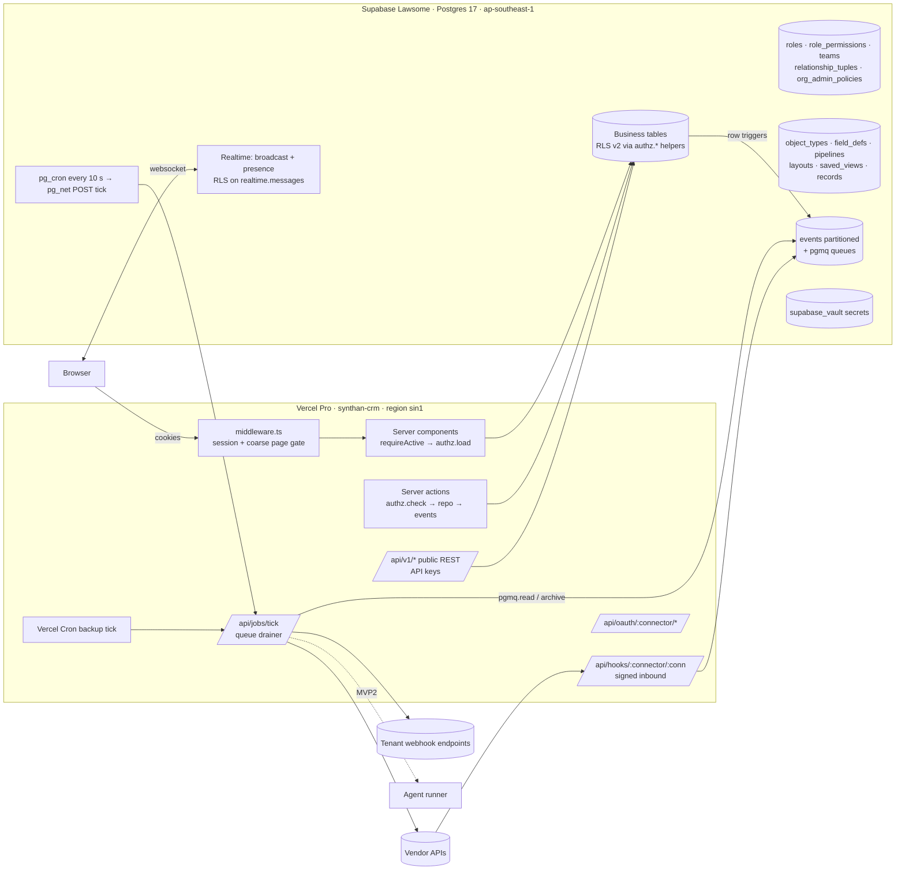

# Growth CRM (Synthan): Build Plan v1

| | |
|---|---|
| Prepared | Tue 27 Oct 2026 (execution starts Wed 28 Oct) |
| Target | Production-ready on **Mon 2 Nov 2026** |
| Base | `c2d562f` on `claude/inspiring-fermat-2iwd0p`. Integration branch `build/v1` **already exists locally and on origin at `c2d562f`** (verified 27 Oct), so step "create build/v1" is done |
| App | `synthenei/apps/growth-crm` (Next.js 15.5 App Router, React 19.1, Tailwind v4, Radix, `motion` 14, Recharts 3, `@supabase/ssr`) |
| Database | Supabase project **Lawsome**, ref `evybdanqxgkjoybrvzru`, ap-southeast-1, Postgres 17. Live migrations: `0001_core` … `0012_tenant_config` (verified with `list_migrations`, 27 Oct). Installed extensions: `pgcrypto`, `uuid-ossp`, `pg_stat_statements`, `supabase_vault 0.3.1`. Available, not installed: `pgmq 1.5.1`, `pg_cron 1.6.4`, `pg_net 0.20.4`, `vector 0.8.2`, `pg_trgm`, `pgtap 1.3.3`, `pg_jsonschema` |
| Gap audit | `krishna AI/Happy UX/clients/lawson/crm/PRODUCTION-READINESS.md` (≈32 % production-ready, 22 connectors at 0 %) |
| Toolchain | System Node is 20. Run everything through Node 22: `npx -y -p node@22 npm run <script>` |

**Reading guide for implementation agents:** read §5 (protocol) first, then your task in §4, then the parts of §1 to §3 your task cites. Do not start a task whose dependencies have not merged into `build/v1`.

---

## 0. What exists today (facts this plan builds on)

| Area | Where | State |
|---|---|---|
| Tenancy | `src/lib/tenancy.ts` | Hard-coded `TENANTS` (lawsome, kaveri-demo, shola-mist), `WORKSPACES` (4), `USERS` (16), `MEMBERSHIPS`, `PERSONAS`. Imported by middleware (edge) |
| Data access | `src/lib/data/source.ts` | `DataSource` interface. `mockSource` for demo. `supabaseSource` reads 6 entities (leads, accounts, deals, tasks, campaigns, campaign_daily_metrics) via `select("*").eq("workspace_id")`; 11 entities in `notWired` |
| Session | `src/lib/auth/session.ts` | HMAC-signed `gcrm_session` cookie carrying memberships; `gcrm_ws`, `gcrm_support` cookies. Real sessions still mirror Supabase auth into this cookie |
| Authz | `src/lib/auth/roles.ts` | 6 fixed roles (`owner, sales_manager, sales_rep, marketing, data, viewer`), `PAGE_ACCESS` matrix (F/E/R/M), `CAN` action map, `SUPPORT_BLOCKED`, `can()`. `src/lib/config/permissions.ts` has a separate config-section matrix |
| Middleware | `src/middleware.ts` | Session verify, admin idle timeout (30 min), `?ws=` switch, page matrix 403, module gate (demo via signed cfg cookie) |
| Config | `src/lib/config/*`, `src/lib/vertical.ts` (700 lines) | One sparse-override JSON doc per tenant (`tenant_config`, versioned, history), presets legal/hospitality/blank, vocabulary nouns, **fixed stage ids** (`LEAD_STAGE_IDS`, `DEAL_STAGE_IDS` are TS unions), modules, branding, dashboard tiles |
| Writes | 13 server-action files | Only `admin/_components/actions.ts`, `admin/.../config-actions.ts`, `settings/_components/config-actions.ts` and login write. Leads, pipeline, accounts, tasks, inbox, campaigns, settings users/pipeline, data-health, AI, integrations all return "Demo: nothing was saved" |
| DB tenancy | `0004_workspaces.sql` | `tenants` → `workspaces` → `memberships(user, workspace, app_role)`. Every business table has `workspace_id NOT NULL` and `tenant_id` derived by trigger `a00_<table>_tenant`. Helpers `member_ws_ids()`, `role_ws_ids(...)`, `member_role_ws_ids(...)`, `is_platform_admin()` (requires `aal2`) |
| RLS | `0006_rls_ws.sql` | Policy per table per verb, uncorrelated `workspace_id in (select …)` form. Platform admins see business rows only through a live `support_sessions` row |
| Integrations | `src/lib/data/mock/integrations.ts`, `hospitality-integrations.ts` | 22 connector specs (`inbound`, `outbound`, `steps`, `fieldMap`), all `showcase`. DB tables `integrations`, `integration_field_maps`, `sync_runs` exist, unused |
| Tests | `scripts/e2e-matrix.mjs` (Playwright, personas × routes × widths), `scripts/config-test.ts`, `supabase/seed/verify_isolation.sql` | No Cypress, no unit runner, no CI |
| i18n | none | English strings inline. Tamil only in `profiles.language`, `message_templates.language`, `inbox/_components/drafts-ta.ts` |
| Hosting | Vercel `synthan-crm` (Hobby), `synthanai-crm.vercel.app`, demo mode, Node 24 runtime | Hobby is non-commercial; cron limited to daily |

**Naming decision: "org" = `tenants` row, `org_id` = the existing `tenant_id` column.** The owner's requirement "tenancy by org_id on every row" is already met: `tenant_id uuid NOT NULL` exists on every business table and is trigger-derived from `workspace_id`. Renaming the column across 30 live tables during a 5-day sprint is pure risk with zero isolation benefit. All new tables carry both `tenant_id` (org) and `workspace_id` (isolation boundary inside an org). In UI copy and docs we say "Organisation"; in SQL it stays `tenant_id`. A view layer can expose `org_id` aliases for the public API.

---

## 1. Target architecture

### 1.1 System view



Principles:
1. **Postgres is the authority.** Every read and write from a user, API key, connector or (MVP2) agent runs under a JWT whose subject has a membership, so RLS applies. The service role is used only by the job drainer for queue mechanics, vault reads and vendor webhook ingestion, and every service-role write path stamps `actor_kind` and re-checks tenant scope explicitly.
2. **The app layer mirrors RLS for UX and early rejection,** never as the only check. A parity test suite proves the TS engine and SQL helpers agree (T057).
3. **Everything tenant-specific is data:** `tenant_config` (vocabulary, modules, branding, dashboard) plus metadata tables (fields, objects, pipelines, layouts, roles, notification rules, connector settings). No code path may branch on a tenant id or slug. A lint rule (T002) fails the build on string literals matching known tenant slugs outside `src/lib/demo/`.
4. **Demo stays, but as a separate deployment.** Demo sessions never touch Supabase (existing rule in `getDataSource`). Production runs with `DEMO_MODE` unset and refuses demo personas.

### 1.2 Tenancy

```
tenants (org: branding, plan, status, primary_owner_id)
 ├─ org_admin_policies (what this org's admins may configure; set by platform)
 ├─ tenant_config (+history)                         ← vocabulary, modules, branding, dashboard
 ├─ roles / role_permissions (custom roles per org)  ← system role templates have tenant_id null
 ├─ object_types / field_defs / pipelines / layouts  ← org-wide (workspace_id null) or per workspace
 └─ workspaces (isolation boundary)
      ├─ memberships (user × workspace × role_id, attributes jsonb)
      ├─ teams / team_members (manager flag)
      └─ every business row (workspace_id NOT NULL, tenant_id derived)
platform_admins (platform_role: super_admin | support | billing | readonly) · support_sessions (≤ 60 min, reasoned)
```

Rules: `workspace_id` is the RLS boundary; `tenant_id` is the org boundary used by config, metadata, billing and cross-workspace org-admin screens. An org admin is a user holding a role with `org.admin` permission in **any** workspace of the tenant. A user may belong to several orgs (Nithya in the seed already does), so every query is scoped by the active workspace from `gcrm_ws`, never by "the user's org".

### 1.3 Authorization (RBAC + ReBAC + ABAC)

#### Decision: in-house policy engine (TypeScript) + relationship tables + SQL helper functions used by RLS

| Option | Works inside one Postgres? | Can RLS use it? | Ops cost | Verdict |
|---|---|---|---|---|
| OpenFGA (Zanzibar) | No: separate Go service with its own store (can use Postgres, but its own schema and API) | No. RLS cannot call it synchronously, so you either duplicate tuples into Postgres or lose DB enforcement | Run + monitor a service; Vercel cannot host it | Rejected for v1. Our `relationship_tuples` table uses the same tuple shape, so a later sync to OpenFGA is a job, not a rewrite |
| Cerbos | PDP is stateless (container, or embedded WASM ePDP) | No. Query-plan output can build app-side SQL filters, but it is not RLS | Sidecar or Cerbos Hub; policy YAML is a second language | Rejected: two sources of truth, and the DB would still need its own rules |
| Oso Cloud | SaaS (local-authorization mode generates SQL filters) | No | Vendor, data about relationships leaves the DB, cost | Rejected |
| **In-house: tables + `authz.*` SQL functions + TS mirror** | **Yes** | **Yes, natively** | None beyond code | **Chosen.** One source of truth (tables), two evaluators (SQL for enforcement, TS for UX), proven equal by a shared fixture matrix |

#### Tables (migration 0013, details in §2)
- `permissions` catalogue (global, seeded): key `"<resource>.<action>"`, e.g. `leads.read`, `leads.write`, `leads.assign`, `leads.export`, `leads.delete`, `pii.read`, `deals.move`, `campaigns.write`, `integrations.manage`, `webhooks.manage`, `api_keys.manage`, `roles.manage`, `fields.manage`, `org.admin`, `org.branding`, `ai.toggle`, `ai.use`, `privacy.fulfil`, `audit.read`, plus one per custom object created at runtime (`obj:<key>.read|write|delete`).
- `roles` (system templates with `tenant_id null` reproduce today's six roles exactly; orgs clone and edit) with `base_role app_role` kept so existing navigation defaults (`HOME_FOR`, mobile nav in `src/components/shell/nav.ts`) keep working for custom roles.
- `role_permissions(role_id, permission_key, scope, conditions, field_mask)` where `scope ∈ {all, team, own, none}`.
- `memberships.role_id` (backfilled), `memberships.attributes jsonb` (ABAC: `regions`, `districts`, `languages`, `verticals`), `memberships.valid_until`.
- `teams(id, workspace_id, parent_team_id)`, `team_members(team_id, user_id, is_manager)`.
- `relationship_tuples(object_type, object_id, relation ∈ {owner, editor, viewer, follower}, subject_type ∈ {user, team, role}, subject_id, expires_at)`: record-level sharing.
- `org_admin_policies(tenant_id, allow_custom_roles, allow_custom_objects, allow_api_keys, allow_webhooks, allow_byok, allowed_modules, max_seats, max_workspaces, …)`: what the **platform super admin** lets this org's admins do.
- `platform_admins.platform_role`.

#### Evaluation order (identical in SQL and TS; first deny wins, default deny)
1. **Authenticate.** No principal → deny. Principal kinds: `user`, `api_key` (bot user), `connector` (service path, scoped to one connection), `agent` (MVP2 bot user), `platform_admin`.
2. **Org state (ABAC, org attributes).** `tenants.status = suspended` → deny all writes, allow owner reads of billing/settings only. `trial` past `trial_ends_at` → read-only.
3. **Entitlements (ABAC, plan).** Module disabled in `tenant_config.modules` or not in `org_admin_policies.allowed_modules` or plan → deny. Feature caps (seats, API keys, webhooks, AI calls) checked against `usage_counters`.
4. **Support-session overlay.** Platform admin without live session → no business data. With session: `read_only` acts as the system `viewer` role; `read_write` as `owner` minus `SUPPORT_BLOCKED` (export, branding, integrations, erase, AI toggle, workspace create, member management, privacy, roles, API keys, webhooks). Expiry is checked in SQL (`support_sessions.expires_at > now()`).
5. **RBAC.** Find `role_permissions` row for (membership.role_id, permission). Missing or `scope = none` → deny.
6. **ReBAC (scope resolution).** `all` → allow. `team` → record `owner_id` ∈ users in my teams or in teams I manage (recursive down `parent_team_id`). `own` → `owner_id = me` or `assignee_id = me`. Independently of scope, a `relationship_tuples` row granting `viewer`/`editor`/`owner` to me, my team or my role on that object allows read (viewer) or write (editor, owner).
7. **ABAC conditions** on the `role_permissions` row (`conditions` jsonb, a small allow-listed operator set: `eq`, `in`, `contains`, `lte`, `gte`, `between_hours`): e.g. `{"record.district": {"in": "@principal.districts"}}`, `{"time": {"between_hours": ["09:00","20:00"], "tz": "Asia/Kolkata"}}`, `{"record.consent_whatsapp": {"eq": true}}` for `messages.send_whatsapp`. Unknown operator → deny (fail closed).
8. **Field masking.** If the principal lacks `pii.read` or the field is in `field_mask`, PII fields (`email`, `phone`, plus any `field_defs.is_pii`) come back masked. In SQL this is the existing `v_leads_masked` pattern generalised: base tables deny SELECT to roles without `pii.read`; they read `v_<table>_masked` views.

#### SQL helpers (schema `authz`, all `security definer`, `set search_path = ''`, `stable`)
| Function | Returns | Used by |
|---|---|---|
| `authz.ws_with(p_perm text, p_min_scope text default 'own')` | `setof uuid` workspaces where the caller holds the permission at ≥ scope (support sessions included per step 4) | Every policy, uncorrelated `workspace_id in (select authz.ws_with('leads.read','all'))` |
| `authz.ws_with_member(p_perm, p_min_scope)` | same but real memberships only (never support) | "never during support" writes |
| `authz.team_user_ids(p_ws uuid)` | `setof uuid` users visible under `team` scope | `owner_id in (select authz.team_user_ids(workspace_id))` (correlated only on `workspace_id`; acceptable because a user has few workspaces; T041 measures) |
| `authz.shared_ids(p_type text, p_min_rel text)` | `setof uuid` object ids shared with me/my teams/my role | `or id in (select authz.shared_ids('lead','viewer'))` |
| `authz.attr(p_ws uuid)` | `jsonb` of my membership attributes | ABAC conditions in policies |
| `authz.cond_ok(p_ws uuid, p_perm text, p_record jsonb)` | `boolean` evaluates `conditions` | Write policies `with check` and RPCs |
| `authz.check(p_ws, p_perm, p_object_type, p_object_id)` | `boolean` full evaluation | RPCs, API, tests |
| `authz.explain(...)` | `jsonb` step-by-step decision | `/settings/roles` "why can't X see this" and the matrix suite |

Policy shape (generated per table by 0016, never hand-written per tenant):
```sql
create policy leads_select on public.leads for select to authenticated using (
  deleted_at is null and (
       workspace_id in (select authz.ws_with('leads.read','all'))
    or (workspace_id in (select authz.ws_with('leads.read','team')) and owner_id in (select authz.team_user_ids(workspace_id)))
    or (workspace_id in (select authz.ws_with('leads.read','own'))  and (owner_id = (select auth.uid()) or owner_id is null and district = any (select jsonb_array_elements_text(authz.attr(workspace_id)->'districts'))))
    or id in (select authz.shared_ids('lead','viewer'))
  ));
```
The `owner_id is null and district …` arm preserves today's rule "a sales_rep sees own leads plus unassigned leads in their territory" (supabase/README.md §3).

TS mirror: `src/lib/authz/` exports `loadPrincipal()` (one RPC `authz.my_grants(ws)` returning the role's permission rows, team ids and attributes; cached per request with React `cache()`), `can(principal, perm, record?)`, `explain()`, and `assertCan()` for server actions. `src/lib/auth/roles.ts` `CAN`/`PAGE_ACCESS` become derived views of the system-role seed (kept for demo mode, generated from the same seed file `src/lib/authz/catalog/system-roles.ts`).

### 1.4 Configuration and metadata model

| Concern | Storage | Editor (UI) | Runtime consumer |
|---|---|---|---|
| Vocabulary, nav labels, funnel/view labels | `tenant_config.vocabulary` (existing), extended to per-locale `vocabulary.i18n.{en,ta}` | `/settings` Config tab (exists, `config-sections.tsx`) | `vocabFor()` in `src/lib/vertical.ts`, i18n layer (§1.12) |
| Modules on/off | `tenant_config.modules` ∩ `org_admin_policies.allowed_modules` | Config tab; platform locks in `/admin/tenants/[id]` | middleware + `requireActive` (exists) + authz step 3 |
| Branding, fonts | `tenant_config.branding` (exists) | Branding tab (exists) | `globals.css` vars |
| Pipelines and stages | `pipelines`, `pipeline_stages` (extended) | `/settings/pipelines` (T032) | Kanban, metrics, probability |
| Lead statuses | lead pipeline in `pipelines` (`object_type = 'lead'`), `leads.stage_id` | same | Leads table, funnel |
| Custom fields | `field_defs` + `custom jsonb` column on system tables | `/settings/fields` (T030) | Field renderer `src/components/fields/*` for forms, tables, detail, filters, import mapping, API |
| Custom objects | `object_types (kind = custom)` + `records` + `record_links` | `/settings/objects` (T033) | Generic `/o/[object]` list + `/o/[object]/[id]` detail |
| Layouts | `layouts` (detail, form, list, card, per role optional) | Layout editor (T033) | Record pages |
| Saved views | `saved_views` | inline "Save view" | Lists, kanban |
| Roles, permissions, teams | §1.3 tables | `/settings/roles`, `/settings/teams` (T017) | authz |
| Notifications | `notification_rules`, `notification_prefs` | `/settings/notifications` (T030b in T027) | notifier worker |
| Integrations | `integrations` (connections), `integration_field_maps`, vault | `/integrations/[id]` | connector runtime |
| AI toggles, caps, BYOK | `ai_policies`, `ai_providers` (0021) | `/ai` settings (T050) | AI gateway |
| Import mappings | `tenant_config.data.importMappings` (exists) → keyed by `field_defs.key` | Import dialog | CSV importer |

Validation: field values are validated twice, in TS (`src/lib/metadata/validate.ts`, generated from `field_defs`) and in SQL (`metadata.validate_custom()` trigger, using `pg_jsonschema` compiled per object type into `object_types.json_schema`). Metadata writes emit `metadata.changed` events and bump `object_types.schema_version`; clients cache by version.

**Fixed stage ids are the main refactor.** `LeadStage` and `DealStage` are TS unions used in `src/lib/data/types.ts`, metrics, charts and `vertical.ts`. T032 replaces them with `string` keys resolved from the pipeline, keeping the old keys as the seeded defaults so existing tenants see no change.

### 1.5 Realtime and multiplayer

| Need | Mechanism | Channel / topic | Authorization |
|---|---|---|---|
| "Who else is here" on a record or board | Supabase Realtime **Presence** | `ws:<workspace_uuid>:rec:<type>:<id>` and `ws:<ws>:board:<pipeline_id>` | Private channels; RLS policy on `realtime.messages` allows `select`/`insert` when `split_part(realtime.topic(), ':', 2)::uuid in (select public.member_ws_ids())` |
| Live list and board updates | **Broadcast from the database**: `realtime.broadcast_changes()` triggers on business tables, payload = `{id, op, version, changed_by, changed_fields[]}` only, never row data | `ws:<ws>:tbl:<table>` | Same policy. Clients refetch the row through RLS, so a rep never receives fields of rows they cannot read. Residual leak: a member learns that some row id changed in their workspace. Accepted and documented; per-user topics for `own`-scoped roles are a T041 option if the critique flags it |
| Personal notifications | `postgres_changes` on `notifications` filtered `user_id=eq.<me>` | n/a | RLS `user_id = auth.uid()`; low volume, so postgres_changes cost is fine |
| Typing / editing indicator | Broadcast (client-to-client, ephemeral) | record topic | same |
| Conflict-safe edits | **Optimistic concurrency**: every mutable business table gets `version int` incremented by trigger; server actions send `expected_version`; mismatch → 409 with the current row; UI shows a "Changed by Priya 20 s ago: review" banner with a field-level diff and merge choice. Kanban moves use `move_deal(p_id, p_stage, p_expected_version)` RPC | n/a | n/a |
| Assignments and @mentions | `comments.mentions uuid[]`, assignment changes → events → `notifications` rows | n/a | Mentioned user must be able to read the record (checked with `authz.check`), else mention is rejected with a reason |
| Activity feed | `events` (partitioned) filtered by workspace and readable objects, exposed through `v_activity_feed` (security_invoker) | n/a | RLS on underlying objects |

Client: `src/lib/realtime/` holds one Supabase browser client per tab, a `RealtimeProvider` in `src/components/shell/providers.tsx`, hooks `usePresence(topic)`, `useTableChanges(table, onChange)`, `useRecordVersion()`. Connection state feeds a **sync status chip** in the top bar (Takt `div.sync`: live / stale / offline).

### 1.6 Jobs and queue

**Decision: `pgmq` + `pg_cron` + `pg_net` in the same Postgres, drained by a Vercel route.**

- Producers write in the same transaction as the business change: trigger → `events` row + `pgmq.send('events', …)`. This is a transactional outbox with no dual-write.
- Queues: `events` (fan-out), `webhook_out`, `connector_sync`, `connector_inbound`, `notify`, `import`, `maintenance`, `agent` (MVP2, created empty on Monday).
- `pg_cron` job every **10 seconds** calls `net.http_post` to `https://<app>/api/jobs/tick` with a bearer secret read from Vault. **Vercel Cron** (Pro: per-minute) calls the same route as a backup if pg_net or the network fails.
- `/api/jobs/tick` (Node runtime, `maxDuration` 300 s on Pro) loops: `pgmq.read(queue, vt => 60, qty => 20)`, dispatches to handlers in `src/lib/jobs/handlers/*`, `pgmq.archive` on success, leaves the message to reappear on failure; after `read_ct > max_attempts` it moves to `<queue>_dlq` and writes `job_runs.status = 'dead'`. A per-tenant concurrency cap (`job_locks` via `pg_try_advisory_xact_lock(hashtext(tenant||queue))`) keeps one noisy tenant from starving others. Handler budget: stop pulling at 240 s.
- `scheduled_jobs` table holds per-connection schedules (GA4 05:30 IST, Google Ads 06:00 IST, token refresh, retention, partition maintenance); a `maintenance` cron materialises due rows into queues.

Why not the alternatives: **Inngest / Trigger.dev** are good but add a vendor, a second dashboard, data leaving the DB and signup/billing steps the owner would have to do today; revisit if job volume outgrows a 10-second drainer. **Vercel Cron alone** has minute granularity and no queue semantics. **Supabase Edge Functions** would split the codebase into a Deno runtime. **QStash** is another vendor. pgmq gives visibility timeouts, retries and archive inside the one database the owner already chose.

### 1.7 Connector framework

`src/lib/connectors/` (T022):
```ts
interface ConnectorDef {
  id: ConnectorId;                // 'whatsapp' | 'meta-ads' | … (matches existing catalog ids)
  auth: 'oauth2' | 'api_key' | 'service_account' | 'webhook_secret' | 'none';
  oauth?: { authorizeUrl; tokenUrl; scopes: string[]; pkce: boolean; extraParams? };
  gate: 'none' | 'needs_vendor_approval' | 'needs_client_credentials';
  sandbox: { supported: boolean; how: string };     // shown in UI and runbook
  streams: StreamDef[];           // inbound sync streams with cursor + schedule
  pushes: PushDef[];              // outbound actions (send template, offline conversion…)
  verifyWebhook?(req, secret): Promise<VerifiedEvent[]>;
  handleWebhook?(ctx, evt): Promise<void>;
  fieldMap: FieldMapSpec[];       // default map, tenant can edit (integration_field_maps)
  consentPurpose?: ConsentPurpose; // outbound marketing pushes require it
}
```
Runtime pieces: credential vault (`private.put_secret / get_secret` wrappers over `vault.create_secret`, service-role only, secrets referenced by `integrations.credential_secret_id`), OAuth start/callback routes with signed state + PKCE verifier in an httpOnly cookie, token refresh job, `sync_runs` writer (exists as table), cursor store `sync_cursors`, dedupe via `external_links` and match keys (E.164 phone, lower(email), GCLID, fbclid), consent gate (outbound marketing push skips contacts without `consent_marketing`/`consent_whatsapp`, and STOP/unsubscribe writes `consent_log`), rate-limit/backoff helper honouring `Retry-After`, PII-stripped payload samples.

Availability: `connector_availability(connector_id, env, mode ∈ {disabled, sandbox, live}, gate_status, note)` is platform-controlled. Paying tenants never see `showcase` cards; demo deployment keeps them. A connection in `sandbox` mode shows an amber "Sandbox: not sending to real customers" chip everywhere it surfaces.

### 1.8 Webhooks

**Inbound** `POST /api/hooks/[connector]/[connectionId]` (and `GET` for Meta's `hub.challenge`): read raw body → provider verifier (Meta `X-Hub-Signature-256` HMAC with app secret; Razorpay `X-Razorpay-Signature`; Slack v0 signature + 5-min timestamp window; Calendly `Calendly-Webhook-Signature`; Cal.com `X-Cal-Signature-256`; Google Pub/Sub push JWT; Mailchimp secret path segment; Zoho/HubSpot v3 signatures) → insert into `webhook_inbox` with `unique(connector_id, provider_event_id)` for replay protection → `pgmq.send('connector_inbound')` → return 200 in < 1 s. Failed verification: 401, row stored with `signature_ok = false` for 7 days (no body).

**Outbound** (tenant-configured): `webhook_endpoints` (https only, URL resolved and blocked for private/link-local/metadata IP ranges at create and at send time), event-type subscriptions from the event catalogue, per-endpoint secret in Vault, **Standard Webhooks** signing (`webhook-id`, `webhook-timestamp`, `webhook-signature: v1,<base64 HMAC-SHA256>`), retries with exponential backoff and jitter (≈ 30 s, 2 m, 10 m, 1 h, 6 h, 24 h), auto-disable after 5 consecutive days of failure with owner notification, `webhook_deliveries` log (status, latency, 2 KB response excerpt), manual replay, "send test event" button, secret rotation with a 24 h overlap.

### 1.9 Public REST API

- Base `/api/v1`. Resources: `leads`, `contacts`, `accounts`, `deals`, `tasks`, `activities`, `campaigns`, `records/{object}`, `pipelines`, `fields`, `webhooks` (REST-hook subscribe for Zapier/Make), `me`.
- Auth: `Authorization: Bearer sk_live_<prefix>_<secret>` (sandbox keys `sk_test_…`). Stored as `sha256` hash + 8-char prefix. Each key is bound to a **bot user** (auth user without password, created by the server via the admin API) with a membership whose role is the key's chosen role; scopes further narrow (`leads:read`, `leads:write`, …).
- Execution: the route verifies the key, then mints a 5-minute JWT for the bot user and calls Supabase with it, so **RLS applies to API traffic exactly as to the UI**. Minting needs the project's JWT signing secret: T025 must first confirm the project still accepts HS256 tokens signed with the legacy JWT secret (Supabase moved to asymmetric signing keys in 2025). If it does not, the fallback is SECURITY DEFINER `api.*` RPCs that call `authz.check` explicitly; the task reports which path it took.
- Cursor pagination (`?cursor=&limit≤100`), filters on system and custom fields (`?filter[custom.room_type]=deluxe`), `Idempotency-Key` header (stored 24 h in `idempotency_keys`), errors as `application/problem+json`, per-key rate limit (default 120 req/min, plan-based) via `rate_limit_hit()`, request log (`api_request_log`, partitioned, 30-day retention). OpenAPI 3.1 at `/api/v1/openapi.json`, generated from the zod schemas.

### 1.10 Event bus (and the MVP2 agent hook)

- Event types are a catalogue in code (`src/lib/events/catalog/<domain>.ts`, one file per domain so tasks never collide) and mirrored to `event_types` for UI pickers: `lead.created|updated|assigned|stage_changed|deleted`, `deal.*`, `account.*`, `contact.*`, `task.*`, `activity.logged`, `message.received|sent|status`, `comment.created`, `mention.created`, `record.<object>.*`, `connector.sync.completed|failed`, `consent.changed`, `metadata.changed`, `member.*`, `webhook.endpoint.disabled`.
- Envelope: `{id, type, tenant_id, workspace_id, object_type, object_id, actor:{kind,id}, occurred_at, version, data:{changed_fields, before?, after?}}`. `before/after` hold non-PII fields only; consumers that need PII refetch under their own principal.
- Fan-out consumers on Monday: outbound webhooks, notifications, connector pushes (e.g. Meta offline conversions on `deal.won`), audit enrichment, realtime is DB-trigger-driven separately. **MVP2:** `agent_triggers` subscribe to the same `events` queue; the drainer already routes unknown consumers to the `agent` queue which is created empty. Nothing in Monday's code needs changing for agents to plug in.

### 1.11 Audit log

Existing `audit_log` (trigger `audit_row_change`, masks PII, stamps `workspace_id` and `support_session_id`) is kept and extended (0014): `actor_kind`, `request_id`, `ip`, `user_agent`, `reason`, `source ∈ {ui, api, connector, job, agent, support}`. Append-only: `update`/`delete` revoked from everyone including `service_role` via a `before update or delete` trigger that raises. Configuration, role, permission, field, connector, API-key, webhook and support actions are logged with a human-readable `summary`. Viewer screens: `/settings/audit` (org), `/admin/audit` (platform), CSV export (blocked during support).

### 1.12 i18n (English + Tamil)

- `next-intl` with locales `en` and `ta`; locale from `profiles.language` (exists, `en|ta`), overridable per session. No locale in the URL (an internal B2B app; keeps existing routes).
- Messages split by namespace into files `messages/<locale>/<namespace>.json` (e.g. `messages/ta/leads.json`) so parallel tasks never edit the same file.
- Layering at runtime: base messages → vertical preset vocabulary → tenant vocabulary for that locale (`tenant_config.vocabulary.i18n.ta`) → custom field and stage labels from metadata (`label jsonb {en, ta}`).
- Formatting with `Intl` for `en-IN` / `ta-IN` (lakh/crore grouping, IST). Tamil font: **Noto Sans Tamil** via `next/font` (Geist has no Tamil glyphs); Tamil body text minimum **13 px** and line-height +10 % because Tamil glyphs at 12 px fall below legibility on Windows ClearType.
- Tamil strings are machine-drafted by agents and marked `"_review": true` in a sidecar file; **a fluent human must review before tenants see Tamil UI** (owner blocker B-9). Until reviewed, Tamil is offered only for message templates and drafts, which already exist in Tamil.

### 1.13 Observability and operations

- **Errors and traces:** Sentry (`@sentry/nextjs`) with `tenant_id`, `workspace_id`, `request_id` tags; `beforeSend` strips emails/phones; session replay off.
- **Logs:** JSON logger `src/lib/obs/log.ts` (`request_id`, `principal_kind`, hashed user id, route, ms). Vercel log drain to the chosen sink (owner choice; Better Stack or Axiom).
- **Health:** `/api/health` (DB round-trip, oldest message age per pgmq queue, last tick time, failed jobs in last hour). External uptime monitor polls it every minute and pages the owner.
- **DB:** `pg_stat_statements` (installed), Supabase advisors (security + performance) run at each gate, slow-query budget: p95 < 150 ms for list queries on 50 k leads.
- **Admin ops page** `/admin/ops`: queue depths, DLQ, job failures, webhook delivery failure rate, connector health per tenant, sync freshness (existing 26 h threshold).

### 1.14 Security baseline

Headers in `next.config.mjs` (CSP with nonces for Next scripts, `frame-ancestors 'none'`, HSTS 2 y, `Referrer-Policy: strict-origin-when-cross-origin`, `Permissions-Policy` minimal, `X-Content-Type-Options`), rate limits on `/login`, `/admin/login`, password reset, invites, API, inbound webhooks (DB token bucket `rate_limit_hit()` plus Vercel WAF rule), `SESSION_SECRET` mandatory outside demo (exists), service-role key only in server modules marked `import "server-only"`, MFA (TOTP via Supabase Auth) mandatory for platform admins and optional-per-org for owners, secrets never in logs, dependency audit in CI.

---

## 2. Data model: migrations 0013+

Rules for every migration: forward-only, numbered, **idempotent** (`create … if not exists`, `create or replace`, `drop policy if exists` before `create policy`, `on conflict do nothing/update` for seeds), additive where possible, no `drop table`/`truncate` on business data, one transaction per file, a `-- verify:` block of `select` assertions at the end, and a pgTAP test file `supabase/tests/<number>_*.test.sql`. RLS enabled on every new table in the same file that creates it. New tables carry `tenant_id` (derived from `workspace_id` via the existing `a00_<table>_tenant` trigger pattern) and `workspace_id` unless marked "global" or "org-wide".

| # | File | Owner task (batch) | Contents |
|---|---|---|---|
| 0013 | `0013_authz_core.sql` | T001 (B1) | §2.1 |
| 0014 | `0014_event_bus_jobs_audit.sql` | T001 (B1) | §2.2 |
| 0015 | `0015_integrations_webhooks_api.sql` | T001 (B1) | §2.3 |
| 0016 | `0016_rls_v2.sql` | T011 (B2) | §2.4 |
| 0017 | `0017_metadata.sql` | T011 (B2) | §2.5 |
| 0018 | `0018_collab_realtime.sql` | T011 (B2) | §2.6 |
| 0019 | `0019_connector_domain.sql` | T021 (B3) | §2.7 |
| 0020 | `0020_entitlements_billing_privacy.sql` | T021 (B3) | §2.8 |
| 0021 | `0021_ai_hooks_embeddings.sql` | T031 (B4) | §2.9 |
| 0022 | `0022_perf_hardening.sql` | T041 (B5) | §2.10 |
| 0023 | `0023_release_fixes.sql` + `seed/prod_bootstrap.sql` | T061 (B7) | §2.11 |

### 2.1 `0013_authz_core`
| Table / change | Columns | RLS |
|---|---|---|
| `permissions` (global) | `key text pk`, `resource text`, `action text`, `description text`, `is_pii bool`, `platform_only bool`, `support_blocked bool` | select: authenticated; write: none (seeded by migration, upsert) |
| `roles` | `id uuid pk`, `tenant_id uuid null` (null = system template), `key text`, `name text`, `description text`, `base_role app_role not null`, `is_system bool`, `created_by uuid`, `created_at`, `updated_at`, `unique nulls not distinct (tenant_id, key)` | select: system rows to all authenticated; tenant rows to members of that tenant; write: `roles.manage` in any workspace of the tenant **and** `org_admin_policies.allow_custom_roles` |
| `role_permissions` | `role_id uuid fk`, `permission_key text fk`, `scope text check in ('all','team','own','none')`, `conditions jsonb default '{}'` (validated by `authz.valid_conditions()`), `field_mask text[] default '{}'`, pk `(role_id, permission_key)` | via parent role |
| `memberships` (alter) | `+ role_id uuid fk roles` (backfill: system role by `role` enum), `+ attributes jsonb default '{}'` (copy `territory_districts` where present), `+ valid_until timestamptz` | existing policies; guard trigger extended so only `roles.manage` holders change `role_id` and nobody grants a role with more permissions than they hold |
| `teams` | `id`, `tenant_id`, `workspace_id`, `name`, `parent_team_id uuid null fk teams`, `created_at` | select: members of ws; write: `teams.manage` |
| `team_members` | `team_id`, `user_id`, `is_manager bool`, pk `(team_id,user_id)` | same |
| `relationship_tuples` | `id`, `tenant_id`, `workspace_id`, `object_type text`, `object_id uuid`, `relation text check in ('owner','editor','viewer','follower')`, `subject_type text check in ('user','team','role')`, `subject_id uuid`, `created_by`, `created_at`, `expires_at`; unique `(object_type, object_id, relation, subject_type, subject_id)`; index `(subject_type, subject_id)` | select: members of ws who can read the object; insert/delete: object editors/owners or `records.share` |
| `org_admin_policies` | `tenant_id pk`, `allow_custom_roles`, `allow_custom_objects`, `allow_api_keys`, `allow_webhooks`, `allow_byok`, `allow_connectors text[]`, `allowed_modules text[]`, `max_seats int`, `max_workspaces int`, `max_custom_fields int`, `updated_by`, `updated_at` | select: tenant members; write: platform `super_admin` only via `admin_set_org_admin_policy(p_tenant, p_policy, p_reason)` (audited) |
| `platform_admins` (alter) | `+ platform_role text default 'super_admin' check in ('super_admin','support','billing','readonly')` | existing |
| functions | `authz.ws_with`, `authz.ws_with_member`, `authz.team_user_ids`, `authz.shared_ids`, `authz.attr`, `authz.cond_ok`, `authz.check`, `authz.explain`, `authz.my_grants(p_ws)` | grant execute to authenticated |
| seed | Six system roles and their permission rows reproducing `CAN` + `PAGE_ACCESS` + 0006 policies exactly (generated from `src/lib/authz/catalog/system-roles.ts` by `scripts/gen-authz-seed.mjs`, committed as SQL) | |

### 2.2 `0014_event_bus_jobs_audit`
| Table / change | Columns | RLS |
|---|---|---|
| extensions | `create extension if not exists pgmq; pg_cron; pg_net` (schema `extensions` where supported) | |
| `events` (partitioned by range `occurred_at`, monthly; partitions Nov 2026 … Dec 2027 created; `maintenance` job creates ahead) | `id bigint generated always as identity`, `tenant_id`, `workspace_id`, `type text`, `object_type text`, `object_id uuid`, `actor_kind text`, `actor_id uuid`, `support_session_id uuid`, `request_id text`, `data jsonb`, `occurred_at timestamptz`, pk `(id, occurred_at)`; index `(workspace_id, occurred_at desc)`, `(object_type, object_id, occurred_at desc)` | select: workspace members with `events.read` (activity feed further filtered by view); insert: only via `events.emit()` security definer |
| `event_types` (global) | `type text pk`, `domain`, `description`, `webhook_eligible bool`, `agent_eligible bool` | select all authenticated |
| function | `events.emit(p_type, p_object_type, p_object_id, p_data jsonb)` inserts event + `pgmq.send('events', …)`; trigger fn `events.row_change()` attached to `leads, deals, accounts, contacts, tasks, activities, conversations, messages, campaigns, memberships` | |
| queues | `pgmq.create(q)` for `events, webhook_out, connector_sync, connector_inbound, notify, import, maintenance, agent` and `<q>_dlq` | pgmq schema not exposed to authenticated |
| `job_runs` | `id bigint`, `queue`, `msg_id bigint`, `kind`, `tenant_id`, `workspace_id`, `status check in ('running','succeeded','failed','dead')`, `attempt int`, `error text`, `started_at`, `finished_at`, `ms int` | select: platform admins; tenant owners see their rows through `v_job_runs_tenant` |
| `scheduled_jobs` | `id`, `tenant_id null`, `workspace_id null`, `kind`, `cron text`, `tz text default 'Asia/Kolkata'`, `payload jsonb`, `next_run_at`, `enabled`, `last_run_at` | owners select own; writes via app with `integrations.manage` |
| `private.settings` | `key text pk`, `value text` (tick URL) | no grants |
| cron | `cron.schedule('gcrm_tick', '10 seconds', …net.http_post(tick_url, bearer from vault 'jobs_tick_secret'))`, `cron.schedule('gcrm_maintenance', '*/5 * * * *', …)` | |
| `audit_log` (alter) | `+ actor_kind text`, `+ source text`, `+ request_id text`, `+ ip inet`, `+ user_agent text`, `+ reason text`, `+ summary text`, `+ workspace_id` (exists via 0004) ; trigger `audit_append_only` raising on update/delete | existing |
| `idempotency_keys` | `tenant_id`, `key_id uuid`, `idem_key text`, `request_hash text`, `response jsonb`, `status int`, `created_at`; pk `(key_id, idem_key)` | service only |
| `rate_limits` + fn `rate_limit_hit(p_bucket text, p_limit int, p_window_s int) returns boolean` | `bucket text`, `window_start timestamptz`, `count int`, pk `(bucket, window_start)` | fn granted to anon + authenticated (login throttling) |
| `version` columns | `+ version int not null default 1` on `leads, deals, accounts, contacts, tasks, campaigns, conversations, audience_segments, pipeline_stages`; trigger `bump_version()` | |

### 2.3 `0015_integrations_webhooks_api`
| Table / change | Columns | RLS |
|---|---|---|
| `connector_catalog` (global, seeded with all 22 + `csv`, `email-smtp`, `resend`) | `id text pk`, `name`, `category`, `auth_kind`, `verticals text[]`, `gate text`, `sandbox_supported bool`, `docs_url` | select all |
| `connector_availability` (global) | `connector_id`, `env text check in ('production','staging','demo')`, `mode check in ('disabled','sandbox','live')`, `gate_status check in ('needs_vendor_approval','needs_client_credentials','ready')`, `note`, pk `(connector_id, env)` | select all; write platform `super_admin` |
| `integrations` (alter, = connections) | `+ connector_id text fk`, `+ mode text check in ('sandbox','live') default 'sandbox'`, `+ credential_secret_id uuid` (vault id), `+ webhook_secret_id uuid`, `+ oauth_scopes text[]`, `+ external_account_id text`, `+ external_account_label text`, `+ connected_by uuid`, `+ connected_at`, `+ token_expires_at`, `+ health jsonb`, `+ disabled_at`; enum `integration_status` add `'sandbox'`, `'disconnected'` | select: `integrations.read`; insert/update/delete: `ws_with_member('integrations.manage')` (never in support) |
| `oauth_states` | `state_hash text pk`, `tenant_id`, `workspace_id`, `connector_id`, `user_id`, `redirect_to`, `expires_at` | service only |
| `sync_cursors` | `integration_id`, `stream text`, `cursor jsonb`, `updated_at`, pk `(integration_id, stream)` | select `integrations.read` |
| `sync_runs` (alter) | `+ stream text`, `+ job_run_id bigint`, `+ mode text` | existing |
| `external_links` | `id`, `tenant_id`, `workspace_id`, `integration_id`, `external_object`, `external_id`, `local_table`, `local_id uuid`, `content_hash`, `last_synced_at`, `direction`; unique `(integration_id, external_object, external_id)`; index `(local_table, local_id)` | select `integrations.read` |
| `webhook_inbox` | `id bigint`, `connector_id`, `integration_id null`, `provider_event_id text`, `received_at`, `signature_ok bool`, `headers jsonb` (allow-listed), `body text` (null if signature failed), `status check in ('queued','processed','failed','ignored')`, `error`, `processed_at`; unique `(connector_id, provider_event_id)`; 30-day retention | none for authenticated; owners see counts via `v_webhook_inbox_stats` |
| `webhook_endpoints` | `id`, `tenant_id`, `workspace_id`, `url text check (url ~ '^https://')`, `description`, `event_types text[]`, `secret_id uuid`, `previous_secret_id uuid`, `secret_rotated_at`, `active bool`, `disabled_reason`, `consecutive_failures int`, `created_by`, `created_at` | `webhooks.manage` (never in support) |
| `webhook_deliveries` (partitioned monthly) | `id bigint`, `endpoint_id`, `event_id bigint`, `event_type`, `attempt int`, `status check in ('pending','succeeded','failed','dead')`, `response_status int`, `response_ms int`, `response_excerpt text`, `next_attempt_at`, `created_at`; pk `(id, created_at)` | select `webhooks.manage` |
| `api_keys` | `id`, `tenant_id`, `workspace_id`, `name`, `prefix text unique`, `key_hash text`, `env check in ('live','test')`, `scopes text[]`, `role_id uuid`, `bot_user_id uuid`, `created_by`, `created_at`, `last_used_at`, `expires_at`, `revoked_at` | `api_keys.manage` (never in support); `key_hash` never selectable (column privilege revoked) |
| `api_request_log` (partitioned monthly) | `id bigint`, `key_id`, `tenant_id`, `workspace_id`, `method`, `path`, `status`, `ms`, `ip inet`, `request_id`, `at`; pk `(id, at)` | `api_keys.manage` |
| vault wrappers | `private.put_secret(p_name, p_secret, p_desc) returns uuid`, `private.get_secret(p_id) returns text`, `private.delete_secret(p_id)` | execute granted to `service_role` only |
| consent fn | `public.can_contact(p_lead uuid, p_purpose consent_purpose) returns boolean` | authenticated + service |

### 2.4 `0016_rls_v2`
For every business table (`leads, contacts, accounts, deals, deal_stage_history, activities, tasks, campaigns, campaign_daily_metrics, audience_segments, lead_events, conversations, messages, message_templates, ga4_daily, integrations, integration_field_maps, sync_runs, consent_log, ai_insights, backup_checks, backup_alert_rules, pipeline_stages, territories, sales_targets, invitations`): `drop policy if exists` + `create policy` in the §1.3 shape. Masked views `v_<table>_masked` (security_barrier) for `leads`, `contacts`, `conversations`, `messages`. **Before the swap**, the file runs a parity block: for each seeded test identity (`verify_isolation.sql` users) it counts visible rows per table under the old helpers and under the new `authz.*` functions and raises if any count differs. The legacy helpers (`role_ws_ids` etc.) stay for views until 0022.

### 2.5 `0017_metadata`
| Table / change | Columns | RLS |
|---|---|---|
| `object_types` | `id`, `tenant_id`, `workspace_id null` (null = org-wide), `key text`, `kind check in ('system','custom')`, `label jsonb` (`{"en":{"one","many"},"ta":{…}}`), `icon text`, `primary_field text`, `is_enabled`, `position`, `json_schema jsonb`, `schema_version int`; unique `(tenant_id, key)` | select tenant members; write `fields.manage` + `org_admin_policies.allow_custom_objects` for `kind='custom'` |
| `field_defs` | `id`, `tenant_id`, `object_type_id`, `key text check (key ~ '^[a-z][a-z0-9_]{1,40}$')`, `label jsonb`, `type check in ('text','long_text','number','money','percent','date','datetime','boolean','select','multi_select','user','lookup','phone','email','url','rating')`, `options jsonb` (choices with `{key,label:{en,ta},color}`, lookup target), `required`, `unique_in_workspace`, `is_pii`, `is_searchable`, `is_filterable`, `default jsonb`, `validation jsonb`, `help jsonb`, `section text`, `position`, `editable_perm text`, `archived_at`; unique `(object_type_id, key)` | same |
| `custom jsonb not null default '{}'` | on `leads, contacts, accounts, deals, tasks, campaigns, conversations`; GIN `jsonb_path_ops` index each; trigger `metadata.validate_custom()` | inherits table |
| `records` | `id`, `tenant_id`, `workspace_id`, `object_type_id`, `title text`, `data jsonb`, `owner_id`, `created_by`, `created_at`, `updated_at`, `version`, `deleted_at`; GIN on `data`, trigram on `title` | §1.3 shape with permission `obj:<key>.read` resolved through `object_types.key` |
| `record_links` | `id`, `tenant_id`, `workspace_id`, `from_type`, `from_id`, `to_type`, `to_id`, `relation`, `created_at` | readable if both ends readable |
| `pipelines` | `id`, `tenant_id`, `workspace_id`, `object_type text` (`lead`, `deal`, or custom key), `key`, `name jsonb`, `is_default`, `position`, `archived_at` | `pipelines.manage` |
| `pipeline_stages` (alter) | `+ pipeline_id uuid fk`, `+ name jsonb`, `+ color text`, `+ outcome check in ('open','won','lost')`, `+ sla_hours int`, `+ required_fields text[]`, `+ archived_at`; uniques move to `(pipeline_id, key)` and `(pipeline_id, position) deferrable` | existing + `pipelines.manage` |
| `leads` (alter) | `+ pipeline_id`, `+ stage_id uuid fk pipeline_stages`; backfill from `status` enum; `status` stays as a derived bucket (trigger keeps it in sync) for views 0008/0011 | |
| `deals` (alter) | `+ pipeline_id` (backfill default pipeline) | |
| `layouts` | `id`, `tenant_id`, `workspace_id null`, `object_type_id`, `kind check in ('detail','form','list','card')`, `role_id null`, `spec jsonb`, `version`, `updated_by`, `updated_at` | read members; write `layouts.manage` |
| `saved_views` | `id`, `tenant_id`, `workspace_id`, `object_type_id`, `owner_id null`, `name`, `filters jsonb`, `sort jsonb`, `columns text[]`, `visibility check in ('private','team','workspace')`, `position` | private: owner; team: team members; workspace: members |
| seed | `seed_workspace_defaults()` (0007) extended to create system `object_types`, default lead + deal pipelines from the tenant preset | |

### 2.6 `0018_collab_realtime`
| Table / change | Columns | RLS |
|---|---|---|
| `comments` | `id`, `tenant_id`, `workspace_id`, `object_type`, `object_id`, `parent_id`, `author_id`, `body text check (length ≤ 10000)`, `mentions uuid[]`, `created_at`, `edited_at`, `deleted_at` | readable iff object readable (`authz.check`); author edits own within 15 min; `comments.moderate` deletes |
| `notifications` | `id`, `tenant_id`, `workspace_id`, `user_id`, `kind`, `object_type`, `object_id`, `actor_id`, `title jsonb`, `body jsonb`, `url text`, `read_at`, `created_at`; index `(user_id, read_at, created_at desc)` | `user_id = auth.uid()` |
| `notification_prefs` | `user_id`, `workspace_id`, `kind`, `channels text[]`, `digest check in ('instant','hourly','daily','off')`, pk `(user_id, workspace_id, kind)` | own rows |
| `notification_rules` | `id`, `tenant_id`, `workspace_id`, `event_type`, `conditions jsonb`, `recipients jsonb` (`owner`, `team_manager`, `role:<id>`, `user:<id>`, `followers`), `channels text[]`, `template jsonb`, `enabled` | `notifications.manage` |
| `follows` | `user_id`, `object_type`, `object_id`, `created_at`, pk all three | own rows |
| `v_activity_feed` | security_invoker view over `events` joined to readable objects | inherits |
| realtime | `alter publication supabase_realtime add table public.notifications`; policies on `realtime.messages` (select + insert) for topics `ws:<uuid>:%` limited to `member_ws_ids()`; trigger `realtime_broadcast_row()` on business tables using `realtime.broadcast_changes` with id-only payload | |

### 2.7 `0019_connector_domain`
| Table / change | Purpose |
|---|---|
| `conv_channel` enum add `instagram`, `sms`, `gbp`, `email` (exists), `msg_status` add `pending_template` | Inbox breadth |
| `message_templates` (alter) `+ provider_template_id`, `+ category`, `+ status check in ('draft','submitted','approved','rejected','paused')`, `+ components jsonb`, `+ integration_id`, `+ rejected_reason` | WhatsApp templates synced from Meta |
| `wa_numbers` | WABA id, phone number id, display number, quality rating, messaging limit tier, per connection |
| `payments` | `provider`, `external_id`, `amount_paise bigint`, `currency`, `status`, `link_url`, `lead_id`, `deal_id`, `record_id` (booking custom object), `paid_at`, `raw_ref` |
| `calendar_events` | external calendar sync: `integration_id`, `external_id`, `starts_at`, `ends_at`, `title`, `linked object`, `status` |
| `reviews` | GBP reviews: rating, text, author display name, reply draft, reply status (human approval) |
| `ad_accounts` | per connection: platform, external id, currency, timezone |
| `campaign_daily_metrics` (alter) `+ integration_id`, `+ external_campaign_id`, `+ source check in ('api','csv','mock')` | ads insights |
| `import_jobs` | CSV/XLSX: `object_type`, `storage_path`, `mapping jsonb`, `mode`, `status`, `rows_total/ok/dup/invalid`, `error_report_path`, `created_by` |
| `email_identities` | per-tenant sending domain, DKIM/SPF status, provider (Resend/SMTP), `from` addresses |
| hospitality preset seed | `booking` custom object + field_defs (check-in, check-out, room, guests, source OTA, commission %) seeded only when preset = hospitality, so OTA connectors map into metadata, not a hard-coded table |

### 2.8 `0020_entitlements_billing_privacy`
| Table | Columns / purpose |
|---|---|
| `plans` (global) | `id`, `name`, `price_paise_monthly`, `price_paise_yearly`, `limits jsonb` (seats, workspaces, ai_calls, api_rpm, webhooks, custom_objects), `modules text[]` |
| `tenant_subscriptions` | `tenant_id pk`, `plan_id`, `status check in ('trial','active','past_due','cancelled','manual')`, `seats`, `trial_ends_at`, `current_period_end`, `provider`, `provider_subscription_id`, `gstin`, `billing_address jsonb` |
| `invoices` | `number` (GST series per FY), `tenant_id`, `period`, `amount_paise`, `gst_paise`, `sac_code`, `status`, `pdf_path`, `issued_at` |
| `usage_counters` | `tenant_id`, `metric`, `period date`, `count bigint`, pk all three; fn `usage_bump(metric, n)` |
| `privacy_requests` | `id`, `tenant_id`, `workspace_id`, `subject_ref` (hash), `lead_id`, `kind check in ('access','correction','erasure','withdrawal','grievance')`, `received_at`, `due_at`, `status`, `handled_by`, `export_path`, `notes` |
| `retention_policies` | `tenant_id`, `object_type`, `days`, `action check in ('anonymise','delete')` |
| `tenants` (alter) | `+ trial_ends_at`, `+ data_region text default 'ap-southeast-1'`, `+ dpo_contact jsonb` |

### 2.9 `0021_ai_hooks_embeddings` (schema for MVP2, minimal runtime on Monday)
| Table | Columns / purpose |
|---|---|
| extension | `create extension if not exists vector` |
| `ai_providers` | `tenant_id`, `provider check in ('anthropic','openai','google','azure_openai','bedrock','openrouter')`, `secret_id` (BYOK, vault) or null (platform key), `default_model`, `allowed_models text[]`, `enabled` |
| `ai_policies` | `tenant_id pk`, `monthly_call_cap`, `monthly_token_cap`, `per_user_daily_cap`, `pii_redaction bool default true`, `store_prompts check in ('none','redacted','full') default 'redacted'`, `features jsonb` (replaces `AI_OFF` constant in `source.ts`) |
| `ai_usage` (partitioned monthly) | `tenant_id`, `workspace_id`, `principal_kind`, `principal_id`, `feature`, `provider`, `model`, `input_tokens`, `output_tokens`, `cost_micro_usd`, `latency_ms`, `at` |
| `ai_audit` | `id`, `tenant_id`, `workspace_id`, `principal`, `feature`, `model`, `prompt_redacted text`, `tool_calls jsonb`, `output_excerpt text`, `source_refs jsonb`, `ai_insight_id`, `at` |
| `agents` | `id`, `tenant_id`, `workspace_id`, `name`, `instructions text`, `provider`, `model`, `tools text[]`, `role_id` (agent acts with this role through its own bot user), `bot_user_id`, `enabled`, `version`, `created_by` |
| `agent_triggers` | `agent_id`, `kind check in ('event','schedule','webhook')`, `event_types text[]`, `filter jsonb`, `cron`, `webhook_secret_id`, `enabled` |
| `agent_runs` | `id`, `agent_id`, `trigger_id`, `event_id`, `status`, `steps jsonb`, `tokens_in/out`, `cost_micro_usd`, `error`, `started_at`, `finished_at` |
| `embeddings` | `id`, `tenant_id`, `workspace_id`, `object_type`, `object_id`, `chunk_ix`, `content_hash`, `model`, `dims smallint`, `embedding vector(1024)`, `created_at`; HNSW `vector_cosine_ops`; RLS mirrors the source object (`authz.check`) |

Model ids for the gateway catalogue (from the owner's brief): `claude-opus-5-5`, `claude-sonnet-5-5`, `claude-haiku-4-5-20251001` (Anthropic default `claude-sonnet-5-5` for drafts, `claude-haiku-4-5-20251001` for classification/summaries). Kept in `src/lib/ai/models.ts`, not in the DB, so they update with a deploy.

### 2.10 `0022_perf_hardening` (content decided by B1 to B4 critique gates)
Expected: composite indexes from `index_advisor` / advisor output, `pg_trgm` GIN for global search on `leads.full_name`, `accounts.name`, `records.title`; drop legacy helpers no longer referenced; `security_invoker` on views where viewers no longer need definer views; retention jobs (`webhook_inbox` 30 d, `api_request_log` 30 d, `events` 13 months, `job_runs` 30 d).

### 2.11 `0023_release_fixes` + `seed/prod_bootstrap.sql`
Fixes from B5/B6 gates. `prod_bootstrap.sql` is idempotent: platform admin row for the owner (by email lookup, no password), `connector_availability` rows for `production`, plans, and **no synthetic data**. Synthetic demo tenants already in the DB (`kaveri-demo`, `is_synthetic` rows in LAWSOME workspaces) are **not deleted by any migration**; T065 produces a reviewed purge script and the owner decides (blocker B-8).

---

## 3. UI design rules (extracted from Takt) and the component stack

Sources: `case-studies/takt-assets/figma-pack/README_FIGMA_BUILD_PACK.md`, `appendix-measured-components.md`, `appendix-measured-text-styles.md`, the redlines, and `~/.tastemaker/profile.md`. The Takt *values* (its orange, Archivo) belong to Takt; what transfers to Growth CRM is the *system discipline*, applied on top of the existing tokens in `src/styles/tokens.css` (60/30/10 paper / navy / cobalt, hue from `--brand-h`, validated chart palette). Tenant branding keeps working because every brand colour derives from `--brand-h`.

### 3.1 Tokens (changes to `src/styles/tokens.css`, owned by T007)
| Token group | Rule |
|---|---|
| Type scale | `12 / 13 / 14 / 15 / 19 / 22 / 26` px only. 12 regular for captions and table body; 12 semibold for row titles; 13 for body inside panels; 14 medium for nav and panel items; 14 semibold for the page title in the top bar; 15 bold (−1.5 % tracking) for card and section headings; 19 bold for page/section titles; 22 bold (−3 %) for summary readouts; 26 semibold mono for the one hero number a screen is about. **Nothing under 12 px**, and 12 px text must clear 4.5:1 on its real background (Takt's muted token failed at 3.1:1; measure ours: `--ink-3 oklch(0.56 …)` on `--paper` must be computed in T007, darken if < 4.5:1). Tamil minimum 13 px |
| Data type | Numbers, ids, money, dates in tables use `--font-mono-ui` (Geist Mono) with `font-variant-numeric: tabular-nums`. Uppercase column/section labels: mono 12 px, +14 % tracking, `--ink-3` |
| Fonts | Keep Geist Sans/Mono as default (already shipped, tenant-overridable via `FONT_KEYS`). Add Noto Sans Tamil. No Inter, no Space Grotesk |
| Radius | Collapse to four roles: `--r-bar: 2px` (bars, tick tracks, progress), `--r-chip: 4px` (chips, stage pills, kanban cards, table cell badges), `--r-control: 8px` (buttons, inputs, popovers, dialogs, panels), `--r-round: 9999px` (avatars, dots, presence faces only). Current `--radius-sm 6px` / `--radius-md 10px` become aliases to 4/8 then removed. **No pill radius on buttons or chips** |
| Spacing | 4 px base (2, 4, 6, 8, 10, 12, 14, 16, 20, 24, 32). Takt measured 6, 10, 12, 14 legitimately; keep them, do not round |
| Density zones | Every region is assigned a zone before layout. **Decision zone** (page header readout, a recovery-style action card, empty states, onboarding): 20–24 px padding, 15/19/22 px type. **Working zone** (record detail panels, forms, inbox thread): 12–16 px padding, 13 px body. **Ledger zone** (tables, kanban columns, sync logs, audit): rows 36 px (table) / 40 px (list), 8–10 px cell padding, 12 px type. If two zones cannot be told apart by density alone, it is not done |
| Colour | Never type a hex or `oklch()` in a component; use tokens. State colours (`--success`, `--warn`, `--danger`, plus a new `--info` time/link token) at full strength for text and 1 px lines, **≈ 12 % for fills** behind text (Takt `--bad at 12%`), 50 % for borders of state chips. State is always paired with an icon or word |
| Lines and depth | Separators are 1 px hairlines (`--line`). No shadow on cards. Exactly one raised surface per screen at a time (popover, dialog, command palette, or the one action card); `--shadow-pop` only there. Drop `--shadow-1` from list rows and cards |
| Modes | Token structure supports a second mode (Takt Floor/Office) but **only light ships Monday**. Dark mode is an open taste question in the profile; do not build it now |
| Icons | lucide-react, stroke 1.75, sizes 17 (rail), 14 (panel/nav), 12 (inline/chips). Stroke only |

### 3.2 Do / don't
**Do**
- Give every screen one dominant organising idea from the CRM's own domain, plus one encoding device that would be nonsense on a crypto dashboard. Concretely: **Pipeline** = stage columns with a stage-age tick row per card (one tick per day in stage, red past `sla_hours`); **Inbox** = the WhatsApp 24-hour customer-care window drawn as a draining bar on each thread; **Tasks / My day** = a day ruler (Takt time canvas) with business hours and holidays shaded; **Lead detail** = timeline as the spine, fields as margin notes; **Integrations** = freshness ruler (last sync vs 26 h threshold).
- Product chrome on every page: rail/sidebar with icons, page title, workspace switcher, presence faces, sync status chip (live/stale/offline), command chip with `kbd` (⌘K), notifications bell.
- Design empty, loading (skeleton matching final layout), error (with the failing source, already a pattern in `source.ts`), partial ("3 of 5 sources synced") and permission-denied states for every screen; "disabled with reason" button variant (tooltip says which permission or which approval is missing).
- Use rules, spacing and shared axes before boxes. Tables are tables, not card grids.
- Copy: plain, specific, no em dashes, no exclamation marks, numbers with units. "Sandbox: messages go to test numbers only", not "Coming soon!".

**Don't**
- KPI strip across the top + dense table + right detail rail where clicking a row fills the rail (the Bootstrap-admin shape). The current home `src/app/(app)/page.tsx` must be checked against this in T054.
- Identical card walls or bento grids; four same-size KPI tiles in a row as the first thing on every page.
- Numbered label scaffolding ("01 Overview", "Step 02 —", "§3 Leads") as decoration. Real step counters in a wizard are fine.
- Pill radii everywhere, gradient heroes, glass/translucent cards, soft drop shadow on every card, emoji as section markers, indigo/violet accents, Tailwind default slate hexes (`#0F172A #64748B #94A3B8 #F8FAFC #4F46E5`), lime/acid accent on near-black, ring gauges, gradient area charts, count-up number animations.
- Half-pixel or off-scale type (12.5, 13.5, 11, 17).
- Uniform padding everywhere.

### 3.3 Component, motion and chart stack
- **Base:** shadcn/ui patterns on Radix, copied into `src/components/ui/` and restyled to our tokens (never the shadcn default theme). Add Radix `popover`, `select`, `checkbox`, `switch`, `radio-group`, `scroll-area`, `toggle-group`, `avatar`, `hover-card`, `context-menu`; `cmdk` for the command palette; `@tanstack/react-table` for tables with column config from `layouts`; `react-hook-form` + `zod` for forms driven by `field_defs`. `class-variance-authority`, `tailwind-merge` already installed.
- **Motion (`motion` 14, installed):** 150–200 ms, ease-out, only for state changes the user caused or must notice: drawer/dialog open, a kanban card moving between stages (`layout` animation), a presence face joining, a toast, an optimistic row settling. No entrance animations on page load, no staggered cascades, no parallax. Every animation wrapped in `useReducedMotion()`; `prefers-reduced-motion` turns them into instant swaps. Motion is "parked" in the owner's taste profile, so restraint is the brief.
- **Charts:** Recharts 3 (installed; wrappers exist in `src/components/charts/*`). Use `--chart-1..5`, `--chart-grid`, `--chart-axis`; direct labels instead of legends where ≤ 5 series; slots 2 and 5 are below 3:1 so always direct-labelled or table-backed (existing rule in tokens.css); every chart has an accessible table toggle; no pie with > 5 slices, no gauges, no 3D, no gradient fills.
- **Remotion: does not fit Monday, and does not fit the CRM's core.** It renders video; nothing in a CRM workflow needs video. The one honest fit is a later, optional "monthly results reel" a tenant could share (MVP2+, server-side render cost). It is not in this plan's task list.

---

## 4. Task list

**Legend.** Size: S ≈ 2 h, M ≈ 3–4 h, L ≈ 5–6 h (one agent session). Monday: **Y** = must be merged and gated by Sun 1 Nov night; **N** = later. "Owns" lists the only files/dirs the task may change; anything else is read-only (see §5.3 for shared files). Cypress specs live under `cypress/e2e/<area>/` and `cypress/component/<area>/`; unit tests under `src/**/__tests__/*.test.ts` (Vitest). Every task also updates its own `docs/tasks/T0xx.md` report (§5.6).

**Schedule** (executing from Wed 28 Oct; one integrator + one reviewer agent run every gate):

| Batch | Tasks | Start | Gate done by |
|---|---|---|---|
| 1 Foundations | T001–T010 | Wed 28 Oct 09:00 | Wed 28 Oct 18:00 |
| 2 Core writes + RLS v2 | T011–T020 | Wed 28 Oct 19:00 | Thu 29 Oct 12:00 |
| 3 Platform surfaces | T021–T030 | Thu 29 Oct 13:00 | Fri 30 Oct 06:00 |
| 4 Config depth + first connectors | T031–T040 | Fri 30 Oct 07:00 | Fri 30 Oct 22:00 |
| 5 Connector breadth + AI gateway | T041–T050 | Sat 31 Oct 07:00 | Sat 31 Oct 22:00 |
| 6 Product completeness + mandatory suites | T051–T060 | Sun 1 Nov 07:00 | Sun 1 Nov 20:00 |
| 7 Release | T061–T065 Y; T066–T070 N | Mon 2 Nov 06:00 | Go-live window Mon 2 Nov 14:00–17:00 IST |

---

### Batch 1: Foundations (T001–T010)

**T001 · DB: authz core, event bus/jobs/audit, integrations/webhooks/API schema**
- Goal: write migrations 0013, 0014, 0015 exactly per §2.1–2.3, plus the system-role seed generator.
- Owns: `supabase/migrations/0013_*.sql`, `0014_*.sql`, `0015_*.sql`, `supabase/tests/0013*..0015*.test.sql`, `scripts/gen-authz-seed.mjs`, `src/lib/authz/catalog/system-roles.ts` (data only; T003 owns the rest of `src/lib/authz/`), `supabase/README.md` (append sections).
- Depends: none.
- Accept: files apply cleanly twice in a row on the Supabase branch DB (idempotent); pgTAP passes; `verify_isolation.sql` still all PASS; system roles reproduce `CAN` and `PAGE_ACCESS` (generator diff = 0); advisors show no new `ERROR` level findings; pg_cron tick job present but pointing at `private.settings.tick_url` (unset = no-op).
- Tests: pgTAP for every helper (`ws_with` per role, `team_user_ids` recursion, `shared_ids` expiry, `cond_ok` operators incl. unknown → false), append-only audit, `rate_limit_hit`, vault wrappers callable only by service_role. Unit: generator snapshot.
- Size L · Monday Y.

**T002 · Test harness, dependencies, CI, lint guards**
- Goal: Cypress (E2E + component) and Vitest wired; full dependency set for the project installed once; GitHub Actions workflow; lint rules.
- Owns: `package.json`, `package-lock.json`, `cypress.config.ts`, `cypress/support/**`, `cypress/fixtures/**`, `cypress/e2e/smoke/**`, `vitest.config.ts`, `src/test/**`, `.github/workflows/growth-crm.yml` (repo root), `eslint.config.mjs`, `scripts/affected-specs.mjs`.
- Deps to add: dev `cypress`, `vitest`, `@vitest/coverage-v8`, `@testing-library/react`, `@testing-library/user-event`, `jsdom`, `eslint`, `eslint-config-next`, `start-server-and-test`; runtime `zod`, `next-intl`, `@sentry/nextjs`, `cmdk`, `@tanstack/react-table`, `react-hook-form`, `@hookform/resolvers`, `papaparse`, `exceljs`, `libphonenumber-js`, `server-only`, `standardwebhooks`, `@anthropic-ai/sdk`, Radix packages from §3.3, `@supabase/realtime-js` (via supabase-js), `zod-to-openapi` (`@asteasolutions/zod-to-openapi`).
- Depends: none.
- Accept: `npm run test:unit`, `npm run cy:run:e2e`, `npm run cy:run:ct`, `npm run lint` exist and pass; custom commands `cy.loginAs(persona)` (demo) and `cy.loginReal(user)` (staging, via Supabase admin API seeded users; refuses to run if `NEXT_PUBLIC_SUPABASE_URL` contains the production ref and `CYPRESS_ALLOW_PROD` is unset); `affected-specs.mjs` maps changed paths to spec globs; lint rule bans tenant slug literals (`lawsome|kaveri|shola`) outside `src/lib/demo/**` and `src/lib/data/mock/**`, bans hex colours in `src/components/**` and `src/app/**`, bans `service_role` imports outside `src/lib/db/service.ts`; CI runs typecheck, lint, unit, build, Cypress smoke on push to `build/v1` and `feat/*`.
- Tests: smoke spec: each demo persona logs in and lands on `HOME_FOR[role]` (ports the essentials of `scripts/e2e-matrix.mjs`).
- Size M · Monday Y.

**T003 · Authz engine (TypeScript mirror)**
- Goal: `src/lib/authz/` engine implementing §1.3 evaluation order, consumed by server actions, RSC and API.
- Owns: `src/lib/authz/**` (except `catalog/system-roles.ts`), `src/lib/auth/roles.ts` (rewrite `CAN`, `PAGE_ACCESS`, `can()` as derived views of the catalog; keep exported names for compatibility), `src/lib/config/permissions.ts` (route its checks through authz).
- Depends: none (codes against §2.1 DDL; DB integration tested after T001 merges, in gate 1).
- Accept: `loadPrincipal(ws)` (demo: from fixture; real: `authz.my_grants` RPC), `can()`, `assertCan()`, `explain()`, `maskRecord()`; condition evaluator with the allow-listed operators; support overlay; org status and entitlement steps; all existing call sites compile unchanged.
- Tests: Vitest table-driven matrix (6 system roles × every permission × scope × own/team/other/shared record × support modes) using `src/lib/authz/__fixtures__/matrix.json`, the **same fixture** T057 runs against SQL.
- Size L · Monday Y.

**T004 · Data access layer v2 (repositories)**
- Goal: typed repository layer replacing ad-hoc `sb.from()` calls.
- Owns: `src/lib/db/**` (`client.ts` request-scoped user client, `service.ts` server-only service client, `repo/<entity>.ts` for leads, accounts, contacts, deals, tasks, activities, campaigns, conversations, messages, integrations, audit; `errors.ts` mapping PG/RLS errors to typed results; `concurrency.ts` expected-version helper), `src/lib/supabase/server.ts`.
- Depends: none.
- Accept: every repo method takes `ws` and returns typed rows; writes accept `expectedVersion` and surface 409; no repo method uses the service client unless named `*AsService`; camel/snake mapping centralised (replaces `camel()` in `source.ts`); paging by keyset.
- Tests: Vitest with a mocked PostgREST client; contract test file listing every method.
- Size M · Monday Y.

**T005 · Real authentication flows**
- Goal: production sign-in lifecycle on Supabase Auth.
- Owns: `src/lib/auth/actions.ts`, `src/lib/auth/session.ts`, `src/app/login/**`, `src/app/admin/login/**`, `src/app/admin/_components/admin-login-form.tsx`, new `src/app/auth/**` (`callback`, `accept-invite`, `reset`, `set-password`, `mfa`).
- Depends: none.
- Accept: invite email → accept → set password → land in workspace; forgot/reset password; real TOTP enrol + verify for platform admins (Supabase MFA, `aal2` required by `is_platform_admin()`); optional MFA for org owners; session cookie re-signed from Supabase session on refresh; logout clears all `gcrm_*` cookies; demo login disabled when `DEMO_MODE` unset; login throttled via `rate_limit_hit`; generic error messages (no user enumeration).
- Tests: Cypress `auth/login.cy.ts`, `auth/invite-accept.cy.ts`, `auth/reset.cy.ts`, `auth/admin-mfa.cy.ts` (staging, TOTP secret from seeded test admin via `otplib` in a Cypress task), `auth/demo-disabled.cy.ts`. Unit: session sign/verify, safe `next` redirects.
- Size L · Monday Y.

**T006 · Tenancy from the database + middleware**
- Goal: real sessions resolve tenants/workspaces/memberships from Supabase; hard-coded data moves to a demo fixture.
- Owns: `src/lib/tenancy.ts` (becomes types + loader facade), new `src/lib/demo/tenancy-fixture.ts` (moved arrays), `src/lib/auth/context.ts`, `src/lib/auth/server.ts`, `src/middleware.ts`, `src/components/shell/switcher.tsx`.
- Depends: none.
- Accept: `requireActive()` loads tenant + workspace + role from `my_workspaces()` (cached per request), demo path unchanged; middleware stays edge-safe (no DB call; uses cookie hints and lets `requireActive` enforce); the 10-minute membership re-check stays; workspace switcher lists DB workspaces; no import of `TENANTS/WORKSPACES/USERS` outside `src/lib/demo/**` (lint from T002 enforces in gate).
- Tests: Cypress `tenancy/switch-workspace.cy.ts`, `tenancy/foreign-ws-403.cy.ts` (`?ws=` of another tenant → 403), `tenancy/revoked-membership.cy.ts`. Unit: `resolveActive` cases.
- Size M · Monday Y.

**T007 · UI foundation: tokens + primitives**
- Goal: apply §3.1 to tokens and build missing primitives.
- Owns: `src/styles/tokens.css`, `src/app/globals.css`, `src/components/ui/**`.
- Depends: none.
- Accept: type scale, radii roles, density-zone utility classes (`zone-decision`, `zone-work`, `zone-ledger`), state fill/border tokens, measured contrast table for every text token on `--paper`, `--surface`, `--navy-900` committed in `docs/contrast.md` (all ≥ 4.5:1 at 12 px); new primitives: `Select`, `Popover`, `Switch`, `Checkbox`, `RadioGroup`, `Sheet`, `Command`, `Form` + `Field` wrappers, `DataTable` v2 (tanstack), `Chip`, `StatusChip` (live/stale/offline), `Kbd`, `DisabledReason`, `EmptyState`, `ErrorState`, `PartialState`, `Skeleton` variants; motion helpers with reduced-motion guard.
- Tests: Cypress component tests per primitive (`cypress/component/ui/*.cy.tsx`): keyboard, focus ring, disabled reason tooltip, reduced motion. Unit: contrast calculator.
- Size L · Monday Y.

**T008 · i18n framework (English + Tamil)**
- Goal: §1.12.
- Owns: `src/i18n/**`, `messages/en/*.json`, `messages/ta/*.json` (namespaces `common`, `shell`, `auth`, `errors` created here; later tasks add their own namespace files), `src/app/layout.tsx`, `src/lib/format.ts`.
- Depends: none.
- Accept: `next-intl` configured without locale routing; locale from profile then cookie; `t()` available in RSC and client; vocabulary layering function `messagesFor(locale, tenantConfig, metadataLabels)`; Noto Sans Tamil loaded only when locale = `ta`; `format.ts` uses `Intl` with `en-IN`/`ta-IN`; Tamil strings flagged `_review` in `messages/ta/_review.json`.
- Tests: Cypress `i18n/switch-language.cy.ts` (profile language → shell in Tamil, no layout overflow at 390 px). Unit: layering precedence, INR lakh formatting.
- Size M · Monday Y.

**T009 · Observability, security headers, rate limiting**
- Goal: §1.13, §1.14 baseline.
- Owns: `next.config.mjs`, `instrumentation.ts`, `sentry.*.config.ts`, `src/lib/obs/**`, `src/app/api/health/route.ts`, `src/lib/security/**` (rate limit helper, SSRF URL guard used later by T024).
- Depends: none.
- Accept: CSP with nonce passes on every route (no console CSP errors in smoke), HSTS etc. present; Sentry captures a thrown test error with tenant tags and no PII; `/api/health` returns DB + queue status (queue part tolerant until 0014 is applied); request-id header propagated; SSRF guard rejects private, loopback, link-local, metadata and non-https URLs (DNS-resolved).
- Tests: Cypress `security/headers.cy.ts`, `ops/health.cy.ts`. Unit: SSRF guard table, rate-limit helper, PII scrubber.
- Size M · Monday Y.

**T010 · Environment schema, demo/production separation, Vercel config**
- Goal: one validated env module; demo deployment separable; Vercel settings as code.
- Owns: `src/lib/env.ts`, `src/lib/auth/cookies.ts`, `vercel.json`, `.env.example`, `src/lib/demo/README.md`, `src/lib/data/source.ts` (only the `getDataSource` mode switch).
- Depends: none.
- Accept: zod-validated env with `APP_ENV ∈ {production, staging, demo, test}`; production refuses to boot with `DEMO_MODE=1` or without `SESSION_SECRET`/Supabase keys; `vercel.json` sets `regions: ["sin1"]`, functions `maxDuration` for `/api/jobs/tick` (300) and crons (`/api/jobs/tick` every minute); demo deployment documented as a second Vercel project `synthan-crm-demo` built from the same branch with `APP_ENV=demo`.
- Tests: Unit: env parsing matrix. Cypress `env/demo-mode.cy.ts` (demo personas visible only when `APP_ENV=demo`).
- Size S · Monday Y.

**Critique & test gate 1** (reviewer agent, after integrator applies 0013–0015 to the Supabase branch DB and regenerates `supabase/types.ts`)
- Exercise in Cypress: smoke for all demo personas; real login + invite + reset + admin MFA on staging; workspace switch and foreign `?ws=` 403; language switch to Tamil at 1440 and 390; headers spec; health spec.
- Run: `verify_isolation.sql` on the branch, pgTAP 0013–0015, advisors (security + performance), authz Vitest matrix.
- Critique: (a) authz: does any `role_permissions` seed row widen today's access (diff generator output against `PAGE_ACCESS`/`CAN`)? does `support_blocked` cover every item in `SUPPORT_BLOCKED`? (b) tenant leaks: any new table without RLS, any function without `search_path = ''`, any grant to `anon` beyond `submit_lead`, `track_event`, `tenant_branding`, `rate_limit_hit`; (c) UI: tokens against §3.1 (type scale, radii, contrast table real numbers), primitives' states; (d) perf: helper functions are `stable` and used in uncorrelated form.
- Exit: all green, findings either fixed in a follow-up commit on the same feat branch or logged into `docs/gates/gate-1.md` and assigned to T041/T061.

---

### Batch 2: Core writes + RLS v2 (T011–T020)

**T011 · DB: RLS v2 swap, metadata, collaboration/realtime**
- Goal: migrations 0016, 0017, 0018 per §2.4–2.6.
- Owns: `supabase/migrations/0016_*`, `0017_*`, `0018_*`, `supabase/tests/0016*..0018*`, `supabase/seed/seed.sql` (extend for new tables, idempotent), `supabase/seed/verify_isolation.sql` (extend).
- Depends: T001.
- Accept: parity block in 0016 passes (old vs new visible-row counts identical for all seeded identities); stages backfilled into default pipelines with no change to `v_pipeline_summary` output; realtime policies allow member topics only; `verify_isolation.sql` extended to new tables and still PASS.
- Tests: pgTAP per table (select/insert/update/delete for each system role, other workspace, other tenant, support read_only/read_write, platform admin without session); custom-field validation trigger cases.
- Size L · Monday Y.

**T012 · DataSource: wire the 11 remaining entities**
- Goal: real sessions read every entity from Supabase.
- Owns: `src/lib/data/source.ts` (except the mode switch T010 touched; rebase), `src/lib/data/supabase/**` (new mappers), `src/lib/data/metrics.ts`.
- Depends: T004, T006.
- Accept: `notWired` is empty; team (memberships + profiles), activities, ga4, conversations (+messages), integrations, consent, privacy requests (empty until 0020), audit, sync runs, AI settings (`ai_policies` fallback to `AI_OFF` until 0021), holidays (`workspaces.holidays`); masked views used for roles without `pii.read`; metrics computed from views where they exist (`v_pipeline_summary`, `v_funnel_daily`, `v_rep_scorecard`).
- Tests: Cypress `data/real-reads.cy.ts` (each page renders real rows for owner on staging, empty-state for a fresh workspace); Unit: mappers.
- Size L · Monday Y.

**T013 · Leads: persist every action**
- Owns: `src/app/(app)/leads/**`, `messages/*/leads.json`.
- Depends: T003, T004, T006, T008.
- Goal/Accept: create lead (new), edit fields, assign (bulk), change status/stage with lost reason, log call, log email, schedule demo (creates task + calendar placeholder), accept/dismiss suggestion, export (masked unless `pii.read`; blocked in support), all via repo + `assertCan` + expected version; audit rows and `lead.*` events written by DB triggers; toasts say "Saved" only after commit; 409 shows conflict banner.
- Tests: Cypress `leads/create.cy.ts`, `leads/assign.cy.ts`, `leads/status.cy.ts`, `leads/log-activity.cy.ts`, `leads/export.cy.ts`, `leads/conflict.cy.ts` (two sessions edit the same lead), `leads/rep-scope.cy.ts`. Unit: action input schemas.
- Size L · Monday Y.

**T014 · Pipeline: persisted moves, won/lost, stage history**
- Owns: `src/app/(app)/pipeline/**`, `messages/*/pipeline.json`.
- Depends: T003, T004.
- Accept: `moveDeal` → `move_deal` RPC with expected version; won/lost captures; `deal_stage_history` written by existing trigger; optimistic kanban with rollback on error; stage-age tick device (§3.2).
- Tests: Cypress `pipeline/move.cy.ts`, `pipeline/won-lost.cy.ts`, `pipeline/rep-cannot-move-others.cy.ts`, `pipeline/conflict.cy.ts`; component test for the card with stage-age ticks.
- Size M · Monday Y.

**T015 · Accounts and contacts: persisted CRUD**
- Owns: `src/app/(app)/accounts/**`, new `src/app/(app)/contacts/**`, `messages/*/accounts.json`.
- Depends: T003, T004.
- Accept: create/edit/merge accounts (dedupe on name + city per existing unique index), contacts CRUD linked to accounts, account timeline; vocabulary nouns from config (law firm / property / company).
- Tests: Cypress `accounts/crud.cy.ts`, `accounts/merge.cy.ts`, `contacts/crud.cy.ts`, `accounts/viewer-masked.cy.ts`.
- Size M · Monday Y.

**T016 · Tasks: persisted, with week calendar**
- Owns: `src/app/(app)/tasks/**`, `src/app/(app)/sales/**`, `messages/*/tasks.json`.
- Depends: T003, T004.
- Accept: create, complete (bulk), reschedule, reassign; first-response tasks from trigger visible; My day uses the day-ruler device with business hours + holidays.
- Tests: Cypress `tasks/create-complete.cy.ts`, `tasks/reschedule.cy.ts`, `tasks/reassign-permissions.cy.ts`, `sales/my-day.cy.ts`.
- Size M · Monday Y.

**T017 · Users, roles, teams (org admin)**
- Owns: `src/app/(app)/settings/_components/users-tab.tsx`, `settings/_components/actions.ts`, new `settings/_components/roles-tab.tsx`, `teams-tab.tsx`, `src/app/(app)/settings/roles/**`, `messages/*/settings-access.json`.
- Depends: T003, T005, T006.
- Accept: invite (real `invite_member` + admin invite email), change role, suspend, set membership attributes (districts/regions); custom roles: clone a system role, edit permission scopes and conditions with a guarded editor (cannot grant more than you hold), "explain access" panel using `authz.explain`; teams with managers; all blocked when `org_admin_policies.allow_custom_roles = false` (with reason).
- Tests: Cypress `settings/invite.cy.ts`, `settings/change-role.cy.ts`, `settings/custom-role.cy.ts`, `settings/teams.cy.ts`, `settings/no-escalation.cy.ts`, `settings/support-blocked.cy.ts`.
- Size L · Monday Y.

**T018 · Platform admin console: real tenants and org-admin policy**
- Owns: `src/app/admin/**` except `src/app/admin/(console)/audit/**` and `admin/login` (T005).
- Depends: T003, T005, T006.
- Accept: tenants list/detail from DB, create tenant from preset (existing RPC), set status, seat/owner bootstrap, **org-admin policy editor** (`admin_set_org_admin_policy` with reason), connector availability matrix editor, support session start/end real (reason ≥ 20 chars, mode, 60 min cap) with amber banner in app; platform roles respected (`support` cannot edit policies, `billing` sees only billing).
- Tests: Cypress `admin/create-tenant.cy.ts`, `admin/org-admin-policy.cy.ts`, `admin/support-session.cy.ts`, `admin/platform-roles.cy.ts`.
- Size L · Monday Y.

**T019 · Event bus runtime + job drainer**
- Owns: `src/lib/events/**` (incl. `catalog/core.ts`), `src/lib/jobs/**`, `src/app/api/jobs/**`, `src/app/admin/(console)/ops/**`.
- Depends: T001, T004, T009, T010.
- Accept: `/api/jobs/tick` authenticated by `JOBS_TICK_SECRET` (pg_net) or `CRON_SECRET` (Vercel Cron); drains queues per §1.6 with per-tenant advisory locks, DLQ, `job_runs`; handler registry with typed payloads; `/admin/ops` shows depths, oldest age, DLQ with requeue; `scheduled_jobs` materialiser.
- Tests: Unit: drainer loop with fake pgmq (retry, DLQ after N, time budget). Cypress `ops/queue.cy.ts` (emit test event → visible processed in ops page within 20 s on staging).
- Size L · Monday Y.

**T020 · Audit library + audit viewers**
- Owns: `src/lib/audit/**`, `src/app/(app)/settings/_components/audit-tab.tsx` (new), `src/app/admin/(console)/audit/**`.
- Depends: T003, T004.
- Accept: `audit.record({action, summary, reason})` for app-level actions that are not row changes (exports, logins, config views); org viewer with filters (actor, table, date, source) and CSV export; platform viewer across tenants; support-session writes visibly flagged.
- Tests: Cypress `audit/org-viewer.cy.ts`, `audit/platform-viewer.cy.ts`, `audit/export-blocked-in-support.cy.ts`.
- Size M · Monday Y.

**Critique & test gate 2**
- Exercise: every leads/pipeline/accounts/contacts/tasks spec on staging as owner, manager, rep, viewer; two-browser conflict specs; invite → accept → custom role → access matches explain; support session read_only and read_write flows; ops queue spec.
- Run: pgTAP 0016–0018, extended `verify_isolation.sql`, advisors, `EXPLAIN ANALYZE` on lead list as rep and owner with the seed (target < 50 ms on seed size).
- Critique: authz holes (can a rep move another rep's deal through the RPC? can a manager grant `roles.manage`? does a support session reach export through any action?), leaks (any page still reading `src/lib/demo/**` in real mode), UX (density zones on leads/pipeline/tasks, stage-age device legible, no KPI-strip-table-rail shape), perf (N+1 in DataSource, keyset paging).

---

### Batch 3: Platform surfaces (T021–T030)

**T021 · DB: connector domain + entitlements/billing/privacy**
- Owns: `supabase/migrations/0019_*`, `0020_*`, `supabase/tests/0019*..0020*`.
- Depends: T011.
- Accept: §2.7, §2.8 applied idempotently; hospitality `booking` object seeded only for hospitality preset; enum additions committed before use.
- Tests: pgTAP for every new table's RLS; `usage_bump` concurrency; privacy request due-date default (30 days, configurable).
- Size M · Monday Y.

**T022 · Connector framework core + integrations UI**
- Owns: `src/lib/connectors/core/**`, `src/lib/connectors/registry.ts`, `src/app/api/oauth/**`, `src/app/(app)/integrations/**`, `messages/*/integrations.json`.
- Depends: T001, T004, T019.
- Accept: §1.7 interfaces; vault put/get through service-only module; OAuth start/callback with signed state + PKCE; token refresh job; sync runner (`connector_sync` queue) writing `sync_runs` and `sync_cursors`; field-map engine applying `integration_field_maps` with transforms (`e164_phone`, `inr_paise_to_rupees`, `stage_key_map`, `date_ist`); dedupe via `external_links`; consent gate; integrations pages driven by `connector_catalog` + `connector_availability` + connections; showcase cards hidden unless `APP_ENV=demo`; connect/disconnect/run-now/logs; never available in support sessions (existing UI rule now enforced server-side); a built-in **`mock` connector** used by tests.
- Tests: Cypress `integrations/connect-mock.cy.ts`, `integrations/run-sync.cy.ts`, `integrations/logs.cy.ts`, `integrations/hidden-showcase.cy.ts`, `integrations/support-blocked.cy.ts`. Unit: field-map transforms, dedupe, OAuth state signing, consent gate.
- Size L · Monday Y.

**T023 · Inbound webhook receiver**
- Owns: `src/app/api/hooks/**`, `src/lib/connectors/verify/**` (one file per provider verifier: meta, razorpay, slack, calendly, calcom, google-pubsub, mailchimp, hubspot, zoho).
- Depends: T001, T019.
- Accept: §1.8 inbound; Meta GET challenge; raw-body verification; dedupe; < 1 s 200; signature failures 401 + logged without body; per-connector rate limit.
- Tests: Unit: each verifier against recorded vendor test vectors (fixtures under `src/lib/connectors/verify/__fixtures__`). Cypress `webhooks/inbound-mock.cy.ts` (`cy.request` signed payload → row appears → processed).
- Size M · Monday Y.

**T024 · Outbound webhooks (tenant-configurable)**
- Owns: `src/lib/webhooks/**`, `src/app/(app)/settings/webhooks/**`, `messages/*/webhooks.json`.
- Depends: T001, T009, T019.
- Accept: §1.8 outbound: endpoint CRUD with SSRF guard, event picker from catalogue, Standard Webhooks signing, retries, delivery log, replay, test event, secret rotation, auto-disable + notification; gated by `org_admin_policies.allow_webhooks` and `webhooks.manage`.
- Tests: Cypress `webhooks/endpoint-crud.cy.ts`, `webhooks/test-delivery.cy.ts` (local echo server via `cy.task`), `webhooks/retry-and-replay.cy.ts`, `webhooks/ssrf-rejected.cy.ts`. Unit: signer against Standard Webhooks reference vectors, backoff schedule.
- Size M · Monday Y.

**T025 · Public REST API v1 + API keys**
- Owns: `src/app/api/v1/**`, `src/lib/api/**`, `src/app/(app)/settings/api-keys/**`, `messages/*/api.json`.
- Depends: T001, T003, T004.
- Accept: §1.9 complete for leads, contacts, accounts, deals, tasks, activities, campaigns, pipelines, fields, webhooks (REST hooks), me; JWT-minting path verified or RPC fallback chosen and reported; key create (shown once), revoke, scopes, role; OpenAPI served; rate limit + idempotency.
- Tests: Cypress `api/keys.cy.ts`, `api/leads-crud.cy.ts`, `api/scope-denied.cy.ts`, `api/cross-tenant-404.cy.ts`, `api/idempotency.cy.ts`, `api/rate-limit.cy.ts`. Unit: key hashing/parsing, filter parser, problem+json.
- Size L · Monday Y.

**T026 · Realtime multiplayer**
- Owns: `src/lib/realtime/**`, `src/components/realtime/**`, `src/components/shell/providers.tsx`, `src/components/shell/shell.tsx` (top bar: presence faces, sync chip, ⌘K chip slot, bell slot).
- Depends: T011.
- Accept: §1.5: presence on record pages and boards, live list refresh on broadcast, editing indicator, sync status chip states, reconnection with backoff; no row data in broadcast payloads.
- Tests: Cypress `realtime/presence.cy.ts` (two sessions see each other), `realtime/live-update.cy.ts` (session A moves deal, B's board updates < 3 s), `realtime/foreign-topic-denied.cy.ts` (subscribe to another tenant's topic fails). Component: sync chip states.
- Size L · Monday Y.

**T027 · Comments, @mentions, notifications centre, activity feed**
- Owns: `src/components/collab/**`, `src/app/(app)/notifications/**`, `src/lib/notify/**`, `src/app/(app)/settings/notifications/**`, `messages/*/collab.json`.
- Depends: T011, T019.
- Accept: comment thread on any record (system or custom), @mention autocomplete limited to users who can read the record, follow/unfollow, bell with unread count via postgres_changes, notification rules editor, email channel via Resend (`RESEND_API_KEY`) with templates in en/ta, digest job; activity feed per record and per workspace.
- Tests: Cypress `collab/comment-mention.cy.ts`, `collab/mention-no-access.cy.ts`, `collab/notifications.cy.ts`, `collab/rules.cy.ts`, `collab/activity-feed.cy.ts`.
- Size L · Monday Y.

**T028 · Inbox: persisted conversations**
- Owns: `src/app/(app)/inbox/**`, `messages/*/inbox.json`.
- Depends: T003, T004, T011.
- Accept: conversations and messages from DB; internal notes, assign, link to lead, close/reopen; outbound send goes through a `MessageChannel` interface with only the `mock` channel live in this task (WhatsApp/email wired in T035/T038); 24 h window bar device; Tamil drafts only from tenant templates (the c2d562f leak class cannot recur: drafts keyed by tenant + conversation id).
- Tests: Cypress `inbox/assign-close.cy.ts`, `inbox/note.cy.ts`, `inbox/link-lead.cy.ts`, `inbox/window-expired-template-only.cy.ts`, `inbox/no-cross-tenant-drafts.cy.ts`.
- Size M · Monday Y.

**T029 · Campaigns, audience, segments: persisted**
- Owns: `src/app/(app)/campaigns/**`, `src/app/(app)/audience/**`, `src/lib/segments/**`, `messages/*/campaigns.json`.
- Depends: T003, T004.
- Accept: campaign CRUD/status/notes, CSV import of daily metrics (uses T036 later; here a simple metrics CSV), segment builder compiles to a **parameterised** filter over allow-listed fields (system + `field_defs.is_filterable`), saved segments with live counts, export with consent filter.
- Tests: Cypress `campaigns/crud.cy.ts`, `audience/segment-build-save.cy.ts`, `audience/export-consent-only.cy.ts`. Unit: segment compiler (injection attempts rejected).
- Size M · Monday Y.

**T030 · Custom fields: admin editor + runtime renderer**
- Owns: `src/components/fields/**`, `src/lib/metadata/**`, `src/app/(app)/settings/fields/**`, `messages/*/fields.json`.
- Depends: T011.
- Accept: create/edit/archive fields per object with type, options, required, PII, searchable, filterable, section, role visibility, labels en/ta; renderer components `FieldInput`, `FieldValue`, `FieldFilter`, `FieldColumn`; validator generated from `field_defs` matching SQL trigger; limits from `org_admin_policies.max_custom_fields`.
- Tests: Cypress `fields/create-each-type.cy.ts`, `fields/required-validation.cy.ts`, `fields/pii-masked-for-viewer.cy.ts`; component tests for each field type. Unit: validator parity cases shared with pgTAP fixtures.
- Size L · Monday Y.

**Critique & test gate 3**
- Exercise: connect mock connector → run sync → logs; signed inbound webhook; outbound endpoint test + retry + replay; API key → CRUD → scope denied → cross-tenant 404; two-session realtime presence and live board; mention flow; inbox flows; segment build; custom field create → appears in form/table/filter.
- Critique: SSRF and secret handling (no secret in logs, `key_hash` unselectable, vault ids only), webhook replay protection, API parity with UI permissions (same matrix), realtime payloads contain no row data, notifications respect read access, UI density in settings editors (decision vs ledger zones), Tamil overflow on new namespaces.

---

### Batch 4: Configuration depth + first connectors (T031–T040)

**T031 · DB: AI hooks + embeddings (MVP2 schema)**
- Owns: `supabase/migrations/0021_*`, `supabase/tests/0021*`.
- Depends: T021.
- Accept: §2.9; `agent` queue exists; agents require a bot user + role (no service-role agents); embeddings RLS mirrors source objects.
- Tests: pgTAP RLS for every table; caps function.
- Size M · Monday Y (schema only).

**T032 · Dynamic pipelines and lead statuses (remove fixed stage unions)**
- Owns: `src/lib/data/types.ts`, `src/lib/config/types.ts`, `src/lib/config/presets.ts`, `src/lib/vertical.ts` (stage-related parts), `src/app/(app)/settings/_components/pipeline-tab.tsx`, `src/app/(app)/settings/pipelines/**`, `src/components/charts/funnel.tsx`.
- Depends: T011, T014.
- Accept: `LeadStage`/`DealStage` become `string` keys resolved from pipelines; multiple deal pipelines per workspace; add/rename/reorder/archive stages with probability, colour, outcome, SLA, required fields; pipeline page reads the chosen pipeline; legacy keys seeded so LAWSOME and Shola Mist render identically; `scripts/config-test.ts` updated and green.
- Tests: Cypress `pipelines/edit-stages.cy.ts`, `pipelines/second-pipeline.cy.ts`, `pipelines/required-field-on-move.cy.ts`, `pipelines/vocab-parity.cy.ts` (legal vs hospitality words unchanged). Unit: config test.
- Size L · Monday Y.

**T033 · Custom objects, layouts, saved views**
- Owns: `src/app/(app)/o/**`, `src/app/(app)/settings/objects/**`, `src/app/(app)/settings/layouts/**`, `src/lib/layouts/**`, `src/components/shell/nav.ts`, `messages/*/objects.json`.
- Depends: T011, T030.
- Accept: create custom object (labels en/ta, icon, primary field), generic list (tanstack, columns from layout, saved views, filters from field_defs) and detail (layout sections, related records via `record_links`, comments from T027), nav entries for enabled objects, per-role layouts, `obj:<key>.*` permissions appear in the role editor automatically.
- Tests: Cypress `objects/create-object.cy.ts`, `objects/records-crud.cy.ts`, `objects/permissions.cy.ts`, `views/save-share.cy.ts`, `layouts/role-layout.cy.ts`.
- Size L · Monday Y.

**T034 · CSV / Excel import and export (connector #0)**
- Owns: `src/lib/import/**`, `src/app/(app)/leads/_components/import-dialog.tsx` is owned by T013 in B2 and free now: T034 owns it plus `src/app/(app)/import/**`, `src/lib/jobs/handlers/import.ts`.
- Depends: T019, T030, T013.
- Accept: upload to Supabase Storage (private bucket per tenant path, RLS on `storage.objects`), parse CSV/XLSX (papaparse / exceljs) in the `import` queue, column mapping UI using field_defs and saved `importMappings`, dedupe (email, E.164 phone, account name+city), merge/skip, error report CSV, progress via realtime, `import_jobs` history; export any list view honouring masks and support block.
- Tests: Cypress `import/leads-csv.cy.ts`, `import/xlsx-accounts.cy.ts`, `import/dedupe-merge.cy.ts`, `import/error-report.cy.ts`, `export/list-masked.cy.ts`. Unit: phone normaliser, mapper.
- Size L · Monday Y.

**T035 · WhatsApp Business (Cloud API)**
- Owns: `src/lib/connectors/whatsapp/**`.
- Depends: T022, T023, T028.
- Accept: connection via Meta embedded signup **or** manual (WABA id, phone number id, system-user token into vault); inbound messages/status/STOP → conversations, messages, consent_log; template sync + send template (Tamil + English) and session replies within 24 h; click-to-WhatsApp referral → lead campaign; per-message pricing note; sandbox: Meta's test business number and up to 5 test recipients. Gate shown: "Needs Meta business verification + template approval for live".
- Tests: Unit: payload mappers with recorded Meta fixtures, STOP handling, window rule. Cypress `connectors/whatsapp-inbound.cy.ts` (signed fixture → inbox), `connectors/whatsapp-send-sandbox.cy.ts` (stubbed Graph API via `cy.intercept` on server-side mock base URL `WHATSAPP_API_BASE`).
- Size L · Monday Y (sandbox).

**T036 · Meta Lead Ads + Instagram + Ads Insights**
- Owns: `src/lib/connectors/meta-ads/**`.
- Depends: T022, T023.
- Accept: OAuth (Facebook Login for Business), page + ad account selection, leadgen webhook → lead with form field mapping (tenant-editable), daily insights sync into `campaign_daily_metrics`, offline conversions on `deal.won`/booking paid (consent-gated), Instagram DM → inbox when permission granted; sandbox via Meta Lead Ads Testing Tool and a test ad account.
- Tests: Unit: leadgen mapper, insights mapper (cost, currency). Cypress `connectors/meta-leadgen.cy.ts` (signed fixture), `connectors/meta-insights-sync.cy.ts` (mock API base).
- Size L · Monday Y (sandbox).

**T037 · Razorpay (tenant payments)**
- Owns: `src/lib/connectors/razorpay/**`, `src/components/payments/**`.
- Depends: T022, T023.
- Accept: API key connection (test keys first), payment link from a quote/deal/booking, webhook `payment_link.paid`/`payment.captured` → `payments` + stage move (hospitality: Booked) + event; refunds read-only; test mode end-to-end with Razorpay test cards.
- Tests: Unit: signature + mapper. Cypress `connectors/razorpay-link-paid.cy.ts` (signed fixture), `connectors/razorpay-test-mode-badge.cy.ts`.
- Size M · Monday Y (test mode).

**T038 · Email: outbound (Resend/SMTP) + Mailchimp**
- Owns: `src/lib/connectors/email/**`, `src/lib/connectors/mailchimp/**`, `src/app/(app)/settings/email/**`.
- Depends: T022, T023, T028.
- Accept: per-tenant sending identity (domain verification guide with DKIM/SPF status from Resend API, or SMTP credentials in vault), send from inbox and lead page, bounces/complaints webhooks → consent/status; Mailchimp OAuth, push consented contacts to an audience, unsubscribes → `consent_log` withdrawal. Avoids Gmail restricted scopes entirely for sending.
- Tests: Unit: consent filter, MIME build. Cypress `connectors/email-send.cy.ts` (mock provider), `connectors/mailchimp-sync.cy.ts`, `connectors/unsubscribe-consent.cy.ts`.
- Size M · Monday Y.

**T039 · Google Analytics 4 + Google Ads + Google Sheets import**
- Owns: `src/lib/connectors/google/ga4/**`, `src/lib/connectors/google/ads/**`, `src/lib/connectors/google/sheets/**`, `src/lib/connectors/google/shared/**`.
- Depends: T022.
- Accept: GA4 via service account (key in vault) `runReport` daily 05:30 IST into `ga4_daily`; Google Ads via OAuth + developer token (test account until token approved) daily 06:00 IST cost/clicks/impressions + GCLID match + offline conversion upload; Sheets one-time import into the T034 pipeline. Gate shown for Ads: "Needs Google Ads developer token (basic access)".
- Tests: Unit: report mappers, micros conversion, GCLID matcher. Cypress `connectors/ga4-sync.cy.ts`, `connectors/google-ads-sync.cy.ts`, `connectors/sheets-import.cy.ts` (all against mock base URLs).
- Size L · Monday Y (Ads test account).

**T040 · Custom fields + presence everywhere on record pages**
- Owns: `src/app/(app)/leads/[id]/**`, `src/app/(app)/accounts/[id]/**`, `src/app/(app)/contacts/[id]/**`, `src/app/(app)/campaigns/[id]/**`, `src/app/(app)/leads/_components/leads-table.tsx`.
- Depends: T026, T027, T030, T013, T015, T029.
- Accept: detail pages render layout sections with custom fields, presence faces, comments, follow, conflict banner; list pages show custom columns and filters; timeline as spine (§3.2).
- Tests: Cypress `records/custom-field-roundtrip.cy.ts` (create field → edit on lead → visible in list + API), `records/presence-on-detail.cy.ts`, `records/conflict-banner.cy.ts`.
- Size M · Monday Y.

**Critique & test gate 4**
- Exercise: edit stages + second pipeline + move with required fields; create custom object and records; CSV import with dedupe; WhatsApp inbound + sandbox send; Meta leadgen fixture; Razorpay paid fixture → stage move; email send + unsubscribe; GA4 + Ads mock syncs; custom field roundtrip UI ↔ API.
- Critique: consent enforcement on every outbound path, PII in `sync_runs.payload_sample`, token refresh failure surfaces as `needs_attention` (not silent), vocabulary parity legal vs hospitality, pipeline refactor regressions in metrics/charts, import performance on 20 k rows (< 2 min), UI of settings editors against §3.

---

**T071 · Instagram + Facebook organic post metrics** (added 31 Oct 2026 at the owner's request; runs in Batch 4 after T036)
- Goal: organic (non-ad) post performance for the tenant's connected Instagram business account and Facebook Page, shown beside the paid-ads numbers.
- Owns: `src/lib/connectors/meta/organic/**`, `src/app/(app)/analytics/social/**`, `supabase/migrations/0021b_social_metrics.sql`, `supabase/tests/0021b*.test.sql`, `messages/en/social.json`, `messages/ta/social.json`, `cypress/e2e/social/**`, `docs/tasks/T071.md`. T071 is the only task writing a migration in this window; the file name `0021b` sorts between 0021 (T031) and 0022 (T041) so numbering stays unchanged.
- Depends: T022 (connector framework), T036 (Meta OAuth, page and Instagram account selection).
- Data model (all tables: tenant_id + workspace_id, RLS via `private.rls_table`, append-only metrics): `social_accounts` (platform instagram|facebook, external_id, display name, followers snapshot, integration_id); `social_posts` (account, external_id, kind feed|reel|story|carousel|video, caption, permalink, media_url, posted_at, status); `social_post_metrics_daily` (post, day, impressions, reach, likes, comments, shares, saves, video_views, link_clicks, engagement_rate computed); `social_account_metrics_daily` (account, day, followers, follower_delta, profile_views, reach, website_clicks).
- Sync: scheduled job daily 06:30 IST plus manual "Refresh now" through the connector framework; posts fetched incrementally (since last post), metrics re-fetched for posts younger than 30 days then weekly; stories only while live (24 h window), recorded as captured. Respect Meta rate limits with backoff; metrics unavailable for a post are stored as null, never zero. Token expiry sets `needs_attention`.
- UI (Takt rules, no KPI-strip + table + rail shape, no card wall): a Social page under Analytics with one organising device: a post timeline strip (one mark per post on a date axis, mark height = reach, colour by kind, direct labels) above a ledger table of posts with sortable columns; account trend (followers, reach) as one shared-axis Recharts chart; each post opens a sheet with its daily curve and the paid-boost link if the post was promoted. States: empty, loading, error naming the source, partial ("3 of 5 posts synced"), not-connected ("Connect Instagram"), needs-vendor-approval (before Meta grants the insights permissions), permission-denied.
- Accept: fixture-tested mappers for the Graph API insights responses (units, nulls, story expiry); metrics never shown as live without credentials and the availability gate; consent/PII: no commenter names or text stored (counts only); real sessions never read demo data; demo mode shows labelled sample data.
- Tests: Unit: insights mappers incl. nulls and rate-limit backoff, engagement-rate math, story window, dedupe on re-sync. pgTAP: RLS isolation on all four tables. Cypress `social/timeline.cy.ts`, `social/not-connected.cy.ts`, `social/needs-approval.cy.ts` (fixture API base).
- Size L · Monday N.

### Batch 5: Connector breadth + AI gateway (T041–T050)

**T041 · DB: performance and hardening (0022)**
- Owns: `supabase/migrations/0022_*`, `supabase/tests/0022*`, `scripts/load/**` (seed 50 k leads into the **branch DB only**, autocannon scripts).
- Depends: T031 and gate 1–4 findings.
- Accept: §2.10; p95 list queries < 150 ms at 50 k leads / 20 users per workspace; advisors clean or each remaining item justified in `docs/gates/advisors.md`.
- Tests: pgTAP regression; load report committed.
- Size L · Monday Y.

**T042 · Gmail + Google Calendar**
- Owns: `src/lib/connectors/google/gmail/**`, `src/lib/connectors/google/calendar/**`.
- Depends: T022, T039.
- Accept: OAuth per user, Calendar (sensitive scope) two-way: demos/meetings and hospitality room holds → `calendar_events`; Gmail (restricted scope) read threads with known contacts + send replies, **only enabled while the Google OAuth app is in "testing" (≤ 100 named test users) until CASA completes**, clearly gated in UI.
- Tests: Unit: thread matcher, calendar mapper. Cypress `connectors/gcal-sync.cy.ts`, `connectors/gmail-gated.cy.ts`.
- Size L · Monday Y (testing mode).

**T043 · Outlook / Microsoft 365 (mail + calendar via Graph)**
- Owns: `src/lib/connectors/microsoft/**`.
- Depends: T022.
- Accept: Entra ID multi-tenant app OAuth, mail read/send for known contacts, calendar sync, admin-consent link for firms, change notifications via Graph subscriptions (webhook validation token).
- Tests: Unit: Graph mappers + subscription validation. Cypress `connectors/outlook-gated.cy.ts` (mock base URL).
- Size M · Monday Y (code complete; live needs publisher verification).

**T044 · LinkedIn Lead Gen**
- Owns: `src/lib/connectors/linkedin/**`.
- Depends: T022.
- Accept: OAuth, lead form responses poll (and webhook when Lead Sync is approved), ad analytics daily spend; marked `needs_vendor_approval` until LinkedIn grants the product; tested against recorded fixtures because LinkedIn has no public sandbox.
- Tests: Unit: mappers from fixtures. Cypress `connectors/linkedin-gated.cy.ts`.
- Size M · Monday Y (fixtures only).

**T045 · Google Business Profile**
- Owns: `src/lib/connectors/google/business-profile/**`, `src/components/reviews/**`.
- Depends: T022, T039, T021.
- Accept: listing selection, performance metrics daily, reviews into `reviews`, AI-or-human drafted reply requiring human approval before posting; `needs_vendor_approval` until API access is granted; fixture-tested.
- Tests: Unit: mappers. Cypress `connectors/gbp-review-approval.cy.ts`.
- Size M · Monday Y (fixtures only).

**T046 · OTA via channel manager (Booking.com, MakeMyTrip/Goibibo, Airbnb)**
- Owns: `src/lib/connectors/channel-manager/**`, `src/lib/connectors/ical/**`.
- Depends: T022, T023, T033.
- Accept: adapter interface `ChannelManager` with reservations in/modify/cancel → `booking` custom-object records (labelled OTA, commission), availability out; one concrete adapter for the partner the owner picks (blocker B-6), a generic **iCal** fallback (import Airbnb/Booking calendars read-only, export blocks) that needs no approval and works Monday.
- Tests: Unit: reservation mapper, iCal parser. Cypress `connectors/ical-import.cy.ts`, `connectors/channel-manager-fixture.cy.ts`.
- Size L · Monday Y (iCal live; partner adapter fixture-only).

**T047 · Calendly + Cal.com**
- Owns: `src/lib/connectors/calendly/**`, `src/lib/connectors/calcom/**`.
- Depends: T022, T023.
- Accept: webhook subscriptions (Calendly needs client's paid plan), booked/cancelled → task + owner notification + lead match by email.
- Tests: Unit: signature + mapper. Cypress `connectors/calendly-booked.cy.ts`, `connectors/calcom-booked.cy.ts`.
- Size S · Monday Y.

**T048 · Zoho CRM + HubSpot (two-way sync and migration import)**
- Owns: `src/lib/connectors/zoho/**`, `src/lib/connectors/hubspot/**`.
- Depends: T022, T023, T034.
- Accept: OAuth (Zoho India DC `.in` accounts URL), initial import via the import pipeline, incremental sync with `external_links` and `conflict_owner` rule from `integration_field_maps`, webhooks where available.
- Tests: Unit: conflict resolution table. Cypress `connectors/zoho-import.cy.ts`, `connectors/hubspot-sync.cy.ts` (mock bases).
- Size L · Monday Y (developer/sandbox accounts).

**T049 · Slack + Zapier + Make**
- Owns: `src/lib/connectors/slack/**`, `integrations/zapier-app/**` (Zapier Platform CLI app definition), `integrations/make-app/**` (Make custom app JSON), `src/lib/connectors/automation/**`.
- Depends: T022, T024, T025.
- Accept: Slack OAuth + channel picker, alerts from notification rules (new enquiry, SLA breached, advance received, sync failed); Zapier private app with triggers (REST hooks on `/api/v1/webhooks`) and actions (create lead, update deal); Make app definition. Public listing is an owner step later.
- Tests: Unit: Slack block builder, signature. Cypress `connectors/slack-alert.cy.ts`, `api/rest-hooks.cy.ts`.
- Size M · Monday Y (private apps).

**T050 · AI gateway: providers, BYOK, caps, audit; existing AI features real**
- Owns: `src/lib/ai/**`, `src/app/(app)/ai/**`, `src/app/(app)/leads/[id]/_components/ai-panel.tsx` (handed over from T040 after B4), `src/app/(app)/inbox/_components/drafts-ta.ts` (delete; replaced), `messages/*/ai.json`.
- Depends: T031, T022, T028.
- Accept: provider abstraction (`anthropic` default with `claude-sonnet-5-5`, `claude-haiku-4-5-20251001`, `claude-opus-5-5`; OpenAI/Google adapters behind the same interface), BYOK key in vault, per-tenant caps from `ai_policies` enforced before call, PII redaction before prompt, `ai_usage` + `ai_audit` rows for every call, features (reply draft en/ta, lead summary, next-best action, ask-the-CRM over views only) **off by default** and toggled by owners; feature toggle blocked in support. No agents.
- Tests: Unit: cap enforcement, redaction, provider adapter contract with recorded responses. Cypress `ai/toggle-off-by-default.cy.ts`, `ai/reply-draft-ta.cy.ts` (mock provider), `ai/cap-reached.cy.ts`.
- Size L · Monday Y.

**Critique & test gate 5**
- Exercise: every connector spec; AI toggle + draft + cap; load test report review.
- Critique: each connector's UI states its true gate (no "live" badge without credentials + approval), secrets only in vault, `sync_runs` errors human-readable, AI prompts free of raw PII, cost caps cannot be bypassed via API, rate-limit/backoff on vendor 429s, no Gmail restricted scope requested unless the tenant explicitly opts into the testing-mode connector.

---

### Batch 6: Product completeness + mandatory suites (T051–T060)

**T051 · Org onboarding wizard + empty states**
- Owns: `src/app/(app)/onboarding/**`, `src/app/admin/(console)/tenants/new/**`, `src/components/empty/**`.
- Depends: T018, T032, T033.
- Accept: platform creates org → owner invited → owner wizard: vertical preset, branding (name, monogram, hue, fonts with live contrast check), modules, pipelines, first custom fields, invite team, connect first integration (optional), import CSV (optional); every module has a designed empty state for a zero-data workspace.
- Tests: Cypress `onboarding/new-org-end-to-end.cy.ts`, `onboarding/empty-states.cy.ts` (visit every module in a fresh workspace).
- Size L · Monday Y.

**T052 · DPDP: privacy requests, consent capture, retention**
- Owns: `src/app/(app)/settings/_components/privacy-controls.tsx`, `src/app/(app)/settings/privacy/**`, `src/lib/privacy/**`, `src/app/(public)/privacy/**` (tenant-branded notice + request form).
- Depends: T021, T019.
- Accept: request intake (public form with rate limit + email verification), access export bundle, correction, erasure job (uses `erase_lead`, extends to custom objects, embeddings and external links), withdrawal → consent_log, due-date tracking, retention job per `retention_policies`, breach-register page for owners.
- Tests: Cypress `privacy/request-intake.cy.ts`, `privacy/erasure.cy.ts`, `privacy/access-export.cy.ts`, `privacy/retention-job.cy.ts`.
- Size L · Monday Y.

**T053 · Platform billing and entitlement enforcement**
- Owns: `src/lib/billing/**`, `src/app/admin/(console)/billing/**`, `src/app/(app)/settings/billing/**`.
- Depends: T021, T037.
- Accept: plans, seat counting from memberships, trial expiry → read-only, suspended → write-deny (enforced by authz step 2/3 and SQL), Razorpay Subscriptions in **test mode** for Synthan's own billing (live after owner KYC), GST invoice PDF with GSTIN/SAC, manual-invoice status for pilots.
- Tests: Cypress `billing/seat-limit.cy.ts`, `billing/trial-expired-readonly.cy.ts`, `billing/suspended.cy.ts`, `billing/subscription-test-mode.cy.ts`.
- Size L · Monday Y (test mode).

**T054 · Dashboards and analytics on real data (Takt rules)**
- Owns: `src/app/(app)/page.tsx`, `src/app/(app)/analytics/**`, `src/components/charts/**`, `src/components/ui/kpi.tsx` (handover from T007).
- Depends: T012, T032.
- Accept: home rebuilt around one organising idea (pipeline flow vs target over the month, with the decision zone first) rather than KPI strip + table + rail; tiles from `tenant_config.dashboard` with real metrics; Recharts per §3.3 with table toggles; attribution from real touches.
- Tests: Cypress `dashboard/owner-home.cy.ts`, `dashboard/viewer-masked.cy.ts`, `analytics/attribution.cy.ts`; component tests for charts' accessible tables.
- Size L · Monday Y.

**T055 · Data health + backups real**
- Owns: `src/app/(app)/data-health/**`, `src/lib/backups/**`, `src/lib/data/backup.ts`.
- Depends: T019, T022.
- Accept: sync freshness from `sync_runs` vs 26 h threshold, alert rules persisted and evaluated by job (notify via T027), restore-drill log writes `backup_checks`, nightly logical dump job (schema + per-tenant row counts heartbeat; full dump runs from the integrator machine per runbook since Vercel cannot run `pg_dump` reliably).
- Tests: Cypress `data-health/alert-rule.cy.ts`, `data-health/restore-drill.cy.ts`.
- Size M · Monday Y.

**T056 · Global search + command palette**
- Owns: `src/components/command/**`, `src/lib/search/**`, `src/app/api/search/**`.
- Depends: T022 (for integration results), T033, T041.
- Accept: ⌘K palette (cmdk) with records (trigram on names/titles + searchable custom fields), actions ("New lead", "Log call"), navigation; results respect RLS; recent items.
- Tests: Cypress `search/palette.cy.ts`, `search/no-foreign-results.cy.ts`.
- Size M · Monday Y.

**T057 · Authorization matrix suite (mandatory)**
- Owns: `cypress/e2e/authz-matrix/**`, `supabase/tests/authz_matrix.test.sql`, `scripts/gen-authz-matrix.mjs`.
- Depends: T003, T011, T025, T033.
- Accept: generated from the permission catalogue × system roles × a custom role × scopes × record relationships (own, team, managed team, shared, other) × channels (UI server action, REST API, SQL direct): every cell asserts allow/deny; SQL and TS evaluators run the same fixture and must agree; failing cell names role, permission, record and channel.
- Tests: the suite itself (target ≥ 1,500 assertions, < 15 min in CI by running SQL cells in one transaction and UI cells by sampling one route per permission plus all API cells).
- Size L · Monday Y.

**T058 · Cross-tenant isolation suite (mandatory)**
- Owns: `cypress/e2e/isolation/**`, `supabase/tests/isolation_all_tables.test.sql`.
- Depends: T011, T021, T025, T026, T031.
- Accept: introspects `information_schema` for every table/view/function in `public`, `authz`, `events`; for each, a principal of tenant A cannot select/insert/update/delete tenant B rows; every `/api/v1` route returns 404 for B's ids with A's key; realtime topic subscribe to B denied; storage object of B denied; webhook endpoint of B not listed; outbound deliveries never include B's events; vocabulary leak test (no legal words in hospitality and vice versa, from the existing live check); support session confined to one workspace.
- Tests: the suite; fails if a new table appears without a test (introspection count check).
- Size L · Monday Y.

**T059 · Accessibility + mobile pass + shell polish**
- Owns: `src/components/shell/**` except `providers.tsx`, `src/app/(app)/layout.tsx`, `src/app/(app)/profile/**`, `src/app/(app)/forbidden/**`, `src/app/(app)/error.tsx`, `src/app/(app)/loading.tsx`.
- Depends: T026, T033.
- Accept: axe clean on every route (`cypress-axe`), keyboard reachability, focus order, 390 px no horizontal scroll (existing check), Tamil at 390 px, shell chrome per §3.2 (rail, title, presence, sync chip, ⌘K, bell), forbidden page explains which permission is missing.
- Tests: Cypress `a11y/all-routes.cy.ts`, `mobile/390.cy.ts`.
- Size M · Monday Y.

**T060 · Full-flow regression and UX critique pass**
- Owns: `cypress/e2e/flows/**`, `docs/gates/ux-critique.md`.
- Depends: all of B1–B5.
- Accept: one spec per persona journey (owner day, manager assignment, rep day, marketing campaign → leads, data import + integration health, viewer read-only, platform admin support session, hospitality reservations day); a written UX critique against §3 with screenshots at 1440/768/390, each issue tagged fix-now (assigned into T061–T065) or later.
- Tests: the suite.
- Size L · Monday Y.

**Critique & test gate 6 (release candidate gate)**
- Exercise: full Cypress suite (E2E + component) on staging, authz matrix, isolation suite, a11y, load test rerun after 0022, `verify_isolation.sql`, pgTAP all, advisors.
- Critique: anything red blocks release; UX critique fix-now items; billing enforcement; DPDP flows; confirm every connector's availability row matches reality.

---

### Batch 7: Release (T061–T065 Monday, T066–T070 after Monday)

**T061 · DB: release fixes + production bootstrap**
- Owns: `supabase/migrations/0023_*`, `supabase/seed/prod_bootstrap.sql`, `supabase/seed/purge_synthetic.sql` (reviewed, **not executed** without owner go-ahead).
- Depends: gate 6.
- Accept: §2.11; bootstrap idempotent (run twice = no diff); purge script dry-run report (row counts per table) attached to the release notes.
- Size M · Monday Y.

**T062 · Security review and fixes**
- Owns: `docs/security/review-2026-11.md`, fixes limited to files listed in the review and pre-approved by the integrator (each fix one commit).
- Depends: gate 6.
- Accept: OWASP ASVS L1 checklist pass, `npm audit` no high/critical in runtime deps, secret scan of the repo history for this app (no keys), CSP final, session fixation/CSRF review of server actions, rate limits verified, MFA enforced for platform admins in production config.
- Tests: Cypress `security/*.cy.ts` extended.
- Size M · Monday Y.

**T063 · Documentation: admin guide, connector runbooks, API docs**
- Owns: `docs/admin-guide.md`, `docs/connectors/<id>.md` (one per connector: what the client must provide, approvals, sandbox steps, go-live flip, failure modes), `src/app/(public)/docs/api/**` (renders OpenAPI).
- Depends: B4, B5.
- Size M · Monday Y.

**T064 · Release candidate regression on production-like data**
- Owns: `docs/gates/rc-report.md`.
- Depends: T061–T063.
- Accept: full suites green on the branch DB after `prod_bootstrap.sql`; smoke on the production deployment after go-live (read-only checks + one owner-created test record that the owner deletes).
- Size S · Monday Y.

**T065 · Go-live execution**
- Owns: `docs/runbooks/go-live.md`, `docs/runbooks/rollback.md`, Vercel and Supabase settings (performed by the integrator with the owner present).
- Depends: T064 and owner go-ahead.
- Accept: §6 checklist complete.
- Size M · Monday Y.

**T066 · MVP2: agent runtime (dispatcher + runner)** · Owns `src/lib/agents/runtime/**` · Depends T031, T050 · consumes `agent` queue, runs a tool loop as the agent's bot user, caps + audit · Monday N.
**T067 · MVP2: agent builder UI** · Owns `src/app/(app)/agents/**` · Depends T066 · triggers, tools, test run, run history · Monday N.
**T068 · MVP2: embeddings pipeline + semantic search** · Owns `src/lib/embeddings/**` · Depends T031 · chunk + embed on `*.updated` events, re-embed on schema change, RLS-safe kNN RPC · Monday N.
**T069 · eCourts / cause-list decision spike** · Owns `docs/decisions/ecourts.md` · blocked on legal opinion (readiness doc risk) · Monday N.
**T070 · Dark mode (second token mode)** · Owns `src/styles/tokens.css` (post-release) · only after the owner resolves the light/dark taste question · Monday N.

**Totals:** 70 tasks in 7 batches; 65 marked Monday = Y (T066–T070 are N).

---

## 5. Agent integration protocol

### 5.1 Branches and worktrees
- Integration branch: `build/v1` (exists at `c2d562f`). Production branch `claude/inspiring-fermat-2iwd0p` is **never** pushed to by agents; only the owner's explicit go-ahead moves it (T065).
- Each task works in its own worktree and branch: `git worktree add ../wt/T013 -b feat/T013-leads-writes origin/build/v1`. Slug = kebab title, ≤ 4 words.
- Dev server per agent: `NEXT_DIST_DIR=.next-T013 npx -y -p node@22 npx next dev -p 31<NN>` where `NN` = task number mod 100 (T013 → 3113). Cypress `baseUrl` from `CYPRESS_BASE_URL`.

### 5.2 Connecting work back ("merge loop")
```
1. git fetch origin && git rebase origin/build/v1          # resolve only within your owned files
2. npx -y -p node@22 npm ci                                 # only if package-lock changed upstream
3. npx -y -p node@22 npm run typecheck && npm run lint
4. npx -y -p node@22 npm run test:unit
5. npx -y -p node@22 npm run build
6. node scripts/affected-specs.mjs | xargs npx -y -p node@22 npx cypress run --spec   # your specs + affected
7. git push origin feat/T013-leads-writes
8. git checkout build/v1 && git pull --ff-only && git merge --no-ff feat/T013-leads-writes -m "T013: leads writes"
9. git push origin build/v1     # rejected = someone merged first → go to 1 (max 3 attempts, then report CONFLICT)
```
`git push` to `build/v1` is the lock: only fast-forwards succeed, so two agents can never both "win". A conflict outside your owned files means a plan violation: stop and report, do not edit the other file.

### 5.3 Shared-file rules
| File / area | Rule |
|---|---|
| `package.json`, `package-lock.json` | Owned by T002 in B1. Afterwards only the **integrator** changes them, in a `chore(deps)` commit before a batch starts. A task needing a new dependency lists it in its report; it must not install it |
| `supabase/migrations/**` | One owner per batch (T001, T011, T021, T031, T041, —, T061). Nobody else writes SQL migrations. Need a schema change mid-batch? Report it; it goes into the next batch's DB task |
| `supabase/types.ts`, `supabase/schema.sql` | Regenerated only by the integrator after applying migrations to the branch DB (`generate_typescript_types`) |
| `messages/<locale>/*.json` | One namespace file per feature; only the owning task edits it. `common.json` belongs to T008 then the integrator |
| `src/lib/events/catalog/<domain>.ts`, `src/lib/authz/catalog/*.ts` | One file per domain; new permissions go in the domain file of the owning task and are added to the SQL seed by the next DB task |
| `src/components/shell/nav.ts` | T033 in B4 (dynamic nav from objects + modules); other tasks request nav entries in their report |
| `src/lib/data/types.ts` | T032 in B4; before that, additive types go in `src/lib/data/types/<area>.ts` |
| `src/app/(app)/layout.tsx`, `src/app/layout.tsx` | T008 (B1), T059 (B6); others request |
| Tests | Each task writes only its own spec files |

### 5.4 Database practice (single shared Postgres)
- Agents never apply migrations to production. The integrator applies each batch's migrations **first to a Supabase branch** (`create_branch` on project `evybdanqxgkjoybrvzru`, persistent branch `build-v1`, needs Supabase Pro and has a cost the owner confirms once) and runs pgTAP + `verify_isolation.sql` + advisors there. Staging Vercel env points at the branch. If branching is unavailable, fallback: local Postgres 17 via `supabase start` (Docker) for pgTAP, plus the rollback-only `DO … RAISE EXCEPTION` pattern of `verify_isolation.sql` against production for read-only checks.
- Production applies happen only in T065 (and hotfixes), after a fresh backup (§6), one migration per `apply_migration` call, name = file name without `.sql`, in order, with `list_migrations` before and after.
- Seeds are idempotent and never contain real personal data. Test users for Cypress exist only on the branch DB.

### 5.5 Definition of done (per task)
1. All acceptance criteria met; owned-files-only diff (`git diff --name-only origin/build/v1...` ⊆ owns list).
2. Typecheck, lint, unit, build green; own Cypress specs + affected specs green on staging.
3. No new `any` in public interfaces; no secrets, no tenant slugs, no hex colours outside tokens; UI copy without em dashes.
4. i18n: new strings in the task's namespace for `en`, Tamil draft for `ta` flagged `_review`.
5. Authz: every server action and route calls `assertCan`; every new table has RLS + pgTAP (DB tasks).
6. States: empty, loading, error, partial, denied designed for every new screen.
7. Report written (§5.6) and merged with the code.

### 5.6 Reporting back
Each task commits `docs/tasks/T0xx.md` and posts the same text as its final message:
```
T0xx · <title> · MERGED <sha> | BLOCKED | CONFLICT
Done: <3–6 bullets of what now works>
Tests: <spec files> — <n> passing; unit <n> passing
Deviations from plan: <none | what and why>
Needs from integrator: <deps to add | schema change for next DB task | nav entry | none>
Owner actions surfaced: <vendor/credential needs, or none>
Known gaps: <honest list>
```
The reviewer agent at each gate writes `docs/gates/gate-N.md` (pass/fail per flow, critique findings with owner task).

---

## 6. Monday release checklist and go-live runbook

### 6.1 Before Monday (owner, see §7 for dates)
- [ ] Vercel team on **Pro**; project `synthan-crm` = production. Create `synthan-crm-demo` (demo, `APP_ENV=demo`) and move the existing `synthanai-crm.vercel.app` alias to it so the client demo links `/g/lawsome`, `/g/shola-mist` keep working (owner decision B-10).
- [ ] Supabase organisation on **Pro** (no idle pause, daily backups, branching); PITR add-on recommended.
- [ ] Domain bought; DNS for `app.<domain>`, `demo.<domain>`, `api.<domain>` (optional alias), email sending subdomain with DKIM/SPF/DMARC.
- [ ] Vercel project settings: Node.js **22.x** (currently 24.x), root `synthenei/apps/growth-crm`, production branch stays `claude/inspiring-fermat-2iwd0p` until the owner approves the merge from `build/v1`.

### 6.2 Region
Function region **`sin1` (Singapore)**, co-located with the database in ap-southeast-1. Reason: a page render makes several sequential DB round trips (session check, `my_grants`, 2–6 queries); from `bom1` each costs a Mumbai↔Singapore round trip, while from `sin1` the user pays that distance once per request. `bom1` only makes sense if the database moves to ap-south-1 (Mumbai), which conflicts with the owner's decision to keep project Lawsome. DPDP Act 2023 does not currently require data localisation (cross-border transfer is allowed except to countries the government restricts), so Singapore is acceptable; state it in the privacy notice.

### 6.3 Environment variables (names only)
Core: `APP_ENV`, `APP_BASE_URL`, `NEXT_PUBLIC_APP_BASE_URL`, `NEXT_PUBLIC_SUPABASE_URL`, `NEXT_PUBLIC_SUPABASE_ANON_KEY`, `SUPABASE_SERVICE_ROLE_KEY`, `SUPABASE_JWT_SECRET`, `SESSION_SECRET`, `DATA_SOURCE`, `DEMO_MODE` (must be unset in production), `JOBS_TICK_SECRET`, `CRON_SECRET`.
Observability: `SENTRY_DSN`, `NEXT_PUBLIC_SENTRY_DSN`, `SENTRY_AUTH_TOKEN`, `SENTRY_ORG`, `SENTRY_PROJECT`, `LOG_DRAIN_TOKEN` (if used).
Email: `RESEND_API_KEY`, `EMAIL_FROM`, `EMAIL_REPLY_TO`.
Platform vendor apps (Synthan-owned apps; per-tenant secrets live in Vault, never in env): `META_APP_ID`, `META_APP_SECRET`, `META_WEBHOOK_VERIFY_TOKEN`, `META_CONFIG_ID` (embedded signup), `WHATSAPP_API_BASE`, `GOOGLE_OAUTH_CLIENT_ID`, `GOOGLE_OAUTH_CLIENT_SECRET`, `GOOGLE_ADS_DEVELOPER_TOKEN`, `GOOGLE_ADS_LOGIN_CUSTOMER_ID`, `MICROSOFT_CLIENT_ID`, `MICROSOFT_CLIENT_SECRET`, `LINKEDIN_CLIENT_ID`, `LINKEDIN_CLIENT_SECRET`, `MAILCHIMP_CLIENT_ID`, `MAILCHIMP_CLIENT_SECRET`, `HUBSPOT_CLIENT_ID`, `HUBSPOT_CLIENT_SECRET`, `ZOHO_CLIENT_ID`, `ZOHO_CLIENT_SECRET`, `SLACK_CLIENT_ID`, `SLACK_CLIENT_SECRET`, `SLACK_SIGNING_SECRET`, `CALENDLY_CLIENT_ID`, `CALENDLY_CLIENT_SECRET`, `CALENDLY_WEBHOOK_SIGNING_KEY`, `CHANNEL_MANAGER_API_BASE`, `CHANNEL_MANAGER_PARTNER_KEY`.
Platform billing: `RAZORPAY_KEY_ID`, `RAZORPAY_KEY_SECRET`, `RAZORPAY_WEBHOOK_SECRET`, `BILLING_GSTIN`, `BILLING_SAC_CODE`.
AI (platform default; tenant BYOK in Vault): `ANTHROPIC_API_KEY`, `AI_DEFAULT_MODEL`.
Staging/test only: `CYPRESS_BASE_URL`, `CYPRESS_ALLOW_SEED`, `SUPABASE_BRANCH_REF`.

### 6.4 Go-live runbook (Mon 2 Nov, 14:00–17:00 IST, owner present)
1. **Freeze** `build/v1` (gate 6 + T064 green). Tag `v1.0.0-rc`.
2. **Backup** production: Supabase dashboard backup confirmed for today + manual `supabase db dump` (schema, then data) by the owner or with `SUPABASE_DB_URL` set in the integrator's shell (owner provides; never committed), stored outside the repo; record row counts per table.
3. **Migrations to production:** `list_migrations` (expect 0001–0012) → `apply_migration` 0013 … 0023 in order → `list_migrations` (expect 0001–0023) → pgTAP smoke subset → `verify_isolation.sql` → advisors. Any failure: stop, do not continue to step 4; restore is not needed for a failed migration because each file is one transaction.
4. **Bootstrap:** run `prod_bootstrap.sql`; set `private.settings.tick_url`, Vault `jobs_tick_secret`; enable pg_cron jobs.
5. **Vercel:** set production env vars (§6.3), regions `sin1`, Node 22, cron enabled; owner approves merging `build/v1` into `claude/inspiring-fermat-2iwd0p` (or switching the production branch to `build/v1`); deploy.
6. **Domains:** attach `app.<domain>` to `synthan-crm`, `demo.<domain>` + legacy alias to `synthan-crm-demo`.
7. **Auth settings (Supabase dashboard):** public sign-ups off, email confirmation on, TOTP MFA on, site URL + redirect URLs = `app.<domain>`, SMTP set to the Resend sender.
8. **Smoke (T064):** health endpoint green, platform admin MFA login, create real org for the first pilot, owner invite accepted, create/edit/move a test record, outbound webhook test to a request bin, API key test call, tick running (`job_runs` advancing), Sentry receives a test event.
9. **Monitoring on:** uptime monitor on `/api/health` (1 min, pages owner), Sentry alerts (new issue, error rate), queue-age alert (> 5 min), webhook failure-rate alert.
10. **Announce** to pilot tenants only after step 8 passes.

### 6.5 Rollback
- **App:** Vercel "Promote previous deployment" (instant). Because all migrations are additive, the previous app version runs against the new schema; 0016 policy swap is the exception, so keep the pre-0016 policy definitions as `supabase/rollback/0016_down.sql` (reviewed in gate 2) for emergency use.
- **Data:** restore from the step-2 backup or PITR only on owner decision; any restore loses writes since the backup, so prefer forward fixes.
- **Jobs:** `select cron.unschedule('gcrm_tick')` stops all background processing in one statement.
- **Connectors:** set `connector_availability.mode = 'disabled'` per connector to stop vendor calls without a deploy.

---

## 7. Risks and owner blockers

### 7.1 Owner actions (who: owner; agents cannot create accounts, accept vendor terms or submit business documents)
| # | Action | Needed by | Why it is on the critical path |
|---|---|---|---|
| B-1 | **Upgrade Vercel to Pro** (commercial use, per-minute cron, 300 s functions, WAF rate rules) | Wed 28 Oct (for staging crons in B2) | Hobby is non-commercial and cron is daily only |
| B-2 | **Upgrade Supabase org to Pro** (+ confirm branching cost, consider PITR) | Wed 28 Oct, before gate 1 | Branch DB for testing; no idle pause; backups |
| B-3 | **Buy the domain and publish a privacy policy + terms page** on it | Thu 29 Oct | Meta, Google and LinkedIn app reviews require a live privacy-policy URL and verified domain; OAuth redirect URIs need the final domain |
| B-4 | **Meta:** Business verification, WhatsApp Business Account + phone number, create the Meta app, request advanced access (`whatsapp_business_messaging`, `whatsapp_business_management`, `leads_retrieval`, `ads_read`, `pages_manage_metadata`, `pages_show_list`, `instagram_manage_messages`), submit first templates (en + ta) | Start **today**; app id/secret needed Fri 30 Oct for T035/T036 sandbox | Verification and app review are outside engineering control and commonly take days to weeks |
| B-5 | **Google:** GCP project, OAuth consent screen (in testing mode now; submit verification for Calendar sensitive scope), **Google Ads API developer token** application under an MCC, **Business Profile API** access request, decide whether Gmail read is worth a CASA assessment (send via Resend avoids it) | Start **today**; client id/secret by Fri 30 Oct | Ads token, GBP access and verification are reviewed by Google on their timeline; CASA for restricted Gmail scopes takes weeks and costs money |
| B-6 | **Channel manager partner** for OTAs (e.g. STAAH, eZee, AxisRooms): pick one, request sandbox + partner agreement | Fri 30 Oct for fixtures; agreement whenever | Booking.com/MMT/Airbnb are not directly reachable for a small property; iCal fallback ships Monday |
| B-7 | **LinkedIn** Marketing Developer Platform / Lead Sync application; **Microsoft** Entra app + publisher verification (needs a Partner Network id) | Start today | Approval gated; code ships fixture-tested |
| B-8 | Decide fate of synthetic rows/tenants in the production DB (`kaveri-demo`, `is_synthetic` rows in LAWSOME workspaces): keep suspended or purge with `purge_synthetic.sql` | Sun 1 Nov | Real and synthetic data share one DB under the single-DB decision |
| B-9 | Name a fluent Tamil reviewer for UI strings and templates | Sat 31 Oct | Machine-drafted Tamil must not reach tenants unreviewed |
| B-10 | Approve the demo/production project split and moving the `synthanai-crm.vercel.app` alias to the demo project | Thu 29 Oct | Preserves client demo links while production gets clean env vars |
| B-11 | Razorpay: Synthan's own account KYC (platform billing); each hospitality tenant's own Razorpay account | Synthan KYC start today; tenants per onboarding | Live payments need KYC; test mode ships Monday |
| B-12 | Self-serve developer apps: Mailchimp, HubSpot, Zoho (India DC), Slack, Calendly, Zapier, Make; Resend account + domain | Fri 30 Oct | Quick, but each needs the owner's account and terms acceptance |
| B-13 | Business entity, GSTIN, ToS, Privacy Policy, DPA reviewed by a lawyer | Before the first paid invoice | Legal, not engineering |
| B-14 | Move the code out of the `GopalK1995/GopalK1995` profile repo into a dedicated private repo with branch protection | After Monday (recommended) | Reduces blast radius; not Monday-critical |
| B-15 | eCourts data source + legal opinion | Before promising it to LAWSOME | Possible terms/legal risk; no official API known |

### 7.2 Engineering risks
| Risk | Likelihood | Impact | Mitigation | Decide by |
|---|---|---|---|---|
| Throughput: 65 tasks in 5 days needs ~10 parallel agents per batch plus fast gates; one red gate cascades | High | High | Batches sized so each task fits one session; gates time-boxed (2 h); findings deferred to T041/T061 unless they are security or tenant-isolation issues; drop order if late: T046 partner adapter, T048, T043, T044, T045 move to "fixtures only" or Monday N | Each gate |
| RLS v2 policy swap (0016) changes access silently | Medium | Very high | Parity block inside the migration, pgTAP per table, T057/T058 suites, rollback file | Gate 2 |
| Stage-union refactor (T032) breaks metrics/charts/vocabulary | Medium | Medium | Seeded legacy keys, `config-test.ts`, vocab parity spec | Gate 4 |
| API JWT minting not supported by the project's signing keys | Medium | Medium | RPC fallback designed in §1.9 | T025 |
| pg_net/pg_cron tick unreliable from Supabase to Vercel | Low | High | Vercel Cron backup tick each minute; `/admin/ops` lag alert | Gate 2 |
| Realtime cost/throughput with broadcast triggers on hot tables | Low (pilot scale) | Medium | id-only payloads; per-workspace topics; measure in T041 | Gate 5 |
| Vendor sandboxes missing (LinkedIn, GBP, channel managers) | Certain | Medium | Fixture-based contract tests; UI states "needs vendor approval"; never shown as live | Ongoing |
| Single shared DB: a bad migration or heavy job affects all tenants | Medium | High | Branch-first testing, backups before apply, per-tenant job locks, statement timeouts on job connections | Ongoing |
| Tamil UI quality | High without review | Medium (trust) | B-9; Tamil UI off until reviewed | Sat 31 Oct |
| Owner availability for credentials and go-ahead on Monday | Medium | High | §7.1 dates; go-live window fixed at 14:00–17:00 IST | Mon 2 Nov |
